<!-- Konvertiert aus quelle/Bildbeschreibungen_detailliert_mit_Positionen.docx (Curlin, 09.10.2026). Nicht von Hand ändern. -->

21 anonymisierte Screenshots \| Räumliche Beschreibung und Positionsverzeichnis

# So sind die Positionsangaben zu lesen

Alle Beschreibungen beziehen sich ausschließlich auf die anonymisierten Bilder. Geschwärzte Inhalte werden weder wiedergegeben noch ergänzt. Die ursprüngliche Bildreihenfolge bleibt erhalten. Die Datei enthält keine Originalbilder und keine verdeckten Quelldaten.

Der Ursprung liegt oben links: x läuft nach rechts, y nach unten. Prozentangaben beziehen sich auf die vollständige Bildbreite beziehungsweise Bildhöhe. Die Bereiche in der räumlichen Übersicht sind visuell angenähert. Die Pixelangaben im Positionsverzeichnis bezeichnen den erkannten sichtbaren Text, nicht die gesamte Schaltfläche oder Karte. Beispiel: x 300–410, y 100–115 beschreibt die Textfläche zwischen diesen Bildkoordinaten.

Das Positionsverzeichnis enthält eindeutig lesbare, allgemeine Oberflächenbeschriftungen. Nicht eindeutig lesbare Symbole, abgeschnittene Textreste und verdeckte Wörter werden nicht interpretiert. Wiederholte Beschriftungen erscheinen mehrfach, wenn sie an verschiedenen Stellen sichtbar sind. Das Verzeichnis ist eine zusätzliche Orientierungshilfe, keine Behauptung einer vollständigen Texterkennung.

# Bild 1: Task Logs: Aufgabenprotokolle

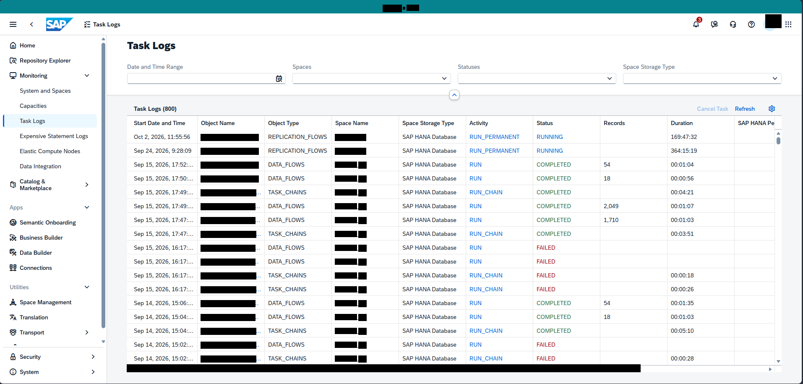

Bildformat: 1914 × 915 Pixel. Die folgenden Positionen beziehen sich auf dieses vollständige Bild.

## 1. Gesamtaufbau und sichtbarer Zustand

### Gesamtansicht

Eine helle SAP-Datasphere-Oberfläche zeigt die Seite „Task Logs“. Eine schmale vertikale Navigation befindet sich am linken Rand. Rechts daneben nimmt eine breite, mehrspaltige Protokolltabelle den größten Teil des Bildes ein.

### Links und oben

In der linken Navigation stehen unter anderem Home, Repository Explorer, Monitoring, System and Spaces, Capacities, Task Logs, Expensive Statement Logs und Elastic Compute Nodes. Weiter unten folgen Data Integration, Catalog & Marketplace sowie die Bereiche Business Builder, Data Builder und Connections. Oberhalb der Tabelle sind Filter mit den Bezeichnungen Date and Time Range, Spaces, Statuses und Space Storage Type angeordnet.

### Tabelle im Hauptbereich

Die Tabellenüberschriften umfassen Start Date and Time, Object Name, Object Type, Space Name, Space Storage Type, Activity, Status, Records und Duration. Die Zeilen zeigen unter anderem die Objekttypen REPLICATION_FLOWS, DATA_FLOWS und TASK_CHAINS. In der Aktivitätsspalte stehen RUN_PERMANENT, RUN und RUN_CHAIN. Die Statusspalte enthält RUNNING, COMPLETED und FAILED. Datums- und Zeitangaben sowie Laufzeiten stehen jeweils in eigenen Spalten.

### Bedienelemente und Anordnung

Oberhalb der Tabellenzeilen befindet sich rechts „Refresh“. Die Einträge sind horizontal ausgerichtet und durch dezente Zeilentrennungen gegliedert. Am rechten Rand setzt sich die Tabelle mit weiteren Spalten fort. Die sichtbare Oberfläche enthält keine geöffnete Detailansicht oder einen Dialog.

## 2. Räumliche Beschreibung von oben nach unten

### Linke Navigationsspalte

**Ungefähre Bildregion:** x 0–13 %, y 5–100 %

Eine durchgehende schmale Spalte mit kleinen Symbolen links und den jeweiligen Textbezeichnungen rechts daneben. Die Monitoring-Einträge stehen im oberen Teil, App- und Verwaltungsbereiche weiter unten.

### Titel und Filter

**Ungefähre Bildregion:** x 15–98 %, y 10–25 %

Die Seitenüberschrift liegt links über der Filterreihe. Vier Filtergruppen sind horizontal verteilt. Date and Time Range steht am weitesten links, Spaces folgt rechts davon, dann Statuses und schließlich Space Storage Type.

### Protokolltabelle

**Ungefähre Bildregion:** x 16–100 %, y 27–100 %

Die Tabellenkopfzeile liegt oberhalb der ersten Datenzeile. Startzeit, Objekt, Objekttyp, Space, Speicherart, Aktivität, Status, Datensatzanzahl und Laufzeit folgen von links nach rechts. Die Statusspalte liegt rechts der Aktivitätsspalte; Records und Duration folgen weiter rechts.

## 3. Positionsverzeichnis der lesbaren Beschriftungen

Sortierung nach Bildhöhe, innerhalb derselben Höhe von links nach rechts. Angegeben sind Textbegrenzungen; Abstände und Bedienelementflächen können darüber hinausreichen.

<table>
<colgroup>
<col style="width: 33%" />
<col style="width: 30%" />
<col style="width: 35%" />
</colgroup>
<thead>
<tr class="header">
<th>Sichtbarer Text</th>
<th>Textposition in Pixeln</th>
<th>Relative Lage im Bild</th>
</tr>
</thead>
<tbody>
<tr class="odd">
<td>Task Logs</td>
<td>x 222–286 
y 53–66</td>
<td>oben, links 
x 11.6–15.0 % 
y 5.8–7.2 %</td>
</tr>
<tr class="even">
<td>Task Logs</td>
<td>x 303–418 
y 99–122</td>
<td>oben, links 
x 15.8–21.8 % 
y 10.8–13.3 %</td>
</tr>
<tr class="odd">
<td>Home</td>
<td>x 48–84 
y 103–113</td>
<td>oben, links 
x 2.5–4.4 % 
y 11.3–12.3 %</td>
</tr>
<tr class="even">
<td>Repository Explorer</td>
<td>x 48–168 
y 139–152</td>
<td>oben, links 
x 2.5–8.8 % 
y 15.2–16.6 %</td>
</tr>
<tr class="odd">
<td>Date and Time Range</td>
<td>x 304–436 
y 154–167</td>
<td>oben, links 
x 15.9–22.8 % 
y 16.8–18.3 %</td>
</tr>
<tr class="even">
<td>Spaces</td>
<td>x 698–742 
y 154–167</td>
<td>oben, mittig 
x 36.5–38.8 % 
y 16.8–18.3 %</td>
</tr>
<tr class="odd">
<td>Statuses</td>
<td>x 1092–1144 
y 154–164</td>
<td>oben, mittig 
x 57.1–59.7 % 
y 16.8–17.9 %</td>
</tr>
<tr class="even">
<td>Space Storage Type</td>
<td>x 1486–1608 
y 154–167</td>
<td>oben, rechts 
x 77.6–84.0 % 
y 16.8–18.3 %</td>
</tr>
<tr class="odd">
<td>Monitoring</td>
<td>x 48–113 
y 175–188</td>
<td>oben, links 
x 2.5–5.9 % 
y 19.1–20.5 %</td>
</tr>
<tr class="even">
<td>System and Spaces</td>
<td>x 48–168 
y 211–224</td>
<td>oben, links 
x 2.5–8.8 % 
y 23.1–24.5 %</td>
</tr>
<tr class="odd">
<td>Capacities</td>
<td>x 47–111 
y 247–260</td>
<td>oben, links 
x 2.5–5.8 % 
y 27.0–28.4 %</td>
</tr>
<tr class="even">
<td>Task Logs</td>
<td>x 319–384 
y 254–267</td>
<td>oben, links 
x 16.7–20.1 % 
y 27.8–29.2 %</td>
</tr>
<tr class="odd">
<td>Refresh</td>
<td>x 1753–1799 
y 254–264</td>
<td>oben, rechts 
x 91.6–94.0 % 
y 27.8–28.9 %</td>
</tr>
<tr class="even">
<td>Task Logs</td>
<td>x 47–108 
y 283–296</td>
<td>oben, links 
x 2.5–5.6 % 
y 30.9–32.3 %</td>
</tr>
<tr class="odd">
<td>Start Date and Time</td>
<td>x 320–441 
y 288–298</td>
<td>oben, links 
x 16.7–23.0 % 
y 31.5–32.6 %</td>
</tr>
<tr class="even">
<td>Object Name</td>
<td>x 479–559 
y 288–301</td>
<td>oben, links 
x 25.0–29.2 % 
y 31.5–32.9 %</td>
</tr>
<tr class="odd">
<td>Object Type</td>
<td>x 639–712 
y 288–301</td>
<td>oben, mittig 
x 33.4–37.2 % 
y 31.5–32.9 %</td>
</tr>
<tr class="even">
<td>Space Name</td>
<td>x 800–878 
y 288–301</td>
<td>oben, mittig 
x 41.8–45.9 % 
y 31.5–32.9 %</td>
</tr>
<tr class="odd">
<td>Space Storage Type</td>
<td>x 960–1082 
y 288–301</td>
<td>oben, mittig 
x 50.1–56.5 % 
y 31.5–32.9 %</td>
</tr>
<tr class="even">
<td>Activity</td>
<td>x 1119–1163 
y 288–301</td>
<td>oben, mittig 
x 58.5–60.8 % 
y 31.5–32.9 %</td>
</tr>
<tr class="odd">
<td>Status</td>
<td>x 1280–1318 
y 288–298</td>
<td>oben, rechts 
x 66.8–68.8 % 
y 31.5–32.6 %</td>
</tr>
<tr class="even">
<td>Records</td>
<td>x 1440–1489 
y 288–298</td>
<td>oben, rechts 
x 75.2–77.8 % 
y 31.5–32.6 %</td>
</tr>
<tr class="odd">
<td>Duration</td>
<td>x 1600–1651 
y 288–298</td>
<td>oben, rechts 
x 83.6–86.3 % 
y 31.5–32.6 %</td>
</tr>
<tr class="even">
<td>SAP HANA</td>
<td>x 1760–1826 
y 288–298</td>
<td>oben, rechts 
x 91.9–95.4 % 
y 31.5–32.6 %</td>
</tr>
<tr class="odd">
<td>Expensive Statement Logs</td>
<td>x 48–210 
y 319–332</td>
<td>auf mittlerer Höhe, links 
x 2.5–11.0 % 
y 34.9–36.3 %</td>
</tr>
<tr class="even">
<td>REPLICATION_FLOWS</td>
<td>x 640–779 
y 321–333</td>
<td>auf mittlerer Höhe, mittig 
x 33.4–40.7 % 
y 35.1–36.4 %</td>
</tr>
<tr class="odd">
<td>SAP HANA Database</td>
<td>x 960–1088 
y 321–331</td>
<td>auf mittlerer Höhe, mittig 
x 50.1–56.8 % 
y 35.1–36.2 %</td>
</tr>
<tr class="even">
<td>RUN_PERMANENT</td>
<td>x 1120–1238 
y 321–333</td>
<td>auf mittlerer Höhe, mittig 
x 58.5–64.7 % 
y 35.1–36.4 %</td>
</tr>
<tr class="odd">
<td>RUNNING</td>
<td>x 1280–1341 
y 321–331</td>
<td>auf mittlerer Höhe, rechts 
x 66.9–70.1 % 
y 35.1–36.2 %</td>
</tr>
<tr class="even">
<td>Elastic Compute Nodes</td>
<td>x 48–191 
y 355–368</td>
<td>auf mittlerer Höhe, links 
x 2.5–10.0 % 
y 38.8–40.2 %</td>
</tr>
<tr class="odd">
<td>REPLICATION_FLOWS</td>
<td>x 640–779 
y 354–366</td>
<td>auf mittlerer Höhe, mittig 
x 33.4–40.7 % 
y 38.7–40.0 %</td>
</tr>
<tr class="even">
<td>SAP HANA Database</td>
<td>x 960–1088 
y 354–364</td>
<td>auf mittlerer Höhe, mittig 
x 50.1–56.8 % 
y 38.7–39.8 %</td>
</tr>
<tr class="odd">
<td>RUN_PERMANENT</td>
<td>x 1120–1238 
y 354–366</td>
<td>auf mittlerer Höhe, mittig 
x 58.5–64.7 % 
y 38.7–40.0 %</td>
</tr>
<tr class="even">
<td>RUNNING</td>
<td>x 1280–1341 
y 354–364</td>
<td>auf mittlerer Höhe, rechts 
x 66.9–70.1 % 
y 38.7–39.8 %</td>
</tr>
<tr class="odd">
<td>DATA_FLOWS</td>
<td>x 640–726 
y 387–399</td>
<td>auf mittlerer Höhe, mittig 
x 33.4–37.9 % 
y 42.3–43.6 %</td>
</tr>
<tr class="even">
<td>SAP HANA Database</td>
<td>x 960–1088 
y 387–397</td>
<td>auf mittlerer Höhe, mittig 
x 50.1–56.8 % 
y 42.3–43.4 %</td>
</tr>
<tr class="odd">
<td>RUN</td>
<td>x 1120–1147 
y 387–397</td>
<td>auf mittlerer Höhe, mittig 
x 58.5–59.9 % 
y 42.3–43.4 %</td>
</tr>
<tr class="even">
<td>COMPLETED</td>
<td>x 1279–1360 
y 387–397</td>
<td>auf mittlerer Höhe, rechts 
x 66.8–71.1 % 
y 42.3–43.4 %</td>
</tr>
<tr class="odd">
<td>Data Integration</td>
<td>x 48–146 
y 391–404</td>
<td>auf mittlerer Höhe, links 
x 2.5–7.6 % 
y 42.7–44.2 %</td>
</tr>
<tr class="even">
<td>DATA_FLOWS</td>
<td>x 640–726 
y 420–432</td>
<td>auf mittlerer Höhe, mittig 
x 33.4–37.9 % 
y 45.9–47.2 %</td>
</tr>
<tr class="odd">
<td>SAP HANA Database</td>
<td>x 960–1088 
y 420–430</td>
<td>auf mittlerer Höhe, mittig 
x 50.1–56.8 % 
y 45.9–47.0 %</td>
</tr>
<tr class="even">
<td>RUN</td>
<td>x 1120–1147 
y 420–430</td>
<td>auf mittlerer Höhe, mittig 
x 58.5–59.9 % 
y 45.9–47.0 %</td>
</tr>
<tr class="odd">
<td>COMPLETED</td>
<td>x 1279–1360 
y 420–430</td>
<td>auf mittlerer Höhe, rechts 
x 66.8–71.1 % 
y 45.9–47.0 %</td>
</tr>
<tr class="even">
<td>TASK_CHAINS</td>
<td>x 639–730 
y 453–465</td>
<td>auf mittlerer Höhe, mittig 
x 33.4–38.1 % 
y 49.5–50.8 %</td>
</tr>
<tr class="odd">
<td>SAP HANA Database</td>
<td>x 960–1088 
y 453–463</td>
<td>auf mittlerer Höhe, mittig 
x 50.1–56.8 % 
y 49.5–50.6 %</td>
</tr>
<tr class="even">
<td>RUN_CHAIN</td>
<td>x 1120–1197 
y 453–465</td>
<td>auf mittlerer Höhe, mittig 
x 58.5–62.5 % 
y 49.5–50.8 %</td>
</tr>
<tr class="odd">
<td>COMPLETED</td>
<td>x 1279–1360 
y 453–463</td>
<td>auf mittlerer Höhe, rechts 
x 66.8–71.1 % 
y 49.5–50.6 %</td>
</tr>
<tr class="even">
<td>DATA_FLOWS</td>
<td>x 640–726 
y 486–498</td>
<td>auf mittlerer Höhe, mittig 
x 33.4–37.9 % 
y 53.1–54.4 %</td>
</tr>
<tr class="odd">
<td>SAP HANA Database</td>
<td>x 960–1088 
y 486–496</td>
<td>auf mittlerer Höhe, mittig 
x 50.1–56.8 % 
y 53.1–54.2 %</td>
</tr>
<tr class="even">
<td>RUN</td>
<td>x 1120–1147 
y 486–496</td>
<td>auf mittlerer Höhe, mittig 
x 58.5–59.9 % 
y 53.1–54.2 %</td>
</tr>
<tr class="odd">
<td>COMPLETED</td>
<td>x 1279–1360 
y 486–496</td>
<td>auf mittlerer Höhe, rechts 
x 66.8–71.1 % 
y 53.1–54.2 %</td>
</tr>
<tr class="even">
<td>Apps</td>
<td>x 23–54 
y 489–502</td>
<td>auf mittlerer Höhe, links 
x 1.2–2.8 % 
y 53.4–54.9 %</td>
</tr>
<tr class="odd">
<td>DATA_FLOWS</td>
<td>x 640–726 
y 519–531</td>
<td>auf mittlerer Höhe, mittig 
x 33.4–37.9 % 
y 56.7–58.0 %</td>
</tr>
<tr class="even">
<td>SAP HANA Database</td>
<td>x 960–1088 
y 519–529</td>
<td>auf mittlerer Höhe, mittig 
x 50.1–56.8 % 
y 56.7–57.8 %</td>
</tr>
<tr class="odd">
<td>RUN</td>
<td>x 1120–1147 
y 519–529</td>
<td>auf mittlerer Höhe, mittig 
x 58.5–59.9 % 
y 56.7–57.8 %</td>
</tr>
<tr class="even">
<td>COMPLETED</td>
<td>x 1279–1360 
y 519–529</td>
<td>auf mittlerer Höhe, rechts 
x 66.8–71.1 % 
y 56.7–57.8 %</td>
</tr>
<tr class="odd">
<td>Semantic Onboarding</td>
<td>x 48–181 
y 525–538</td>
<td>auf mittlerer Höhe, links 
x 2.5–9.5 % 
y 57.4–58.8 %</td>
</tr>
<tr class="even">
<td>TASK_CHAINS</td>
<td>x 639–730 
y 552–564</td>
<td>auf mittlerer Höhe, mittig 
x 33.4–38.1 % 
y 60.3–61.6 %</td>
</tr>
<tr class="odd">
<td>SAP HANA Database</td>
<td>x 960–1088 
y 552–562</td>
<td>auf mittlerer Höhe, mittig 
x 50.1–56.8 % 
y 60.3–61.4 %</td>
</tr>
<tr class="even">
<td>RUN_CHAIN</td>
<td>x 1120–1197 
y 552–564</td>
<td>auf mittlerer Höhe, mittig 
x 58.5–62.5 % 
y 60.3–61.6 %</td>
</tr>
<tr class="odd">
<td>COMPLETED</td>
<td>x 1279–1360 
y 552–562</td>
<td>auf mittlerer Höhe, rechts 
x 66.8–71.1 % 
y 60.3–61.4 %</td>
</tr>
<tr class="even">
<td>Business Builder</td>
<td>x 48–150 
y 561–571</td>
<td>auf mittlerer Höhe, links 
x 2.5–7.8 % 
y 61.3–62.4 %</td>
</tr>
<tr class="odd">
<td>DATA_FLOWS</td>
<td>x 640–726 
y 585–597</td>
<td>auf mittlerer Höhe, mittig 
x 33.4–37.9 % 
y 63.9–65.2 %</td>
</tr>
<tr class="even">
<td>SAP HANA Database</td>
<td>x 960–1088 
y 585–595</td>
<td>auf mittlerer Höhe, mittig 
x 50.1–56.8 % 
y 63.9–65.0 %</td>
</tr>
<tr class="odd">
<td>RUN</td>
<td>x 1120–1147 
y 585–595</td>
<td>auf mittlerer Höhe, mittig 
x 58.5–59.9 % 
y 63.9–65.0 %</td>
</tr>
<tr class="even">
<td>FAILED</td>
<td>x 1280–1323 
y 585–595</td>
<td>auf mittlerer Höhe, rechts 
x 66.9–69.1 % 
y 63.9–65.0 %</td>
</tr>
<tr class="odd">
<td>Data Builder</td>
<td>x 48–124 
y 597–607</td>
<td>auf mittlerer Höhe, links 
x 2.5–6.5 % 
y 65.2–66.3 %</td>
</tr>
<tr class="even">
<td>DATA_FLOWS</td>
<td>x 640–726 
y 618–630</td>
<td>unten, mittig 
x 33.4–37.9 % 
y 67.5–68.9 %</td>
</tr>
<tr class="odd">
<td>SAP HANA Database</td>
<td>x 960–1088 
y 618–628</td>
<td>unten, mittig 
x 50.1–56.8 % 
y 67.5–68.6 %</td>
</tr>
<tr class="even">
<td>RUN</td>
<td>x 1120–1147 
y 618–628</td>
<td>unten, mittig 
x 58.5–59.9 % 
y 67.5–68.6 %</td>
</tr>
<tr class="odd">
<td>FAILED</td>
<td>x 1280–1323 
y 618–628</td>
<td>unten, rechts 
x 66.9–69.1 % 
y 67.5–68.6 %</td>
</tr>
<tr class="even">
<td>Connections</td>
<td>x 47–124 
y 633–643</td>
<td>unten, links 
x 2.5–6.5 % 
y 69.2–70.3 %</td>
</tr>
<tr class="odd">
<td>TASK_CHAINS</td>
<td>x 639–730 
y 651–663</td>
<td>unten, mittig 
x 33.4–38.1 % 
y 71.1–72.5 %</td>
</tr>
<tr class="even">
<td>SAP HANA Database</td>
<td>x 960–1088 
y 651–661</td>
<td>unten, mittig 
x 50.1–56.8 % 
y 71.1–72.2 %</td>
</tr>
<tr class="odd">
<td>RUN_CHAIN</td>
<td>x 1120–1197 
y 651–663</td>
<td>unten, mittig 
x 58.5–62.5 % 
y 71.1–72.5 %</td>
</tr>
<tr class="even">
<td>FAILED</td>
<td>x 1280–1323 
y 651–661</td>
<td>unten, rechts 
x 66.9–69.1 % 
y 71.1–72.2 %</td>
</tr>
<tr class="odd">
<td>Utilities</td>
<td>x 24–68 
y 679–689</td>
<td>unten, links 
x 1.3–3.6 % 
y 74.2–75.3 %</td>
</tr>
<tr class="even">
<td>TASK_CHAINS</td>
<td>x 639–730 
y 684–696</td>
<td>unten, mittig 
x 33.4–38.1 % 
y 74.8–76.1 %</td>
</tr>
<tr class="odd">
<td>SAP HANA Database</td>
<td>x 960–1088 
y 684–694</td>
<td>unten, mittig 
x 50.1–56.8 % 
y 74.8–75.8 %</td>
</tr>
<tr class="even">
<td>RUN_CHAIN</td>
<td>x 1120–1197 
y 684–696</td>
<td>unten, mittig 
x 58.5–62.5 % 
y 74.8–76.1 %</td>
</tr>
<tr class="odd">
<td>FAILED</td>
<td>x 1280–1323 
y 684–694</td>
<td>unten, rechts 
x 66.9–69.1 % 
y 74.8–75.8 %</td>
</tr>
<tr class="even">
<td>Space Management</td>
<td>x 48–170 
y 715–728</td>
<td>unten, links 
x 2.5–8.9 % 
y 78.1–79.6 %</td>
</tr>
<tr class="odd">
<td>DATA_FLOWS</td>
<td>x 640–726 
y 717–729</td>
<td>unten, mittig 
x 33.4–37.9 % 
y 78.4–79.7 %</td>
</tr>
<tr class="even">
<td>SAP HANA Database</td>
<td>x 960–1088 
y 717–727</td>
<td>unten, mittig 
x 50.1–56.8 % 
y 78.4–79.5 %</td>
</tr>
<tr class="odd">
<td>RUN</td>
<td>x 1120–1147 
y 717–727</td>
<td>unten, mittig 
x 58.5–59.9 % 
y 78.4–79.5 %</td>
</tr>
<tr class="even">
<td>COMPLETED</td>
<td>x 1279–1360 
y 717–727</td>
<td>unten, rechts 
x 66.8–71.1 % 
y 78.4–79.5 %</td>
</tr>
<tr class="odd">
<td>DATA_FLOWS</td>
<td>x 640–726 
y 750–762</td>
<td>unten, mittig 
x 33.4–37.9 % 
y 82.0–83.3 %</td>
</tr>
<tr class="even">
<td>SAP HANA Database</td>
<td>x 960–1088 
y 750–760</td>
<td>unten, mittig 
x 50.1–56.8 % 
y 82.0–83.1 %</td>
</tr>
<tr class="odd">
<td>RUN</td>
<td>x 1120–1147 
y 750–760</td>
<td>unten, mittig 
x 58.5–59.9 % 
y 82.0–83.1 %</td>
</tr>
<tr class="even">
<td>COMPLETED</td>
<td>x 1279–1360 
y 750–760</td>
<td>unten, rechts 
x 66.8–71.1 % 
y 82.0–83.1 %</td>
</tr>
<tr class="odd">
<td>Translation</td>
<td>x 47–114 
y 751–761</td>
<td>unten, links 
x 2.5–6.0 % 
y 82.1–83.2 %</td>
</tr>
<tr class="even">
<td>TASK_CHAINS</td>
<td>x 639–730 
y 783–795</td>
<td>unten, mittig 
x 33.4–38.1 % 
y 85.6–86.9 %</td>
</tr>
<tr class="odd">
<td>SAP HANA Database</td>
<td>x 960–1088 
y 783–793</td>
<td>unten, mittig 
x 50.1–56.8 % 
y 85.6–86.7 %</td>
</tr>
<tr class="even">
<td>RUN_CHAIN</td>
<td>x 1120–1197 
y 783–795</td>
<td>unten, mittig 
x 58.5–62.5 % 
y 85.6–86.9 %</td>
</tr>
<tr class="odd">
<td>COMPLETED</td>
<td>x 1279–1360 
y 783–793</td>
<td>unten, rechts 
x 66.8–71.1 % 
y 85.6–86.7 %</td>
</tr>
<tr class="even">
<td>Transport</td>
<td>x 47–105 
y 787–800</td>
<td>unten, links 
x 2.5–5.5 % 
y 86.0–87.4 %</td>
</tr>
<tr class="odd">
<td>DATA_FLOWS</td>
<td>x 640–726 
y 816–828</td>
<td>unten, mittig 
x 33.4–37.9 % 
y 89.2–90.5 %</td>
</tr>
<tr class="even">
<td>SAP HANA Database</td>
<td>x 960–1088 
y 816–826</td>
<td>unten, mittig 
x 50.1–56.8 % 
y 89.2–90.3 %</td>
</tr>
<tr class="odd">
<td>RUN</td>
<td>x 1120–1147 
y 816–826</td>
<td>unten, mittig 
x 58.5–59.9 % 
y 89.2–90.3 %</td>
</tr>
<tr class="even">
<td>FAILED</td>
<td>x 1280–1323 
y 816–826</td>
<td>unten, rechts 
x 66.9–69.1 % 
y 89.2–90.3 %</td>
</tr>
<tr class="odd">
<td>Security</td>
<td>x 48–97 
y 845–858</td>
<td>unten, links 
x 2.5–5.1 % 
y 92.3–93.8 %</td>
</tr>
<tr class="even">
<td>TASK_CHAINS</td>
<td>x 639–730 
y 849–861</td>
<td>unten, mittig 
x 33.4–38.1 % 
y 92.8–94.1 %</td>
</tr>
<tr class="odd">
<td>SAP HANA Database</td>
<td>x 960–1088 
y 849–859</td>
<td>unten, mittig 
x 50.1–56.8 % 
y 92.8–93.9 %</td>
</tr>
<tr class="even">
<td>RUN_CHAIN</td>
<td>x 1120–1197 
y 849–861</td>
<td>unten, mittig 
x 58.5–62.5 % 
y 92.8–94.1 %</td>
</tr>
<tr class="odd">
<td>FAILED</td>
<td>x 1280–1323 
y 849–859</td>
<td>unten, rechts 
x 66.9–69.1 % 
y 92.8–93.9 %</td>
</tr>
<tr class="even">
<td>System</td>
<td>x 48–92 
y 881–894</td>
<td>unten, links 
x 2.5–4.8 % 
y 96.3–97.7 %</td>
</tr>
</tbody>
</table>

## 4. Abgrenzung

Die Beschreibung benennt nur den sichtbaren Zustand dieses Screenshots. Aus Symbolen ohne lesbare Beschriftung wird keine konkrete Funktion abgeleitet. Inhalte hinter schwarzen Balken und nicht sichtbare Bereiche außerhalb des Bildrandes bleiben unbeschrieben.

# Bild 2: Repository Explorer: Objektübersicht

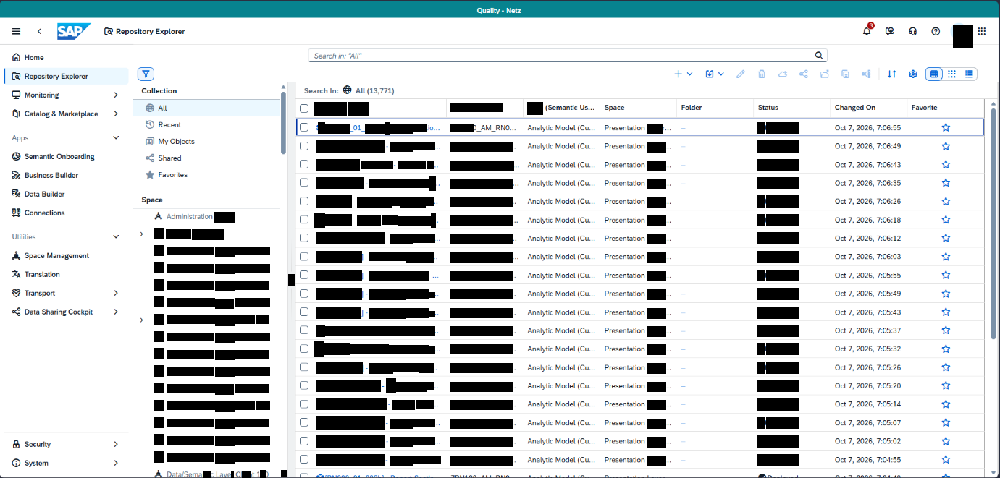

Bildformat: 1381 × 661 Pixel. Die folgenden Positionen beziehen sich auf dieses vollständige Bild.

## 1. Gesamtaufbau und sichtbarer Zustand

### Gesamtansicht

Das Bild zeigt eine tabellarische Objektübersicht. Links stehen die globale Navigation und daneben ein zusätzlicher Filterbereich. Die Objektliste füllt den mittleren und rechten Bildschirmbereich.

### Linker Filterbereich

Der Filterbereich enthält Auswahlmöglichkeiten wie All, Recent, My Objects, Shared und Favorites. Darunter folgt eine Liste von Spaces. Oberhalb des Inhalts sind eine Suchfunktion und eine Werkzeugleiste mit kleinen Symbolen sichtbar.

### Hauptbereich

Die Tabelle besitzt mehrere Spalten. Rechts sind Type beziehungsweise Semantic Usage, Space, Folder, Status, Changed On und Favorite erkennbar. Viele Zeilen enthalten den Objekttyp „Analytic Model“. In der Statusspalte erscheinen Bereitstellungsanzeigen. Die Spalte Changed On enthält Datum und Uhrzeit. Ganz rechts befindet sich die Favoritenspalte mit Sternsymbolen.

### Visuelle Struktur

Die Tabelle ist dicht mit Einträgen gefüllt. Jede Zeile bildet ein eigenes Objekt ab; kleine Objektsymbole stehen am Anfang der Zeilen. Die Such- und Filterelemente liegen oberhalb der Liste, während die globale Navigation am linken Bildschirmrand unverändert sichtbar bleibt. Es ist kein modaler Dialog geöffnet.

## 2. Räumliche Beschreibung von oben nach unten

### Globale Navigation

**Ungefähre Bildregion:** x 0–12 %, y 5–100 %

Die linke Hauptnavigation bleibt von der inneren Filterspalte getrennt.

### Innere Filterspalte

**Ungefähre Bildregion:** x 12–27 %, y 12–100 %

Oben stehen die Auswahlbereiche All, Recent, My Objects, Shared und Favorites untereinander. Darunter beginnt die Space-Liste. Kleine Symbole stehen links vor den Filterbezeichnungen.

### Objekttabelle

**Ungefähre Bildregion:** x 27–100 %, y 17–100 %

Die Werkzeugleiste und Suchauswahl liegen oberhalb der Tabellenkopfzeile. Objekttypen stehen ungefähr in der Mitte der Tabelle. Rechts davon folgen Space, Folder, Status, Änderungszeit und Favoriten. Die Zeilen sind durch dünne horizontale Linien getrennt.

## 3. Positionsverzeichnis der lesbaren Beschriftungen

Sortierung nach Bildhöhe, innerhalb derselben Höhe von links nach rechts. Angegeben sind Textbegrenzungen; Abstände und Bedienelementflächen können darüber hinausreichen.

<table>
<colgroup>
<col style="width: 33%" />
<col style="width: 30%" />
<col style="width: 35%" />
</colgroup>
<thead>
<tr class="header">
<th>Sichtbarer Text</th>
<th>Textposition in Pixeln</th>
<th>Relative Lage im Bild</th>
</tr>
</thead>
<tbody>
<tr class="odd">
<td>Repository Explorer</td>
<td>x 160–255 
y 36–51</td>
<td>oben, links 
x 11.6–18.5 % 
y 5.4–7.7 %</td>
</tr>
<tr class="even">
<td>Home</td>
<td>x 34–60 
y 76–83</td>
<td>oben, links 
x 2.5–4.3 % 
y 11.5–12.6 %</td>
</tr>
<tr class="odd">
<td>Repository Explorer</td>
<td>x 34–121 
y 102–111</td>
<td>oben, links 
x 2.5–8.8 % 
y 15.4–16.8 %</td>
</tr>
<tr class="even">
<td>Search In:</td>
<td>x 421–467 
y 122–129</td>
<td>oben, links 
x 30.5–33.8 % 
y 18.5–19.5 %</td>
</tr>
<tr class="odd">
<td>Monitoring</td>
<td>x 34–81 
y 128–137</td>
<td>oben, links 
x 2.5–5.9 % 
y 19.3–20.7 %</td>
</tr>
<tr class="even">
<td>Space</td>
<td>x 835–862 
y 145–154</td>
<td>oben, mittig 
x 60.5–62.4 % 
y 21.9–23.3 %</td>
</tr>
<tr class="odd">
<td>Folder</td>
<td>x 942–969 
y 145–152</td>
<td>oben, rechts 
x 68.2–70.2 % 
y 21.9–23.0 %</td>
</tr>
<tr class="even">
<td>Status</td>
<td>x 1048–1074 
y 145–152</td>
<td>oben, rechts 
x 75.9–77.8 % 
y 21.9–23.0 %</td>
</tr>
<tr class="odd">
<td>Changed On</td>
<td>x 1153–1209 
y 145–154</td>
<td>oben, rechts 
x 83.5–87.5 % 
y 21.9–23.3 %</td>
</tr>
<tr class="even">
<td>Favorite</td>
<td>x 1260–1294 
y 145–152</td>
<td>oben, rechts 
x 91.2–93.7 % 
y 21.9–23.0 %</td>
</tr>
<tr class="odd">
<td>Catalog &amp; Marketplace</td>
<td>x 34–136 
y 154–163</td>
<td>oben, links 
x 2.5–9.8 % 
y 23.2–24.7 %</td>
</tr>
<tr class="even">
<td>Recent</td>
<td>x 219–250 
y 169–176</td>
<td>oben, links 
x 15.9–18.1 % 
y 25.6–26.6 %</td>
</tr>
<tr class="odd">
<td>Apps</td>
<td>x 18–39 
y 190–194</td>
<td>oben, links 
x 1.3–2.8 % 
y 28.7–29.3 %</td>
</tr>
<tr class="even">
<td>My Objects</td>
<td>x 219–268 
y 192–201</td>
<td>oben, links 
x 15.9–19.4 % 
y 29.0–30.4 %</td>
</tr>
<tr class="odd">
<td>Analytic Model</td>
<td>x 729–794 
y 198–208</td>
<td>oben, mittig 
x 52.8–57.5 % 
y 30.0–31.5 %</td>
</tr>
<tr class="even">
<td>Semantic Onboarding</td>
<td>x 34–130 
y 213–222</td>
<td>oben, links 
x 2.5–9.4 % 
y 32.2–33.6 %</td>
</tr>
<tr class="odd">
<td>Shared</td>
<td>x 219–250 
y 215–222</td>
<td>auf mittlerer Höhe, links 
x 15.9–18.1 % 
y 32.5–33.6 %</td>
</tr>
<tr class="even">
<td>Analytic Model</td>
<td>x 729–794 
y 224–234</td>
<td>auf mittlerer Höhe, mittig 
x 52.8–57.5 % 
y 33.9–35.3 %</td>
</tr>
<tr class="odd">
<td>Business Builder</td>
<td>x 34–108 
y 238–246</td>
<td>auf mittlerer Höhe, links 
x 2.5–7.8 % 
y 36.1–37.2 %</td>
</tr>
<tr class="even">
<td>Favorites</td>
<td>x 219–258 
y 238–245</td>
<td>auf mittlerer Höhe, links 
x 15.9–18.7 % 
y 36.0–37.1 %</td>
</tr>
<tr class="odd">
<td>Analytic Model</td>
<td>x 729–794 
y 250–259</td>
<td>auf mittlerer Höhe, mittig 
x 52.8–57.5 % 
y 37.7–39.2 %</td>
</tr>
<tr class="even">
<td>Data Builder</td>
<td>x 34–89 
y 264–272</td>
<td>auf mittlerer Höhe, links 
x 2.5–6.4 % 
y 40.0–41.1 %</td>
</tr>
<tr class="odd">
<td>Space</td>
<td>x 196–224 
y 272–282</td>
<td>auf mittlerer Höhe, links 
x 14.2–16.2 % 
y 41.2–42.7 %</td>
</tr>
<tr class="even">
<td>Analytic Model</td>
<td>x 729–794 
y 275–284</td>
<td>auf mittlerer Höhe, mittig 
x 52.8–57.5 % 
y 41.6–43.0 %</td>
</tr>
<tr class="odd">
<td>Connections</td>
<td>x 34–89 
y 290–298</td>
<td>auf mittlerer Höhe, links 
x 2.5–6.4 % 
y 43.9–45.1 %</td>
</tr>
<tr class="even">
<td>Analytic Model</td>
<td>x 729–794 
y 301–310</td>
<td>auf mittlerer Höhe, mittig 
x 52.8–57.5 % 
y 45.5–46.9 %</td>
</tr>
<tr class="odd">
<td>Analytic Model</td>
<td>x 729–794 
y 326–335</td>
<td>auf mittlerer Höhe, mittig 
x 52.8–57.5 % 
y 49.3–50.7 %</td>
</tr>
<tr class="even">
<td>Space Management</td>
<td>x 34–123 
y 350–359</td>
<td>auf mittlerer Höhe, links 
x 2.5–8.9 % 
y 52.9–54.3 %</td>
</tr>
<tr class="odd">
<td>Analytic Model</td>
<td>x 729–794 
y 351–360</td>
<td>auf mittlerer Höhe, mittig 
x 52.8–57.5 % 
y 53.1–54.5 %</td>
</tr>
<tr class="even">
<td>Translation</td>
<td>x 36–82 
y 376–383</td>
<td>auf mittlerer Höhe, links 
x 2.6–5.9 % 
y 56.8–57.9 %</td>
</tr>
<tr class="odd">
<td>Analytic Model</td>
<td>x 729–794 
y 377–386</td>
<td>auf mittlerer Höhe, mittig 
x 52.8–57.5 % 
y 57.0–58.4 %</td>
</tr>
<tr class="even">
<td>Transport</td>
<td>x 34–76 
y 402–411</td>
<td>auf mittlerer Höhe, links 
x 2.5–5.5 % 
y 60.7–62.2 %</td>
</tr>
<tr class="odd">
<td>Analytic Model</td>
<td>x 729–794 
y 402–412</td>
<td>auf mittlerer Höhe, mittig 
x 52.8–57.5 % 
y 60.8–62.3 %</td>
</tr>
<tr class="even">
<td>of</td>
<td>x 16–28 
y 425–437</td>
<td>auf mittlerer Höhe, links 
x 1.2–2.0 % 
y 64.3–66.1 %</td>
</tr>
<tr class="odd">
<td>Data Sharing Cockpit</td>
<td>x 34–128 
y 428–437</td>
<td>auf mittlerer Höhe, links 
x 2.5–9.2 % 
y 64.7–66.1 %</td>
</tr>
<tr class="even">
<td>Analytic Model</td>
<td>x 729–794 
y 428–438</td>
<td>auf mittlerer Höhe, mittig 
x 52.8–57.5 % 
y 64.8–66.2 %</td>
</tr>
<tr class="odd">
<td>Analytic Model</td>
<td>x 729–794 
y 454–463</td>
<td>unten, mittig 
x 52.8–57.5 % 
y 68.6–70.0 %</td>
</tr>
<tr class="even">
<td>Analytic Model</td>
<td>x 729–794 
y 479–488</td>
<td>unten, mittig 
x 52.8–57.5 % 
y 72.5–73.8 %</td>
</tr>
<tr class="odd">
<td>Analytic Model</td>
<td>x 729–794 
y 505–514</td>
<td>unten, mittig 
x 52.8–57.5 % 
y 76.4–77.8 %</td>
</tr>
<tr class="even">
<td>Analytic Model</td>
<td>x 729–794 
y 530–539</td>
<td>unten, mittig 
x 52.8–57.5 % 
y 80.2–81.5 %</td>
</tr>
<tr class="odd">
<td>Analytic Model</td>
<td>x 729–794 
y 555–564</td>
<td>unten, mittig 
x 52.8–57.5 % 
y 84.0–85.3 %</td>
</tr>
<tr class="even">
<td>Analytic Model</td>
<td>x 729–794 
y 581–590</td>
<td>unten, mittig 
x 52.8–57.5 % 
y 87.9–89.3 %</td>
</tr>
<tr class="odd">
<td>Analytic Model</td>
<td>x 729–794 
y 606–616</td>
<td>unten, mittig 
x 52.8–57.5 % 
y 91.7–93.2 %</td>
</tr>
<tr class="even">
<td>Security</td>
<td>x 34–70 
y 610–620</td>
<td>unten, links 
x 2.5–5.1 % 
y 92.4–93.8 %</td>
</tr>
<tr class="odd">
<td>System</td>
<td>x 34–66 
y 634–648</td>
<td>unten, links 
x 2.5–4.8 % 
y 96.0–98.0 %</td>
</tr>
<tr class="even">
<td>Analytic Model</td>
<td>x 729–794 
y 632–642</td>
<td>unten, mittig 
x 52.8–57.5 % 
y 95.6–97.0 %</td>
</tr>
</tbody>
</table>

## 4. Abgrenzung

Die Beschreibung benennt nur den sichtbaren Zustand dieses Screenshots. Aus Symbolen ohne lesbare Beschriftung wird keine konkrete Funktion abgeleitet. Inhalte hinter schwarzen Balken und nicht sichtbare Bereiche außerhalb des Bildrandes bleiben unbeschrieben.

# Bild 3: Home: Startseite mit mehreren Karten

Bildformat: 1382 × 658 Pixel. Die folgenden Positionen beziehen sich auf dieses vollständige Bild.

## 1. Gesamtaufbau und sichtbarer Zustand

### Gesamtansicht

Die Startseite ist als Dashboard aus mehreren rechteckigen Karten aufgebaut. Die globale Navigation steht links. Der Hauptbereich ist in mehrere Spalten und eine obere sowie eine untere Kartenreihe gegliedert.

### Obere Kartenreihe

Links befindet sich eine Begrüßungskarte mit der Überschrift „Welcome to SAP Datasphere“, einem größeren grafischen Element und einem erklärenden Absatz. In der mittleren Spalte steht eine Karte „SAP Datasphere Blog“ mit mehreren Beitragsvorschauen. Rechts zeigt „Data Integration Tasks“ eine Liste kürzlich gestarteter Aufgaben. Neben den Einträgen sind Statusanzeigen wie Running und Completed sowie Zeitangaben sichtbar.

### Untere Kartenreihe

Links steht eine Karte „Spaces“ mit den Spalten Name, Storage und Status. Sie enthält horizontale Speicherbalken und sichtbare Statusangaben wie Working. In der Mitte befindet sich „Data Builder“ mit einer Liste kürzlich geänderter Objekte und Bereitstellungsanzeigen. Rechts steht „Quick Actions“. Diese Karte zeigt einen Hinweis, dass noch keine Schnellaktion ausgewählt ist, und die Schaltfläche „Add Quick Actions“.

### Bedienelemente

Am oberen rechten Rand des Inhalts steht „Customize“. Die Karten enthalten eigene Überschriften und teilweise Auswahlfelder wie „Show Only Errors“. Unten in einzelnen Karten sind weiterführende Schaltflächen sichtbar, darunter „Open Blog“ und „Open Data Integration Monitor“.

## 2. Räumliche Beschreibung von oben nach unten

### Begrüßungskarte oben links

**Ungefähre Bildregion:** x 18–55 %, y 13–78 %

Die größte Karte enthält im oberen Teil eine Illustration. Die Überschrift Welcome to SAP Datasphere liegt unter der Illustration. Darunter folgt ein mehrzeiliger Erklärungstext. Ein weiterführender Link befindet sich im unteren Teil.

### Blogkarte oben mittig

**Ungefähre Bildregion:** x 56–75 %, y 13–78 %

Die Überschrift steht am oberen Rand. Darunter sind Beitragsvorschauen mit Titelzeilen, kleineren Zusatzzeilen und Textauszügen gestapelt. Open Blog befindet sich unten in der Karte.

### Aufgabenkarte oben rechts

**Ungefähre Bildregion:** x 76–98 %, y 13–78 %

Data Integration Tasks steht oben. Darunter befinden sich eine Auswahlzeile und Show Only Errors. Die Aufgaben stehen untereinander; Statussymbole und Statuswörter liegen jeweils neben den Einträgen. Open Data Integration Monitor steht am unteren Kartenrand.

### Untere Kartenreihe

**Ungefähre Bildregion:** x 18–98 %, y 79–100 %

Links beginnt Spaces mit den Spalten Name, Storage und Status. Die Speicheranzeigen bestehen aus schmalen horizontalen Balken. In der Mitte beginnt Data Builder. Rechts liegt Quick Actions mit einem Leerzustand und Add Quick Actions. Die unteren Teile werden vom Bildrand abgeschnitten.

## 3. Positionsverzeichnis der lesbaren Beschriftungen

Sortierung nach Bildhöhe, innerhalb derselben Höhe von links nach rechts. Angegeben sind Textbegrenzungen; Abstände und Bedienelementflächen können darüber hinausreichen.

<table>
<colgroup>
<col style="width: 33%" />
<col style="width: 30%" />
<col style="width: 35%" />
</colgroup>
<thead>
<tr class="header">
<th>Sichtbarer Text</th>
<th>Textposition in Pixeln</th>
<th>Relative Lage im Bild</th>
</tr>
</thead>
<tbody>
<tr class="odd">
<td>Home</td>
<td>x 35–62 
y 69–85</td>
<td>oben, links 
x 2.5–4.5 % 
y 10.5–12.9 %</td>
</tr>
<tr class="even">
<td>Refresh</td>
<td>x 1160–1193 
y 78–85</td>
<td>oben, rechts 
x 84.0–86.3 % 
y 11.9–12.9 %</td>
</tr>
<tr class="odd">
<td>Customize</td>
<td>x 1280–1327 
y 78–85</td>
<td>oben, rechts 
x 92.7–96.0 % 
y 11.9–12.9 %</td>
</tr>
<tr class="even">
<td>Repository Explorer</td>
<td>x 36–122 
y 100–109</td>
<td>oben, links 
x 2.6–8.9 % 
y 15.1–16.6 %</td>
</tr>
<tr class="odd">
<td>Monitoring</td>
<td>x 36–83 
y 126–135</td>
<td>oben, links 
x 2.6–6.0 % 
y 19.1–20.5 %</td>
</tr>
<tr class="even">
<td>SAP Datasphere Blog</td>
<td>x 790–891 
y 144–153</td>
<td>oben, mittig 
x 57.1–64.5 % 
y 21.8–23.3 %</td>
</tr>
<tr class="odd">
<td>Data Integration Tasks</td>
<td>x 1054–1159 
y 144–153</td>
<td>oben, rechts 
x 76.2–83.9 % 
y 21.8–23.3 %</td>
</tr>
<tr class="even">
<td>Catalog &amp; Marketplace</td>
<td>x 35–137 
y 151–161</td>
<td>oben, links 
x 2.5–9.9 % 
y 22.9–24.5 %</td>
</tr>
<tr class="odd">
<td>Recent</td>
<td>x 790–820 
y 161–168</td>
<td>oben, mittig 
x 57.2–59.3 % 
y 24.5–25.5 %</td>
</tr>
<tr class="even">
<td>Apps</td>
<td>x 18–40 
y 185–194</td>
<td>oben, links 
x 1.3–2.9 % 
y 28.1–29.5 %</td>
</tr>
<tr class="odd">
<td>Show Only Errors</td>
<td>x 1054–1130 
y 192–202</td>
<td>oben, rechts 
x 76.2–81.8 % 
y 29.3–30.7 %</td>
</tr>
<tr class="even">
<td>of</td>
<td>x 672–691 
y 199–215</td>
<td>oben, mittig 
x 48.6–50.0 % 
y 30.2–32.7 %</td>
</tr>
<tr class="odd">
<td>Semantic Onboarding</td>
<td>x 36–132 
y 210–220</td>
<td>oben, links 
x 2.6–9.6 % 
y 32.0–33.4 %</td>
</tr>
<tr class="even">
<td>Business Builder</td>
<td>x 36–109 
y 236–244</td>
<td>auf mittlerer Höhe, links 
x 2.6–7.9 % 
y 35.9–37.1 %</td>
</tr>
<tr class="odd">
<td>Data Builder</td>
<td>x 36–90 
y 262–270</td>
<td>auf mittlerer Höhe, links 
x 2.6–6.5 % 
y 39.9–41.0 %</td>
</tr>
<tr class="even">
<td>of</td>
<td>x 927–934 
y 269–275</td>
<td>auf mittlerer Höhe, rechts 
x 67.1–67.6 % 
y 40.9–41.8 %</td>
</tr>
<tr class="odd">
<td>records</td>
<td>x 937–964 
y 269–275</td>
<td>auf mittlerer Höhe, rechts 
x 67.8–69.8 % 
y 40.9–41.8 %</td>
</tr>
<tr class="even">
<td>Running</td>
<td>x 1245–1281 
y 266–276</td>
<td>auf mittlerer Höhe, rechts 
x 90.1–92.7 % 
y 40.4–41.9 %</td>
</tr>
<tr class="odd">
<td>Connections</td>
<td>x 33–90 
y 286–300</td>
<td>auf mittlerer Höhe, links 
x 2.4–6.5 % 
y 43.5–45.6 %</td>
</tr>
<tr class="even">
<td>Utilities</td>
<td>x 19–50 
y 322–329</td>
<td>auf mittlerer Höhe, links 
x 1.4–3.6 % 
y 49.0–50.0 %</td>
</tr>
<tr class="odd">
<td>Welcome to SAP Datasphere</td>
<td>x 272–467 
y 323–337</td>
<td>auf mittlerer Höhe, links 
x 19.7–33.8 % 
y 49.1–51.2 %</td>
</tr>
<tr class="even">
<td>Space Management</td>
<td>x 36–124 
y 348–357</td>
<td>auf mittlerer Höhe, links 
x 2.6–9.0 % 
y 52.9–54.3 %</td>
</tr>
<tr class="odd">
<td>from</td>
<td>x 869–886 
y 348–354</td>
<td>auf mittlerer Höhe, mittig 
x 62.9–64.1 % 
y 52.9–53.8 %</td>
</tr>
<tr class="even">
<td>Translation</td>
<td>x 36–84 
y 374–381</td>
<td>auf mittlerer Höhe, links 
x 2.6–6.1 % 
y 56.8–57.9 %</td>
</tr>
<tr class="odd">
<td>of</td>
<td>x 947–954 
y 372–378</td>
<td>auf mittlerer Höhe, rechts 
x 68.5–69.1 % 
y 56.5–57.4 %</td>
</tr>
<tr class="even">
<td>more</td>
<td>x 972–990 
y 374–378</td>
<td>auf mittlerer Höhe, rechts 
x 70.3–71.7 % 
y 56.8–57.4 %</td>
</tr>
<tr class="odd">
<td>data integration,</td>
<td>x 566–637 
y 382–391</td>
<td>auf mittlerer Höhe, mittig 
x 40.9–46.1 % 
y 58.1–59.4 %</td>
</tr>
<tr class="even">
<td>Transport</td>
<td>x 36–77 
y 400–409</td>
<td>auf mittlerer Höhe, links 
x 2.6–5.6 % 
y 60.7–62.2 %</td>
</tr>
<tr class="odd">
<td>Completed</td>
<td>x 1232–1280 
y 400–410</td>
<td>auf mittlerer Höhe, rechts 
x 89.1–92.7 % 
y 60.8–62.2 %</td>
</tr>
<tr class="even">
<td>Data Sharing Cockpit</td>
<td>x 36–129 
y 426–435</td>
<td>auf mittlerer Höhe, links 
x 2.6–9.3 % 
y 64.7–66.1 %</td>
</tr>
<tr class="odd">
<td>Open Blog</td>
<td>x 787–833 
y 445–455</td>
<td>unten, mittig 
x 56.9–60.3 % 
y 67.6–69.1 %</td>
</tr>
<tr class="even">
<td>Open Data Integration Monitor</td>
<td>x 1051–1185 
y 445–455</td>
<td>unten, rechts 
x 76.0–85.7 % 
y 67.6–69.1 %</td>
</tr>
<tr class="odd">
<td>Spaces</td>
<td>x 262–295 
y 490–499</td>
<td>unten, links 
x 18.9–21.3 % 
y 74.5–75.8 %</td>
</tr>
<tr class="even">
<td>Data Builder</td>
<td>x 790–848 
y 490–497</td>
<td>unten, mittig 
x 57.2–61.4 % 
y 74.5–75.5 %</td>
</tr>
<tr class="odd">
<td>Quick Actions</td>
<td>x 1053–1119 
y 490–498</td>
<td>unten, rechts 
x 76.2–81.0 % 
y 74.5–75.7 %</td>
</tr>
<tr class="even">
<td>No quick action selected</td>
<td>x 1100–1234 
y 516–526</td>
<td>unten, rechts 
x 79.6–89.3 % 
y 78.3–79.9 %</td>
</tr>
<tr class="odd">
<td>Add quick actions</td>
<td>x 1079–1158 
y 532–541</td>
<td>unten, rechts 
x 78.1–83.8 % 
y 80.9–82.2 %</td>
</tr>
<tr class="even">
<td>Name</td>
<td>x 262–287 
y 539–546</td>
<td>unten, links 
x 18.9–20.8 % 
y 81.9–83.0 %</td>
</tr>
<tr class="odd">
<td>Storage</td>
<td>x 426–460 
y 539–548</td>
<td>unten, links 
x 30.8–33.3 % 
y 81.9–83.4 %</td>
</tr>
<tr class="even">
<td>Status</td>
<td>x 694–721 
y 539–546</td>
<td>unten, mittig 
x 50.2–52.2 % 
y 81.9–83.0 %</td>
</tr>
<tr class="odd">
<td>Show Only Errors</td>
<td>x 790–866 
y 539–548</td>
<td>unten, mittig 
x 57.2–62.7 % 
y 81.9–83.3 %</td>
</tr>
<tr class="even">
<td>Add Quick Actions</td>
<td>x 1144–1225 
y 555–562</td>
<td>unten, rechts 
x 82.8–88.6 % 
y 84.3–85.5 %</td>
</tr>
<tr class="odd">
<td>Used</td>
<td>x 426–448 
y 570–577</td>
<td>unten, links 
x 30.8–32.5 % 
y 86.6–87.7 %</td>
</tr>
<tr class="even">
<td>MB</td>
<td>x 480–494 
y 570–577</td>
<td>unten, mittig 
x 34.7–35.8 % 
y 86.6–87.7 %</td>
</tr>
<tr class="odd">
<td>of</td>
<td>x 498–506 
y 570–577</td>
<td>unten, mittig 
x 36.0–36.6 % 
y 86.6–87.7 %</td>
</tr>
<tr class="even">
<td>MB</td>
<td>x 529–543 
y 570–577</td>
<td>unten, mittig 
x 38.3–39.3 % 
y 86.6–87.7 %</td>
</tr>
<tr class="odd">
<td>Working</td>
<td>x 708–744 
y 576–585</td>
<td>unten, mittig 
x 51.2–53.8 % 
y 87.5–88.9 %</td>
</tr>
<tr class="even">
<td>Security</td>
<td>x 36–72 
y 609–618</td>
<td>unten, links 
x 2.6–5.2 % 
y 92.6–93.9 %</td>
</tr>
<tr class="odd">
<td>Used</td>
<td>x 426–449 
y 615–622</td>
<td>unten, links 
x 30.8–32.5 % 
y 93.5–94.5 %</td>
</tr>
<tr class="even">
<td>MB</td>
<td>x 480–494 
y 614–622</td>
<td>unten, mittig 
x 34.7–35.8 % 
y 93.4–94.5 %</td>
</tr>
<tr class="odd">
<td>of</td>
<td>x 498–506 
y 615–622</td>
<td>unten, mittig 
x 36.0–36.6 % 
y 93.5–94.5 %</td>
</tr>
<tr class="even">
<td>MB</td>
<td>x 529–543 
y 614–622</td>
<td>unten, mittig 
x 38.3–39.3 % 
y 93.4–94.5 %</td>
</tr>
<tr class="odd">
<td>Working</td>
<td>x 708–744 
y 620–630</td>
<td>unten, mittig 
x 51.2–53.8 % 
y 94.3–95.7 %</td>
</tr>
<tr class="even">
<td>System</td>
<td>x 36–68 
y 635–644</td>
<td>unten, links 
x 2.6–4.9 % 
y 96.5–97.9 %</td>
</tr>
</tbody>
</table>

## 4. Abgrenzung

Die Beschreibung benennt nur den sichtbaren Zustand dieses Screenshots. Aus Symbolen ohne lesbare Beschriftung wird keine konkrete Funktion abgeleitet. Inhalte hinter schwarzen Balken und nicht sichtbare Bereiche außerhalb des Bildrandes bleiben unbeschrieben.

# Bild 4: Capacities: Verbrauchsübersicht

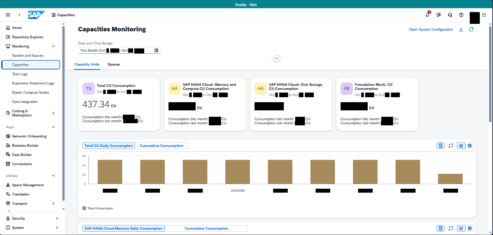

Bildformat: 1381 × 660 Pixel. Die folgenden Positionen beziehen sich auf dieses vollständige Bild.

## 1. Gesamtaufbau und sichtbarer Zustand

### Gesamtansicht

Die Seite zeigt eine Verbrauchsübersicht mit Kennzahlenkarten oben und Diagrammen darunter. Links ist die globale Navigation sichtbar. Der Inhalt erstreckt sich über die übrige Bildschirmbreite.

### Filter und Kennzahlen oben

Im oberen Bereich stehen die Filter Time Range, Units und Spaces. Darunter sind vier Kennzahlenbereiche nebeneinander angeordnet: Total CU Consumption, SAP HANA Cloud: Memory and Compute CU Consumption, SAP HANA Cloud: Disk Storage CU Consumption und Foundation Block: FB Consumption. Die Karten enthalten jeweils eine größere Kennzahl sowie kleinere Zeilen zum aktuellen und vorherigen Monat. Die numerischen Werte werden hier nicht wiedergegeben.

### Diagramme im mittleren Bereich

Unter den Kennzahlen stehen Diagrammbereiche mit den Ansichten „Daily Consumption“ und „Cumulative Consumption“. Ein Balkendiagramm zeigt mehrere schmale blaue Säulen entlang einer horizontalen Zeitachse. Die Diagramme besitzen Überschriften, Achsenbeschriftungen und kleine Symbole rechts neben der jeweiligen Überschrift.

### Unterer Bereich

Weiter unten beginnt ein zusätzlicher Diagrammbereich für den Speicherverbrauch. Der Screenshot zeigt davon nur den oberen Teil. Die Karten und Diagramme sind durch Abstände und helle Hintergrundflächen voneinander getrennt; es ist kein Dialog eingeblendet.

## 2. Räumliche Beschreibung von oben nach unten

### Filterzeile

**Ungefähre Bildregion:** x 16–97 %, y 12–19 %

Time Range steht links, Units mittig und Spaces rechts. Die Felder liegen auf einer gemeinsamen horizontalen Linie.

### Vier Kennzahlenbereiche

**Ungefähre Bildregion:** x 16–97 %, y 20–42 %

Von links nach rechts: Gesamtverbrauch, HANA-Cloud-Arbeitsspeicher und Rechenleistung, HANA-Cloud-Festplattenspeicher und Foundation Block. Überschriften stehen jeweils über der großen Wertposition; darunter folgen kleinere Monatszeilen.

### Diagramme

**Ungefähre Bildregion:** x 16–97 %, y 43–100 %

Die Diagramme liegen untereinander. Daily Consumption und Cumulative Consumption stehen im jeweiligen Kopfbereich. Blaue Säulen stehen senkrecht auf einer horizontalen Achse. Der nächste Diagrammbereich beginnt am unteren Bildrand und ist nur teilweise zu sehen.

## 3. Positionsverzeichnis der lesbaren Beschriftungen

Sortierung nach Bildhöhe, innerhalb derselben Höhe von links nach rechts. Angegeben sind Textbegrenzungen; Abstände und Bedienelementflächen können darüber hinausreichen.

<table>
<colgroup>
<col style="width: 33%" />
<col style="width: 30%" />
<col style="width: 35%" />
</colgroup>
<thead>
<tr class="header">
<th>Sichtbarer Text</th>
<th>Textposition in Pixeln</th>
<th>Relative Lage im Bild</th>
</tr>
</thead>
<tbody>
<tr class="odd">
<td>Capacities</td>
<td>x 160–209 
y 38–48</td>
<td>oben, links 
x 11.6–15.1 % 
y 5.8–7.3 %</td>
</tr>
<tr class="even">
<td>Home</td>
<td>x 34–60 
y 74–82</td>
<td>oben, links 
x 2.5–4.4 % 
y 11.2–12.4 %</td>
</tr>
<tr class="odd">
<td>Capacities</td>
<td>x 219–308 
y 74–92</td>
<td>oben, links 
x 15.9–22.3 % 
y 11.2–13.9 %</td>
</tr>
<tr class="even">
<td>Monitoring</td>
<td>x 314–408 
y 74–92</td>
<td>oben, links 
x 22.7–29.6 % 
y 11.2–13.9 %</td>
</tr>
<tr class="odd">
<td>System</td>
<td>x 1174–1206 
y 79–88</td>
<td>oben, rechts 
x 85.0–87.3 % 
y 12.0–13.3 %</td>
</tr>
<tr class="even">
<td>Repository Explorer</td>
<td>x 34–121 
y 100–110</td>
<td>oben, links 
x 2.5–8.8 % 
y 15.2–16.7 %</td>
</tr>
<tr class="odd">
<td>Monitoring</td>
<td>x 34–82 
y 126–136</td>
<td>oben, links 
x 2.5–5.9 % 
y 19.1–20.6 %</td>
</tr>
<tr class="even">
<td>Date and Time Range</td>
<td>x 220–314 
y 118–127</td>
<td>oben, links 
x 15.9–22.7 % 
y 17.8–19.2 %</td>
</tr>
<tr class="odd">
<td>System and Spaces</td>
<td>x 34–121 
y 152–162</td>
<td>oben, links 
x 2.5–8.8 % 
y 23.0–24.5 %</td>
</tr>
<tr class="even">
<td>Units</td>
<td>x 254–278 
y 177–184</td>
<td>oben, links 
x 18.4–20.1 % 
y 26.8–27.9 %</td>
</tr>
<tr class="odd">
<td>Spaces</td>
<td>x 302–336 
y 176–186</td>
<td>oben, links 
x 21.9–24.3 % 
y 26.7–28.2 %</td>
</tr>
<tr class="even">
<td>Task Logs</td>
<td>x 34–77 
y 204–214</td>
<td>oben, links 
x 2.5–5.6 % 
y 30.9–32.4 %</td>
</tr>
<tr class="odd">
<td>Expensive Statement Logs</td>
<td>x 34–152 
y 230–240</td>
<td>auf mittlerer Höhe, links 
x 2.5–11.0 % 
y 34.8–36.4 %</td>
</tr>
<tr class="even">
<td>SAP HANA Cloud:</td>
<td>x 512–594 
y 234–241</td>
<td>auf mittlerer Höhe, mittig 
x 37.1–43.0 % 
y 35.4–36.5 %</td>
</tr>
<tr class="odd">
<td>SAP HANA Cloud:</td>
<td>x 754–836 
y 234–241</td>
<td>auf mittlerer Höhe, mittig 
x 54.6–60.5 % 
y 35.4–36.5 %</td>
</tr>
<tr class="even">
<td>Disk Storage</td>
<td>x 843–902 
y 234–243</td>
<td>auf mittlerer Höhe, mittig 
x 61.0–65.3 % 
y 35.4–36.8 %</td>
</tr>
<tr class="odd">
<td>Foundation Block:</td>
<td>x 994–1082 
y 234–241</td>
<td>auf mittlerer Höhe, rechts 
x 72.0–78.3 % 
y 35.4–36.5 %</td>
</tr>
<tr class="even">
<td>Total CU Consumption</td>
<td>x 271–379 
y 236–246</td>
<td>auf mittlerer Höhe, links 
x 19.6–27.4 % 
y 35.8–37.3 %</td>
</tr>
<tr class="odd">
<td>CU Consumption</td>
<td>x 559–640 
y 245–255</td>
<td>auf mittlerer Höhe, mittig 
x 40.5–46.3 % 
y 37.1–38.6 %</td>
</tr>
<tr class="even">
<td>CU Consumption</td>
<td>x 753–835 
y 245–255</td>
<td>auf mittlerer Höhe, mittig 
x 54.5–60.5 % 
y 37.1–38.6 %</td>
</tr>
<tr class="odd">
<td>FB Consumption</td>
<td>x 964–1058 
y 244–255</td>
<td>auf mittlerer Höhe, rechts 
x 69.8–76.6 % 
y 36.9–38.6 %</td>
</tr>
<tr class="even">
<td>Elastic Compute Nodes</td>
<td>x 34–138 
y 256–266</td>
<td>auf mittlerer Höhe, links 
x 2.5–10.0 % 
y 38.8–40.2 %</td>
</tr>
<tr class="odd">
<td>Data Integration</td>
<td>x 34–105 
y 282–292</td>
<td>auf mittlerer Höhe, links 
x 2.5–7.6 % 
y 42.7–44.2 %</td>
</tr>
<tr class="even">
<td>Consumption last month</td>
<td>x 231–339 
y 336–346</td>
<td>auf mittlerer Höhe, links 
x 16.7–24.5 % 
y 50.9–52.3 %</td>
</tr>
<tr class="odd">
<td>Consumption this month.</td>
<td>x 472–580 
y 330–340</td>
<td>auf mittlerer Höhe, mittig 
x 34.2–42.0 % 
y 50.0–51.5 %</td>
</tr>
<tr class="even">
<td>Consumption last month:</td>
<td>x 472–580 
y 342–351</td>
<td>auf mittlerer Höhe, mittig 
x 34.2–42.0 % 
y 51.8–53.2 %</td>
</tr>
<tr class="odd">
<td>Consumption this month.</td>
<td>x 954–1062 
y 330–340</td>
<td>auf mittlerer Höhe, rechts 
x 69.1–76.9 % 
y 50.0–51.5 %</td>
</tr>
<tr class="even">
<td>Apps</td>
<td>x 17–39 
y 353–362</td>
<td>auf mittlerer Höhe, links 
x 1.2–2.8 % 
y 53.5–54.8 %</td>
</tr>
<tr class="odd">
<td>Semantic Onboarding</td>
<td>x 34–130 
y 378–388</td>
<td>auf mittlerer Höhe, links 
x 2.5–9.4 % 
y 57.3–58.8 %</td>
</tr>
<tr class="even">
<td>(Total</td>
<td>x 231–260 
y 400–418</td>
<td>auf mittlerer Höhe, links 
x 16.7–18.8 % 
y 60.6–63.3 %</td>
</tr>
<tr class="odd">
<td>Daily Consumption</td>
<td>x 281–370 
y 398–420</td>
<td>auf mittlerer Höhe, links 
x 20.3–26.8 % 
y 60.3–63.6 %</td>
</tr>
<tr class="even">
<td>Business Builder</td>
<td>x 34–108 
y 404–412</td>
<td>auf mittlerer Höhe, links 
x 2.5–7.8 % 
y 61.3–62.4 %</td>
</tr>
<tr class="odd">
<td>Cumulative Consumption</td>
<td>x 392–513 
y 405–415</td>
<td>auf mittlerer Höhe, links 
x 28.4–37.1 % 
y 61.4–62.9 %</td>
</tr>
<tr class="even">
<td>Data Builder</td>
<td>x 34–89 
y 430–438</td>
<td>auf mittlerer Höhe, links 
x 2.5–6.4 % 
y 65.2–66.4 %</td>
</tr>
<tr class="odd">
<td>Connections</td>
<td>x 34–90 
y 454–468</td>
<td>unten, links 
x 2.5–6.6 % 
y 68.9–70.9 %</td>
</tr>
<tr class="even">
<td>Utilities</td>
<td>x 17–49 
y 490–497</td>
<td>unten, links 
x 1.2–3.5 % 
y 74.2–75.3 %</td>
</tr>
<tr class="odd">
<td>Space Management</td>
<td>x 34–123 
y 516–525</td>
<td>unten, links 
x 2.5–8.9 % 
y 78.1–79.5 %</td>
</tr>
<tr class="even">
<td>Translation</td>
<td>x 34–82 
y 542–549</td>
<td>unten, links 
x 2.5–5.9 % 
y 82.0–83.2 %</td>
</tr>
<tr class="odd">
<td>Transport</td>
<td>x 34–76 
y 568–577</td>
<td>unten, links 
x 2.5–5.5 % 
y 86.0–87.4 %</td>
</tr>
<tr class="even">
<td>Security</td>
<td>x 32–70 
y 607–619</td>
<td>unten, links 
x 2.4–5.1 % 
y 92.0–93.8 %</td>
</tr>
<tr class="odd">
<td>system</td>
<td>x 31–66 
y 633–645</td>
<td>unten, links 
x 2.2–4.8 % 
y 95.9–97.7 %</td>
</tr>
<tr class="even">
<td>SAP HANA Cloud</td>
<td>x 238–320 
y 638–645</td>
<td>unten, links 
x 17.2–23.1 % 
y 96.6–97.7 %</td>
</tr>
<tr class="odd">
<td>Daily Consumption</td>
<td>x 365–456 
y 638–647</td>
<td>unten, links 
x 26.4–33.0 % 
y 96.6–98.0 %</td>
</tr>
<tr class="even">
<td>Cumulative Consumption</td>
<td>x 518–639 
y 638–647</td>
<td>unten, mittig 
x 37.5–46.3 % 
y 96.6–98.0 %</td>
</tr>
</tbody>
</table>

## 4. Abgrenzung

Die Beschreibung benennt nur den sichtbaren Zustand dieses Screenshots. Aus Symbolen ohne lesbare Beschriftung wird keine konkrete Funktion abgeleitet. Inhalte hinter schwarzen Balken und nicht sichtbare Bereiche außerhalb des Bildrandes bleiben unbeschrieben.

# Bild 5: System and Spaces: Speicher- und Fehlerkarten

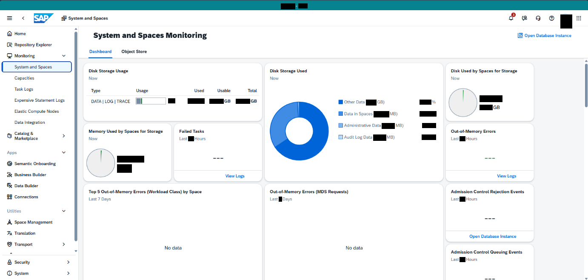

Bildformat: 1382 × 658 Pixel. Die folgenden Positionen beziehen sich auf dieses vollständige Bild.

## 1. Gesamtaufbau und sichtbarer Zustand

### Gesamtansicht

Das Bild zeigt eine technische Monitoring-Seite mit mehreren Kennzahlenkarten. Die globale Navigation liegt links. Der Hauptbereich besteht aus einer oberen Kartenreihe und weiteren Karten darunter.

### Obere Reihe

Links befindet sich „Disk Storage Used“ mit mehreren Größenangaben und einem kreisförmigen beziehungsweise ringförmigen Diagramm. Daneben steht „Disk Used by Spaces for Storage“ mit den Kategorien Used, Usable und Total. Rechts zeigt „Object Store Usage“ eine farblich gegliederte Verteilung. Sichtbare Kategorien sind Other Data, Data in Spaces, Administrative Data und Audit Log Data. Die geschwärzten Zahlen werden nicht beschrieben.

### Mittlere und untere Karten

Weitere Karten tragen die Überschriften Used by Spaces for Storage, Failed Tasks und Out-of-Memory Errors. Die Fehlerkarten beziehen sich sichtbar auf „Last 24 Hours“ und enthalten „View Logs“. Darunter folgen Errors (Workload Class) by Space, Out-of-Memory Errors (MDS Requests), Admission Control Rejection Events und Admission Control Queuing Events. Mehrere dieser Bereiche zeigen „No data“.

### Anordnung und Bedienelemente

Die einzelnen Karten sind weiß und durch deutliche Zwischenräume getrennt. Rechts befindet sich die Schaltfläche „Open Database Instance“. Unterschiedliche Karten zeigen entweder Kennzahlen, Diagramme oder einen leeren Datenzustand. Es ist keine einzelne Fehlermeldung als Dialog geöffnet.

## 2. Räumliche Beschreibung von oben nach unten

### Oberste Kartenreihe

**Ungefähre Bildregion:** x 16–97 %, y 14–52 %

Links steht Disk Storage Used mit einer ringförmigen Grafik. Mittig liegt Disk Used by Spaces for Storage mit Used, Usable und Total. Rechts liegt Object Store Usage mit einem farbigen Diagramm und einer darunter angeordneten Legende.

### Zweite Kartenreihe

**Ungefähre Bildregion:** x 16–76 %, y 52–75 %

Used by Spaces for Storage steht links. Failed Tasks liegt daneben, Out-of-Memory Errors rechts davon. Die Fehlerkarten enthalten kleine Zeitraumzeilen und View Logs.

### Untere Karten

**Ungefähre Bildregion:** x 16–97 %, y 75–100 %

Weitere Fehler- und Admission-Control-Bereiche sind als einzelne weiße Karten angeordnet. No data steht in mehreren Karten innerhalb des Inhaltsbereichs. Open Database Instance liegt rechts im unteren Hauptbereich.

## 3. Positionsverzeichnis der lesbaren Beschriftungen

Sortierung nach Bildhöhe, innerhalb derselben Höhe von links nach rechts. Angegeben sind Textbegrenzungen; Abstände und Bedienelementflächen können darüber hinausreichen.

<table>
<colgroup>
<col style="width: 33%" />
<col style="width: 30%" />
<col style="width: 35%" />
</colgroup>
<thead>
<tr class="header">
<th>Sichtbarer Text</th>
<th>Textposition in Pixeln</th>
<th>Relative Lage im Bild</th>
</tr>
</thead>
<tbody>
<tr class="odd">
<td>System and Spaces</td>
<td>x 161–254 
y 39–49</td>
<td>oben, links 
x 11.6–18.3 % 
y 5.9–7.4 %</td>
</tr>
<tr class="even">
<td>Home</td>
<td>x 34–60 
y 75–83</td>
<td>oben, links 
x 2.5–4.4 % 
y 11.4–12.6 %</td>
</tr>
<tr class="odd">
<td>System and Spaces</td>
<td>x 220–385 
y 76–93</td>
<td>oben, links 
x 15.9–27.9 % 
y 11.6–14.1 %</td>
</tr>
<tr class="even">
<td>Monitoring</td>
<td>x 390–486 
y 75–93</td>
<td>oben, links 
x 28.2–35.2 % 
y 11.4–14.1 %</td>
</tr>
<tr class="odd">
<td>Open Database Instance</td>
<td>x 1233–1342 
y 80–89</td>
<td>oben, rechts 
x 89.2–97.1 % 
y 12.1–13.5 %</td>
</tr>
<tr class="even">
<td>Repository Explorer</td>
<td>x 34–122 
y 101–111</td>
<td>oben, links 
x 2.5–8.8 % 
y 15.3–16.9 %</td>
</tr>
<tr class="odd">
<td>Monitoring</td>
<td>x 34–82 
y 127–137</td>
<td>oben, links 
x 2.5–5.9 % 
y 19.3–20.8 %</td>
</tr>
<tr class="even">
<td>Disk Storage</td>
<td>x 208–269 
y 163–172</td>
<td>oben, links 
x 15.1–19.5 % 
y 24.8–26.1 %</td>
</tr>
<tr class="odd">
<td>Disk Storage Used</td>
<td>x 634–721 
y 163–172</td>
<td>oben, mittig 
x 45.9–52.2 % 
y 24.8–26.2 %</td>
</tr>
<tr class="even">
<td>Disk Used by Spaces for Storage</td>
<td>x 1060–1216 
y 163–172</td>
<td>oben, rechts 
x 76.7–88.0 % 
y 24.8–26.2 %</td>
</tr>
<tr class="odd">
<td>Capacities</td>
<td>x 34–80 
y 179–189</td>
<td>oben, links 
x 2.5–5.8 % 
y 27.2–28.7 %</td>
</tr>
<tr class="even">
<td>Task Logs</td>
<td>x 34–78 
y 205–215</td>
<td>oben, links 
x 2.5–5.6 % 
y 31.2–32.7 %</td>
</tr>
<tr class="odd">
<td>Type</td>
<td>x 214–236 
y 209–219</td>
<td>oben, links 
x 15.5–17.1 % 
y 31.8–33.3 %</td>
</tr>
<tr class="even">
<td>Used</td>
<td>x 457–480 
y 209–217</td>
<td>oben, mittig 
x 33.1–34.7 % 
y 31.8–33.0 %</td>
</tr>
<tr class="odd">
<td>Usable</td>
<td>x 511–542 
y 209–217</td>
<td>oben, mittig 
x 37.0–39.2 % 
y 31.8–33.0 %</td>
</tr>
<tr class="even">
<td>Total</td>
<td>x 582–604 
y 209–217</td>
<td>oben, mittig 
x 42.1–43.7 % 
y 31.8–33.0 %</td>
</tr>
<tr class="odd">
<td>Expensive Statement Logs</td>
<td>x 34–152 
y 232–241</td>
<td>auf mittlerer Höhe, links 
x 2.5–11.0 % 
y 35.2–36.6 %</td>
</tr>
<tr class="even">
<td>Other Data</td>
<td>x 809–857 
y 236–243</td>
<td>auf mittlerer Höhe, mittig 
x 58.5–62.0 % 
y 35.9–36.9 %</td>
</tr>
<tr class="odd">
<td>Elastic Compute Nodes</td>
<td>x 34–138 
y 258–267</td>
<td>auf mittlerer Höhe, links 
x 2.5–10.0 % 
y 39.1–40.6 %</td>
</tr>
<tr class="even">
<td>Data in Spaces</td>
<td>x 810–875 
y 264–272</td>
<td>auf mittlerer Höhe, mittig 
x 58.6–63.3 % 
y 40.0–41.4 %</td>
</tr>
<tr class="odd">
<td>Data Integration</td>
<td>x 34–105 
y 284–293</td>
<td>auf mittlerer Höhe, links 
x 2.5–7.6 % 
y 43.2–44.5 %</td>
</tr>
<tr class="even">
<td>Administrative Data</td>
<td>x 809–895 
y 291–298</td>
<td>auf mittlerer Höhe, mittig 
x 58.5–64.8 % 
y 44.2–45.3 %</td>
</tr>
<tr class="odd">
<td>MB)</td>
<td>x 930–948 
y 291–300</td>
<td>auf mittlerer Höhe, rechts 
x 67.3–68.6 % 
y 44.2–45.5 %</td>
</tr>
<tr class="even">
<td>Used by Spaces for Storage</td>
<td>x 251–382 
y 304–314</td>
<td>auf mittlerer Höhe, links 
x 18.2–27.7 % 
y 46.3–47.7 %</td>
</tr>
<tr class="odd">
<td>Failed Tasks</td>
<td>x 422–480 
y 304–312</td>
<td>auf mittlerer Höhe, links 
x 30.5–34.7 % 
y 46.3–47.4 %</td>
</tr>
<tr class="even">
<td>Out-of-Memory Errors</td>
<td>x 1060–1165 
y 304–314</td>
<td>auf mittlerer Höhe, rechts 
x 76.7–84.3 % 
y 46.3–47.7 %</td>
</tr>
<tr class="odd">
<td>Audit Log Data</td>
<td>x 809–874 
y 318–328</td>
<td>auf mittlerer Höhe, mittig 
x 58.5–63.2 % 
y 48.4–49.8 %</td>
</tr>
<tr class="even">
<td>Apps</td>
<td>x 17–39 
y 355–364</td>
<td>auf mittlerer Höhe, links 
x 1.2–2.8 % 
y 54.0–55.2 %</td>
</tr>
<tr class="odd">
<td>Semantic Onboarding</td>
<td>x 34–131 
y 381–390</td>
<td>auf mittlerer Höhe, links 
x 2.5–9.5 % 
y 57.9–59.3 %</td>
</tr>
<tr class="even">
<td>Business Builder</td>
<td>x 34–108 
y 407–414</td>
<td>auf mittlerer Höhe, links 
x 2.5–7.9 % 
y 61.9–62.9 %</td>
</tr>
<tr class="odd">
<td>View Logs</td>
<td>x 530–575 
y 410–419</td>
<td>auf mittlerer Höhe, mittig 
x 38.4–41.6 % 
y 62.3–63.7 %</td>
</tr>
<tr class="even">
<td>View Logs</td>
<td>x 1168–1213 
y 410–419</td>
<td>auf mittlerer Höhe, rechts 
x 84.6–87.8 % 
y 62.3–63.7 %</td>
</tr>
<tr class="odd">
<td>Data Builder</td>
<td>x 32–92 
y 428–444</td>
<td>auf mittlerer Höhe, links 
x 2.4–6.6 % 
y 65.0–67.5 %</td>
</tr>
<tr class="even">
<td>Out-of-Memory Errors</td>
<td>x 238–342 
y 446–456</td>
<td>unten, links 
x 17.2–24.8 % 
y 67.9–69.3 %</td>
</tr>
<tr class="odd">
<td>(Workload Class)</td>
<td>x 346–427 
y 446–456</td>
<td>unten, links 
x 25.0–30.9 % 
y 67.9–69.3 %</td>
</tr>
<tr class="even">
<td>by Space</td>
<td>x 430–474 
y 446–456</td>
<td>unten, links 
x 31.2–34.3 % 
y 67.9–69.3 %</td>
</tr>
<tr class="odd">
<td>Errors</td>
<td>x 710–739 
y 446–454</td>
<td>unten, mittig 
x 51.4–53.5 % 
y 67.9–69.0 %</td>
</tr>
<tr class="even">
<td>(MDS Requests)</td>
<td>x 742–818 
y 446–456</td>
<td>unten, mittig 
x 53.7–59.2 % 
y 67.9–69.3 %</td>
</tr>
<tr class="odd">
<td>Admission Control Rejection Events</td>
<td>x 1060–1232 
y 446–456</td>
<td>unten, rechts 
x 76.7–89.1 % 
y 67.9–69.3 %</td>
</tr>
<tr class="even">
<td>Connections</td>
<td>x 32–92 
y 457–470</td>
<td>unten, links 
x 2.3–6.7 % 
y 69.5–71.5 %</td>
</tr>
<tr class="odd">
<td>Utilities</td>
<td>x 17–49 
y 492–499</td>
<td>unten, links 
x 1.2–3.5 % 
y 74.8–75.8 %</td>
</tr>
<tr class="even">
<td>Space Management</td>
<td>x 34–123 
y 518–528</td>
<td>unten, links 
x 2.5–8.9 % 
y 78.7–80.2 %</td>
</tr>
<tr class="odd">
<td>Translation</td>
<td>x 34–83 
y 543–553</td>
<td>unten, links 
x 2.5–6.0 % 
y 82.5–84.0 %</td>
</tr>
<tr class="even">
<td>Open Database Instance</td>
<td>x 1104–1213 
y 552–561</td>
<td>unten, rechts 
x 79.8–87.8 % 
y 83.8–85.3 %</td>
</tr>
<tr class="odd">
<td>Transport</td>
<td>x 34–76 
y 570–580</td>
<td>unten, links 
x 2.5–5.5 % 
y 86.6–88.1 %</td>
</tr>
<tr class="even">
<td>No data</td>
<td>x 387–426 
y 578–586</td>
<td>unten, links 
x 28.0–30.9 % 
y 87.8–89.1 %</td>
</tr>
<tr class="odd">
<td>No data</td>
<td>x 813–852 
y 578–586</td>
<td>unten, mittig 
x 58.8–61.6 % 
y 87.8–89.1 %</td>
</tr>
<tr class="even">
<td>Admission Control Queuing Events</td>
<td>x 1060–1228 
y 588–598</td>
<td>unten, rechts 
x 76.7–88.8 % 
y 89.4–90.9 %</td>
</tr>
<tr class="odd">
<td>Security</td>
<td>x 32–70 
y 610–622</td>
<td>unten, links 
x 2.4–5.1 % 
y 92.7–94.5 %</td>
</tr>
<tr class="even">
<td>system</td>
<td>x 31–67 
y 636–648</td>
<td>unten, links 
x 2.2–4.8 % 
y 96.7–98.5 %</td>
</tr>
</tbody>
</table>

## 4. Abgrenzung

Die Beschreibung benennt nur den sichtbaren Zustand dieses Screenshots. Aus Symbolen ohne lesbare Beschriftung wird keine konkrete Funktion abgeleitet. Inhalte hinter schwarzen Balken und nicht sichtbare Bereiche außerhalb des Bildrandes bleiben unbeschrieben.

# Bild 6: Repository Explorer: weitere Listenansicht

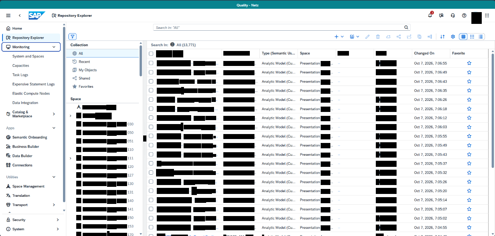

Bildformat: 1383 × 662 Pixel. Die folgenden Positionen beziehen sich auf dieses vollständige Bild.

## 1. Gesamtaufbau und sichtbarer Zustand

### Gesamtansicht

Der Screenshot zeigt erneut eine breite Objektliste mit einer zusätzlichen Filterspalte links neben der Tabelle. Die globale Navigation bleibt am äußersten linken Rand sichtbar.

### Filter und Werkzeugleiste

Im linken Filterbereich stehen All, Recent, My Objects, Shared und Favorites. Unter der Überschrift Space folgt eine vertikale Liste. Oberhalb der Tabelle befindet sich eine Werkzeugleiste mit mehreren Symbolen und einer Such- beziehungsweise Auswahlzeile.

### Tabelleninhalt

Die rechte Hälfte der Tabelle enthält die Spalten Type beziehungsweise Semantic Usage, Space, Folder, Status, Changed On und Favorite. Die sichtbaren Zeilen sind überwiegend als „Analytic Model“ gekennzeichnet. Daneben stehen Bereitstellungsanzeigen. Datum und Uhrzeit sind in der Spalte Changed On zeilenweise angeordnet. Die rechte Randspalte enthält Favoritensymbole.

### Darstellung

Die Zeilen stehen eng untereinander und besitzen gleichartige Abstände. Kleine Symbole kennzeichnen die Objekte am Zeilenanfang. Die Tabellenüberschrift bleibt oberhalb der Einträge sichtbar. Es ist keine Objektvorschau oder ein Einstellungsdialog geöffnet; der Schwerpunkt liegt auf der Listenübersicht.

## 2. Räumliche Beschreibung von oben nach unten

### Navigation und Filter

**Ungefähre Bildregion:** x 0–27 %, y 5–100 %

Links die globale Navigation, daneben die innere Filterspalte. Die Auswahlbereiche stehen im oberen Teil; die Space-Liste setzt sich darunter fort.

### Werkzeugleiste und Liste

**Ungefähre Bildregion:** x 27–100 %, y 12–100 %

Die Aktionssymbole stehen in einer horizontalen Reihe über der Suchauswahl. Die Tabellenkopfzeile liegt darunter. Analytic Model wiederholt sich in den Datenzeilen. Änderungszeit und Favoritensymbole befinden sich weit rechts.

## 3. Positionsverzeichnis der lesbaren Beschriftungen

Sortierung nach Bildhöhe, innerhalb derselben Höhe von links nach rechts. Angegeben sind Textbegrenzungen; Abstände und Bedienelementflächen können darüber hinausreichen.

<table>
<colgroup>
<col style="width: 33%" />
<col style="width: 30%" />
<col style="width: 35%" />
</colgroup>
<thead>
<tr class="header">
<th>Sichtbarer Text</th>
<th>Textposition in Pixeln</th>
<th>Relative Lage im Bild</th>
</tr>
</thead>
<tbody>
<tr class="odd">
<td>Repository Explorer</td>
<td>x 162–257 
y 36–51</td>
<td>oben, links 
x 11.7–18.6 % 
y 5.4–7.7 %</td>
</tr>
<tr class="even">
<td>Home</td>
<td>x 35–61 
y 76–83</td>
<td>oben, links 
x 2.5–4.4 % 
y 11.5–12.5 %</td>
</tr>
<tr class="odd">
<td>Repository Explorer</td>
<td>x 35–122 
y 102–111</td>
<td>oben, links 
x 2.5–8.9 % 
y 15.4–16.8 %</td>
</tr>
<tr class="even">
<td>Search In:</td>
<td>x 423–469 
y 122–129</td>
<td>oben, links 
x 30.6–33.9 % 
y 18.5–19.5 %</td>
</tr>
<tr class="odd">
<td>Monitoring</td>
<td>x 35–82 
y 128–137</td>
<td>oben, links 
x 2.5–5.9 % 
y 19.3–20.7 %</td>
</tr>
<tr class="even">
<td>All</td>
<td>x 220–231 
y 146–153</td>
<td>oben, links 
x 15.9–16.7 % 
y 22.1–23.1 %</td>
</tr>
<tr class="odd">
<td>Type</td>
<td>x 732–753 
y 145–155</td>
<td>oben, mittig 
x 52.9–54.4 % 
y 21.9–23.4 %</td>
</tr>
<tr class="even">
<td>Space</td>
<td>x 838–866 
y 145–155</td>
<td>oben, mittig 
x 60.6–62.6 % 
y 21.9–23.4 %</td>
</tr>
<tr class="odd">
<td>Changed On</td>
<td>x 1157–1213 
y 145–155</td>
<td>oben, rechts 
x 83.7–87.7 % 
y 21.9–23.4 %</td>
</tr>
<tr class="even">
<td>Favorite</td>
<td>x 1264–1299 
y 145–153</td>
<td>oben, rechts 
x 91.4–93.9 % 
y 21.9–23.1 %</td>
</tr>
<tr class="odd">
<td>System and Spaces</td>
<td>x 36–122 
y 154–164</td>
<td>oben, links 
x 2.6–8.8 % 
y 23.3–24.7 %</td>
</tr>
<tr class="even">
<td>Recent</td>
<td>x 221–250 
y 169–176</td>
<td>oben, links 
x 16.0–18.1 % 
y 25.5–26.7 %</td>
</tr>
<tr class="odd">
<td>Analytic Model</td>
<td>x 732–798 
y 174–183</td>
<td>oben, mittig 
x 52.9–57.7 % 
y 26.3–27.6 %</td>
</tr>
<tr class="even">
<td>Capacities</td>
<td>x 35–81 
y 180–188</td>
<td>oben, links 
x 2.5–5.9 % 
y 27.2–28.5 %</td>
</tr>
<tr class="odd">
<td>My Objects</td>
<td>x 221–270 
y 192–202</td>
<td>oben, links 
x 16.0–19.5 % 
y 29.1–30.5 %</td>
</tr>
<tr class="even">
<td>Task Logs</td>
<td>x 35–78 
y 206–216</td>
<td>oben, links 
x 2.5–5.6 % 
y 31.1–32.6 %</td>
</tr>
<tr class="odd">
<td>Analytic Model</td>
<td>x 732–797 
y 199–208</td>
<td>oben, mittig 
x 52.9–57.6 % 
y 30.1–31.4 %</td>
</tr>
<tr class="even">
<td>Shared</td>
<td>x 221–252 
y 216–223</td>
<td>auf mittlerer Höhe, links 
x 16.0–18.2 % 
y 32.6–33.7 %</td>
</tr>
<tr class="odd">
<td>Expensive Statement Logs</td>
<td>x 36–152 
y 232–242</td>
<td>auf mittlerer Höhe, links 
x 2.6–11.0 % 
y 35.0–36.6 %</td>
</tr>
<tr class="even">
<td>Analytic Model</td>
<td>x 732–797 
y 225–234</td>
<td>auf mittlerer Höhe, mittig 
x 52.9–57.6 % 
y 34.0–35.3 %</td>
</tr>
<tr class="odd">
<td>Favorites</td>
<td>x 221–260 
y 239–246</td>
<td>auf mittlerer Höhe, links 
x 16.0–18.8 % 
y 36.1–37.2 %</td>
</tr>
<tr class="even">
<td>Analytic Model</td>
<td>x 732–797 
y 250–260</td>
<td>auf mittlerer Höhe, mittig 
x 52.9–57.6 % 
y 37.8–39.3 %</td>
</tr>
<tr class="odd">
<td>Elastic Compute Nodes</td>
<td>x 36–139 
y 258–268</td>
<td>auf mittlerer Höhe, links 
x 2.6–10.1 % 
y 39.0–40.4 %</td>
</tr>
<tr class="even">
<td>Space</td>
<td>x 198–226 
y 274–283</td>
<td>auf mittlerer Höhe, links 
x 14.3–16.3 % 
y 41.3–42.7 %</td>
</tr>
<tr class="odd">
<td>Data Integration</td>
<td>x 36–106 
y 284–294</td>
<td>auf mittlerer Höhe, links 
x 2.6–7.7 % 
y 42.9–44.4 %</td>
</tr>
<tr class="even">
<td>Analytic Model</td>
<td>x 732–798 
y 302–311</td>
<td>auf mittlerer Höhe, mittig 
x 52.9–57.7 % 
y 45.6–47.0 %</td>
</tr>
<tr class="odd">
<td>Analytic Model</td>
<td>x 732–797 
y 327–336</td>
<td>auf mittlerer Höhe, mittig 
x 52.9–57.6 % 
y 49.4–50.8 %</td>
</tr>
<tr class="even">
<td>Analytic Model</td>
<td>x 732–797 
y 352–362</td>
<td>auf mittlerer Höhe, mittig 
x 52.9–57.6 % 
y 53.2–54.7 %</td>
</tr>
<tr class="odd">
<td>Apps</td>
<td>x 20–40 
y 356–362</td>
<td>auf mittlerer Höhe, links 
x 1.5–2.9 % 
y 53.7–54.7 %</td>
</tr>
<tr class="even">
<td>Semantic Onboarding</td>
<td>x 35–132 
y 381–391</td>
<td>auf mittlerer Höhe, links 
x 2.5–9.5 % 
y 57.6–59.1 %</td>
</tr>
<tr class="odd">
<td>Analytic Model</td>
<td>x 732–797 
y 378–388</td>
<td>auf mittlerer Höhe, mittig 
x 52.9–57.6 % 
y 57.2–58.6 %</td>
</tr>
<tr class="even">
<td>Business Builder</td>
<td>x 36–108 
y 407–415</td>
<td>auf mittlerer Höhe, links 
x 2.6–7.8 % 
y 61.5–62.7 %</td>
</tr>
<tr class="odd">
<td>Analytic Model</td>
<td>x 732–798 
y 404–413</td>
<td>auf mittlerer Höhe, mittig 
x 52.9–57.7 % 
y 61.0–62.4 %</td>
</tr>
<tr class="even">
<td>Data Builder</td>
<td>x 36–90 
y 433–441</td>
<td>auf mittlerer Höhe, links 
x 2.6–6.5 % 
y 65.4–66.6 %</td>
</tr>
<tr class="odd">
<td>Analytic Model</td>
<td>x 732–798 
y 430–439</td>
<td>auf mittlerer Höhe, mittig 
x 52.9–57.7 % 
y 65.0–66.3 %</td>
</tr>
<tr class="even">
<td>Connections</td>
<td>x 35–90 
y 460–467</td>
<td>unten, links 
x 2.5–6.5 % 
y 69.4–70.5 %</td>
</tr>
<tr class="odd">
<td>Analytic Model</td>
<td>x 732–797 
y 455–464</td>
<td>unten, mittig 
x 52.9–57.6 % 
y 68.7–70.1 %</td>
</tr>
<tr class="even">
<td>Analytic Model</td>
<td>x 732–797 
y 480–490</td>
<td>unten, mittig 
x 52.9–57.6 % 
y 72.6–74.0 %</td>
</tr>
<tr class="odd">
<td>Utilities</td>
<td>x 18–50 
y 493–500</td>
<td>unten, links 
x 1.3–3.6 % 
y 74.5–75.5 %</td>
</tr>
<tr class="even">
<td>Analytic Model</td>
<td>x 732–798 
y 506–516</td>
<td>unten, mittig 
x 52.9–57.7 % 
y 76.5–77.9 %</td>
</tr>
<tr class="odd">
<td>Space Management</td>
<td>x 35–124 
y 519–528</td>
<td>unten, links 
x 2.5–9.0 % 
y 78.4–79.8 %</td>
</tr>
<tr class="even">
<td>Analytic Model</td>
<td>x 732–798 
y 532–541</td>
<td>unten, mittig 
x 52.9–57.7 % 
y 80.4–81.7 %</td>
</tr>
<tr class="odd">
<td>Translation</td>
<td>x 36–83 
y 545–552</td>
<td>unten, links 
x 2.6–6.0 % 
y 82.3–83.4 %</td>
</tr>
<tr class="even">
<td>Analytic Model</td>
<td>x 732–797 
y 557–566</td>
<td>unten, mittig 
x 52.9–57.6 % 
y 84.1–85.6 %</td>
</tr>
<tr class="odd">
<td>Transport</td>
<td>x 36–76 
y 571–580</td>
<td>unten, links 
x 2.6–5.5 % 
y 86.3–87.6 %</td>
</tr>
<tr class="even">
<td>Analytic Model</td>
<td>x 732–797 
y 583–592</td>
<td>unten, mittig 
x 52.9–57.6 % 
y 88.1–89.5 %</td>
</tr>
<tr class="odd">
<td>Security</td>
<td>x 33–71 
y 611–624</td>
<td>unten, links 
x 2.4–5.1 % 
y 92.3–94.3 %</td>
</tr>
<tr class="even">
<td>Analytic Model</td>
<td>x 732–798 
y 608–618</td>
<td>unten, mittig 
x 52.9–57.7 % 
y 91.9–93.4 %</td>
</tr>
<tr class="odd">
<td>System</td>
<td>x 35–67 
y 639–648</td>
<td>unten, links 
x 2.5–4.8 % 
y 96.5–97.9 %</td>
</tr>
<tr class="even">
<td>Analytic Model</td>
<td>x 732–798 
y 634–644</td>
<td>unten, mittig 
x 52.9–57.7 % 
y 95.8–97.3 %</td>
</tr>
</tbody>
</table>

## 4. Abgrenzung

Die Beschreibung benennt nur den sichtbaren Zustand dieses Screenshots. Aus Symbolen ohne lesbare Beschriftung wird keine konkrete Funktion abgeleitet. Inhalte hinter schwarzen Balken und nicht sichtbare Bereiche außerhalb des Bildrandes bleiben unbeschrieben.

# Bild 7: Data Integration Monitor: Space-Auswahl

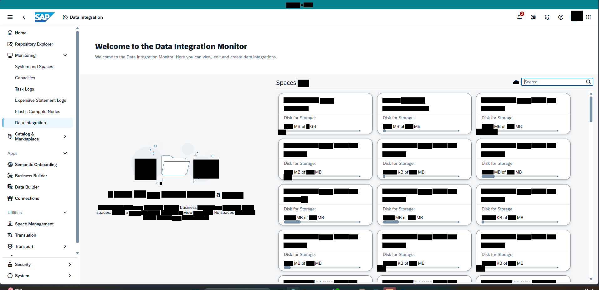

Bildformat: 1914 × 929 Pixel. Die folgenden Positionen beziehen sich auf dieses vollständige Bild.

## 1. Gesamtaufbau und sichtbarer Zustand

### Gesamtansicht

Die Seite trägt die Überschrift „Welcome to the Data Integration Monitor“. Direkt darunter steht ein kurzer Begrüßungs- und Erklärungstext. Unter diesem Kopfbereich folgt ein Raster aus Space-Karten.

### Navigation und Suche

Die globale Navigation befindet sich links. Oberhalb des Kartenrasters steht „Spaces“. Rechts daneben ist ein Suchfeld angeordnet. Kleine Symbole in der Nähe der Überschrift ergänzen die Ansicht.

### Kartenraster

Die Karten sind in mehreren Spalten und Reihen angeordnet. Jede Karte besitzt einen oberen Bereich für die Bezeichnung und einen darunterliegenden Bereich mit der Beschriftung „Disk for Storage“. Die Einheiten MB und GB sowie das verbindende Wort „of“ sind an mehreren Stellen sichtbar. Die Karten haben helle Hintergründe, abgerundete Konturen und kleine grafische Symbole.

### Bildaufbau

Die erste und zweite Kartenreihe sind vollständig sichtbar; weitere Karten setzen sich nach unten fort. Zwischen den Karten bestehen gleichmäßige horizontale und vertikale Abstände. Der Screenshot zeigt die Auswahlübersicht, nicht den Inhalt eines einzelnen Spaces oder eine geöffnete Aufgabe.

## 2. Räumliche Beschreibung von oben nach unten

### Begrüßung

**Ungefähre Bildregion:** x 16–90 %, y 10–18 %

Die große Überschrift liegt oben links im Hauptbereich. Direkt darunter folgt ein einzelner erklärender Absatz.

### Rasterkopf

**Ungefähre Bildregion:** x 16–97 %, y 20–25 %

Spaces steht links, das Suchfeld rechts. Kleine Symbole liegen in der Nähe der Rasterüberschrift.

### Space-Karten

**Ungefähre Bildregion:** x 16–97 %, y 26–100 %

Drei Karten stehen pro Reihe nebeneinander. Die erste Reihe beginnt direkt unter dem Rasterkopf. Jede Karte enthält oben einen Titelbereich und darunter Disk for Storage. Die zweite Reihe wiederholt diese Struktur. Weitere Reihen setzen sich bis zum unteren Bildrand fort.

## 3. Positionsverzeichnis der lesbaren Beschriftungen

Sortierung nach Bildhöhe, innerhalb derselben Höhe von links nach rechts. Angegeben sind Textbegrenzungen; Abstände und Bedienelementflächen können darüber hinausreichen.

<table>
<colgroup>
<col style="width: 33%" />
<col style="width: 30%" />
<col style="width: 35%" />
</colgroup>
<thead>
<tr class="header">
<th>Sichtbarer Text</th>
<th>Textposition in Pixeln</th>
<th>Relative Lage im Bild</th>
</tr>
</thead>
<tbody>
<tr class="odd">
<td>Data Integration</td>
<td>x 224–328 
y 50–63</td>
<td>oben, links 
x 11.7–17.1 % 
y 5.4–6.8 %</td>
</tr>
<tr class="even">
<td>Home</td>
<td>x 49–84 
y 100–110</td>
<td>oben, links 
x 2.6–4.4 % 
y 10.8–11.8 %</td>
</tr>
<tr class="odd">
<td>Repository Explorer</td>
<td>x 49–170 
y 136–149</td>
<td>oben, links 
x 2.6–8.9 % 
y 14.6–16.0 %</td>
</tr>
<tr class="even">
<td>Welcome to the Data Integration Monitor</td>
<td>x 304–790 
y 138–162</td>
<td>oben, links 
x 15.9–41.3 % 
y 14.9–17.4 %</td>
</tr>
<tr class="odd">
<td>Monitoring</td>
<td>x 49–114 
y 172–185</td>
<td>oben, links 
x 2.6–6.0 % 
y 18.5–19.9 %</td>
</tr>
<tr class="even">
<td>Welcome to the Data Integration Monitor!</td>
<td>x 304–557 
y 177–190</td>
<td>oben, links 
x 15.9–29.1 % 
y 19.1–20.5 %</td>
</tr>
<tr class="odd">
<td>edit</td>
<td>x 683–705 
y 177–187</td>
<td>oben, mittig 
x 35.7–36.8 % 
y 19.1–20.1 %</td>
</tr>
<tr class="even">
<td>System and Spaces</td>
<td>x 49–169 
y 208–221</td>
<td>oben, links 
x 2.6–8.8 % 
y 22.4–23.8 %</td>
</tr>
<tr class="odd">
<td>Capacities</td>
<td>x 48–112 
y 244–257</td>
<td>oben, links 
x 2.5–5.9 % 
y 26.3–27.7 %</td>
</tr>
<tr class="even">
<td>Spaces</td>
<td>x 883–946 
y 258–276</td>
<td>oben, mittig 
x 46.1–49.4 % 
y 27.8–29.7 %</td>
</tr>
<tr class="odd">
<td>Task Logs</td>
<td>x 48–108 
y 280–293</td>
<td>oben, links 
x 2.5–5.6 % 
y 30.1–31.5 %</td>
</tr>
<tr class="even">
<td>Expensive Statement Logs</td>
<td>x 49–211 
y 316–329</td>
<td>auf mittlerer Höhe, links 
x 2.6–11.0 % 
y 34.0–35.4 %</td>
</tr>
<tr class="odd">
<td>Elastic Compute Nodes</td>
<td>x 49–192 
y 352–365</td>
<td>auf mittlerer Höhe, links 
x 2.6–10.0 % 
y 37.9–39.3 %</td>
</tr>
<tr class="even">
<td>Disk for Storage:</td>
<td>x 908–1008 
y 372–385</td>
<td>auf mittlerer Höhe, mittig 
x 47.4–52.7 % 
y 40.0–41.4 %</td>
</tr>
<tr class="odd">
<td>Disk for Storage:</td>
<td>x 1224–1324 
y 372–385</td>
<td>auf mittlerer Höhe, mittig 
x 63.9–69.2 % 
y 40.0–41.4 %</td>
</tr>
<tr class="even">
<td>Disk for Storage:</td>
<td>x 1540–1640 
y 372–385</td>
<td>auf mittlerer Höhe, rechts 
x 80.5–85.7 % 
y 40.0–41.4 %</td>
</tr>
<tr class="odd">
<td>Data Integration</td>
<td>x 49–146 
y 388–401</td>
<td>auf mittlerer Höhe, links 
x 2.6–7.7 % 
y 41.8–43.2 %</td>
</tr>
<tr class="even">
<td>of</td>
<td>x 964–980 
y 393–416</td>
<td>auf mittlerer Höhe, mittig 
x 50.4–51.2 % 
y 42.3–44.7 %</td>
</tr>
<tr class="odd">
<td>of</td>
<td>x 1278–1292 
y 400–410</td>
<td>auf mittlerer Höhe, rechts 
x 66.7–67.5 % 
y 43.1–44.1 %</td>
</tr>
<tr class="even">
<td>of</td>
<td>x 1604–1616 
y 400–410</td>
<td>auf mittlerer Höhe, rechts 
x 83.8–84.4 % 
y 43.1–44.1 %</td>
</tr>
<tr class="odd">
<td>MB</td>
<td>x 1648–1667 
y 400–410</td>
<td>auf mittlerer Höhe, rechts 
x 86.1–87.1 % 
y 43.1–44.1 %</td>
</tr>
<tr class="even">
<td>Apps</td>
<td>x 24–55 
y 486–499</td>
<td>auf mittlerer Höhe, links 
x 1.3–2.9 % 
y 52.3–53.7 %</td>
</tr>
<tr class="odd">
<td>Disk for Storage:</td>
<td>x 908–1008 
y 518–531</td>
<td>auf mittlerer Höhe, mittig 
x 47.4–52.7 % 
y 55.8–57.2 %</td>
</tr>
<tr class="even">
<td>Disk for Storage:</td>
<td>x 1224–1324 
y 518–531</td>
<td>auf mittlerer Höhe, mittig 
x 63.9–69.2 % 
y 55.8–57.2 %</td>
</tr>
<tr class="odd">
<td>Disk for Storage:</td>
<td>x 1540–1640 
y 518–531</td>
<td>auf mittlerer Höhe, rechts 
x 80.5–85.7 % 
y 55.8–57.2 %</td>
</tr>
<tr class="even">
<td>Semantic Onboarding</td>
<td>x 48–182 
y 522–535</td>
<td>auf mittlerer Höhe, links 
x 2.5–9.5 % 
y 56.2–57.6 %</td>
</tr>
<tr class="odd">
<td>Business Builder</td>
<td>x 49–151 
y 558–568</td>
<td>auf mittlerer Höhe, links 
x 2.6–7.9 % 
y 60.1–61.1 %</td>
</tr>
<tr class="even">
<td>of</td>
<td>x 1293–1304 
y 546–556</td>
<td>auf mittlerer Höhe, rechts 
x 67.6–68.1 % 
y 58.8–59.8 %</td>
</tr>
<tr class="odd">
<td>of</td>
<td>x 1604–1616 
y 546–556</td>
<td>auf mittlerer Höhe, rechts 
x 83.8–84.4 % 
y 58.8–59.8 %</td>
</tr>
<tr class="even">
<td>Data Builder</td>
<td>x 49–125 
y 594–604</td>
<td>auf mittlerer Höhe, links 
x 2.6–6.5 % 
y 63.9–65.0 %</td>
</tr>
<tr class="odd">
<td>Connections</td>
<td>x 48–124 
y 630–640</td>
<td>unten, links 
x 2.5–6.5 % 
y 67.8–68.9 %</td>
</tr>
<tr class="even">
<td>Disk for Storage:</td>
<td>x 908–1008 
y 664–677</td>
<td>unten, mittig 
x 47.4–52.7 % 
y 71.5–72.9 %</td>
</tr>
<tr class="odd">
<td>Disk for Storage:</td>
<td>x 1224–1324 
y 664–677</td>
<td>unten, mittig 
x 63.9–69.2 % 
y 71.5–72.9 %</td>
</tr>
<tr class="even">
<td>Disk for Storage:</td>
<td>x 1540–1640 
y 664–677</td>
<td>unten, rechts 
x 80.5–85.7 % 
y 71.5–72.9 %</td>
</tr>
<tr class="odd">
<td>Utilities</td>
<td>x 25–69 
y 676–686</td>
<td>unten, links 
x 1.3–3.6 % 
y 72.8–73.8 %</td>
</tr>
<tr class="even">
<td>spaces.</td>
<td>x 309–354 
y 678–688</td>
<td>unten, links 
x 16.1–18.5 % 
y 73.0–74.1 %</td>
</tr>
<tr class="odd">
<td>spaces</td>
<td>x 705–747 
y 678–688</td>
<td>unten, mittig 
x 36.8–39.0 % 
y 73.0–74.1 %</td>
</tr>
<tr class="even">
<td>of</td>
<td>x 972–984 
y 692–702</td>
<td>unten, mittig 
x 50.8–51.4 % 
y 74.5–75.6 %</td>
</tr>
<tr class="odd">
<td>of</td>
<td>x 1288–1300 
y 692–702</td>
<td>unten, rechts 
x 67.3–67.9 % 
y 74.5–75.6 %</td>
</tr>
<tr class="even">
<td>of</td>
<td>x 1609–1620 
y 692–702</td>
<td>unten, rechts 
x 84.1–84.6 % 
y 74.5–75.6 %</td>
</tr>
<tr class="odd">
<td>Space Management</td>
<td>x 48–171 
y 712–725</td>
<td>unten, links 
x 2.5–8.9 % 
y 76.6–78.0 %</td>
</tr>
<tr class="even">
<td>Translation</td>
<td>x 48–115 
y 748–758</td>
<td>unten, links 
x 2.5–6.0 % 
y 80.5–81.6 %</td>
</tr>
<tr class="odd">
<td>Transport</td>
<td>x 48–106 
y 784–797</td>
<td>unten, links 
x 2.5–5.5 % 
y 84.4–85.8 %</td>
</tr>
<tr class="even">
<td>Disk for Storage:</td>
<td>x 908–1008 
y 810–823</td>
<td>unten, mittig 
x 47.4–52.7 % 
y 87.2–88.6 %</td>
</tr>
<tr class="odd">
<td>Disk for Storage:</td>
<td>x 1224–1324 
y 810–823</td>
<td>unten, mittig 
x 63.9–69.2 % 
y 87.2–88.6 %</td>
</tr>
<tr class="even">
<td>Disk for Storage:</td>
<td>x 1540–1640 
y 810–823</td>
<td>unten, rechts 
x 80.5–85.7 % 
y 87.2–88.6 %</td>
</tr>
<tr class="odd">
<td>Security</td>
<td>x 48–98 
y 842–855</td>
<td>unten, links 
x 2.5–5.1 % 
y 90.6–92.0 %</td>
</tr>
<tr class="even">
<td>of</td>
<td>x 962–976 
y 838–848</td>
<td>unten, mittig 
x 50.2–51.0 % 
y 90.2–91.3 %</td>
</tr>
<tr class="odd">
<td>of</td>
<td>x 1293–1305 
y 838–848</td>
<td>unten, rechts 
x 67.6–68.2 % 
y 90.2–91.3 %</td>
</tr>
<tr class="even">
<td>MB</td>
<td>x 1340–1356 
y 838–848</td>
<td>unten, rechts 
x 70.0–70.8 % 
y 90.2–91.3 %</td>
</tr>
<tr class="odd">
<td>of</td>
<td>x 1609–1621 
y 838–848</td>
<td>unten, rechts 
x 84.1–84.7 % 
y 90.2–91.3 %</td>
</tr>
<tr class="even">
<td>MB</td>
<td>x 1656–1672 
y 838–848</td>
<td>unten, rechts 
x 86.5–87.4 % 
y 90.2–91.3 %</td>
</tr>
<tr class="odd">
<td>System</td>
<td>x 48–93 
y 878–891</td>
<td>unten, links 
x 2.5–4.9 % 
y 94.5–95.9 %</td>
</tr>
</tbody>
</table>

## 4. Abgrenzung

Die Beschreibung benennt nur den sichtbaren Zustand dieses Screenshots. Aus Symbolen ohne lesbare Beschriftung wird keine konkrete Funktion abgeleitet. Inhalte hinter schwarzen Balken und nicht sichtbare Bereiche außerhalb des Bildrandes bleiben unbeschrieben.

# Bild 8: Business Builder: Space-Auswahl

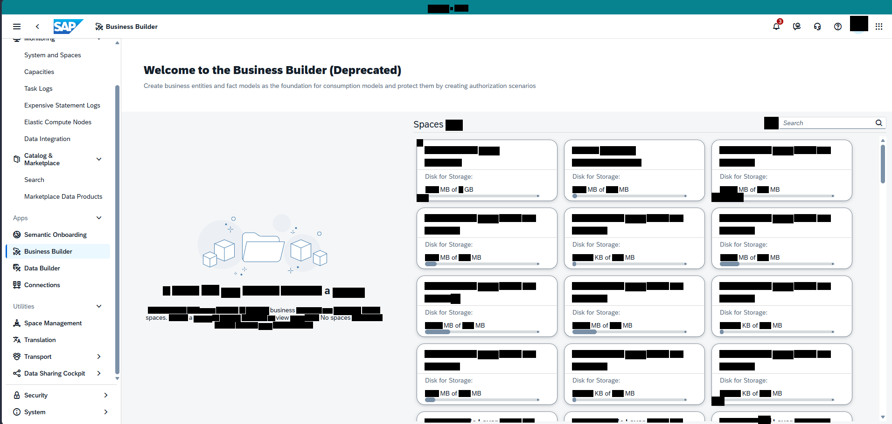

Bildformat: 1912 × 911 Pixel. Die folgenden Positionen beziehen sich auf dieses vollständige Bild.

## 1. Gesamtaufbau und sichtbarer Zustand

### Gesamtansicht

Oben steht „Welcome to the Business Builder (Deprecated)“. Darunter befindet sich ein erklärender Satz zu Business Entities, Fact Models, Consumption Models und Authorization Scenarios. Der restliche Hauptbereich zeigt Space-Karten.

### Links und oben

Am linken Rand bleibt die globale Navigation sichtbar. Unterhalb der Begrüßung steht „Spaces“. Im rechten Bereich oberhalb des Rasters ist ein Suchfeld angeordnet.

### Hauptbereich

Mehrere Karten stehen in einem regelmäßigen Raster mit mehreren Spalten. Jede Karte enthält einen Bezeichnungsbereich und die Beschriftung „Disk for Storage“. Sichtbare Einheiten sind MB und GB. Die Karten zeigen kleine Symbole und eine helle, klar abgegrenzte Fläche. Die untersten Karten werden vom unteren Bildrand angeschnitten.

### Abgrenzung der Ansicht

Es ist kein Business-Entity-Editor geöffnet. Das Bild zeigt ausschließlich die vorgeschaltete Übersicht mit den auswählbaren Karten. Die Kennzeichnung „Deprecated“ steht direkt in der Begrüßungsüberschrift und ist Bestandteil der sichtbaren Oberfläche.

## 2. Räumliche Beschreibung von oben nach unten

### Kopfbereich

**Ungefähre Bildregion:** x 16–97 %, y 10–25 %

Welcome to the Business Builder mit dem Zusatz Deprecated steht oben. Der Erklärungstext folgt unmittelbar darunter. Spaces liegt unter dem Text links, das Suchfeld auf gleicher Höhe rechts.

### Kartenraster

**Ungefähre Bildregion:** x 16–97 %, y 26–100 %

Drei Karten pro Reihe. Titelbereich und Speicherzeile sind vertikal innerhalb jeder Karte angeordnet. Die Karten sind durch gleichmäßige Zwischenräume getrennt; am unteren Rand werden weitere Karten angeschnitten.

## 3. Positionsverzeichnis der lesbaren Beschriftungen

Sortierung nach Bildhöhe, innerhalb derselben Höhe von links nach rechts. Angegeben sind Textbegrenzungen; Abstände und Bedienelementflächen können darüber hinausreichen.

<table>
<colgroup>
<col style="width: 33%" />
<col style="width: 30%" />
<col style="width: 35%" />
</colgroup>
<thead>
<tr class="header">
<th>Sichtbarer Text</th>
<th>Textposition in Pixeln</th>
<th>Relative Lage im Bild</th>
</tr>
</thead>
<tbody>
<tr class="odd">
<td>Business Builder</td>
<td>x 228–338 
y 52–62</td>
<td>oben, links 
x 11.9–17.7 % 
y 5.7–6.8 %</td>
</tr>
<tr class="even">
<td>System and Spaces</td>
<td>x 53–173 
y 113–126</td>
<td>oben, links 
x 2.8–9.0 % 
y 12.4–13.8 %</td>
</tr>
<tr class="odd">
<td>Capacities</td>
<td>x 52–116 
y 149–162</td>
<td>oben, links 
x 2.7–6.1 % 
y 16.4–17.8 %</td>
</tr>
<tr class="even">
<td>Welcome to the Business Builder</td>
<td>x 308–700 
y 140–159</td>
<td>oben, links 
x 16.1–36.6 % 
y 15.4–17.5 %</td>
</tr>
<tr class="odd">
<td>(Deprecated)</td>
<td>x 707–860 
y 141–164</td>
<td>oben, mittig 
x 37.0–45.0 % 
y 15.5–18.0 %</td>
</tr>
<tr class="even">
<td>Task Logs</td>
<td>x 52–112 
y 185–198</td>
<td>oben, links 
x 2.7–5.9 % 
y 20.3–21.7 %</td>
</tr>
<tr class="odd">
<td>Expensive Statement Logs</td>
<td>x 53–215 
y 221–234</td>
<td>oben, links 
x 2.8–11.2 % 
y 24.3–25.7 %</td>
</tr>
<tr class="even">
<td>Elastic Compute Nodes</td>
<td>x 53–196 
y 257–270</td>
<td>oben, links 
x 2.8–10.3 % 
y 28.2–29.6 %</td>
</tr>
<tr class="odd">
<td>Spaces</td>
<td>x 887–950 
y 260–278</td>
<td>oben, mittig 
x 46.4–49.7 % 
y 28.5–30.5 %</td>
</tr>
<tr class="even">
<td>Search</td>
<td>x 1680–1721 
y 259–269</td>
<td>oben, rechts 
x 87.9–90.0 % 
y 28.4–29.5 %</td>
</tr>
<tr class="odd">
<td>Data Integration</td>
<td>x 53–150 
y 293–306</td>
<td>oben, links 
x 2.8–7.8 % 
y 32.2–33.6 %</td>
</tr>
<tr class="even">
<td>Disk for Storage:</td>
<td>x 912–1012 
y 374–387</td>
<td>auf mittlerer Höhe, mittig 
x 47.7–52.9 % 
y 41.1–42.5 %</td>
</tr>
<tr class="odd">
<td>Disk for Storage:</td>
<td>x 1228–1328 
y 374–387</td>
<td>auf mittlerer Höhe, mittig 
x 64.2–69.5 % 
y 41.1–42.5 %</td>
</tr>
<tr class="even">
<td>Disk for Storage:</td>
<td>x 1544–1644 
y 374–387</td>
<td>auf mittlerer Höhe, rechts 
x 80.8–86.0 % 
y 41.1–42.5 %</td>
</tr>
<tr class="odd">
<td>Search</td>
<td>x 53–94 
y 381–391</td>
<td>auf mittlerer Höhe, links 
x 2.8–4.9 % 
y 41.8–42.9 %</td>
</tr>
<tr class="even">
<td>of</td>
<td>x 968–984 
y 395–418</td>
<td>auf mittlerer Höhe, mittig 
x 50.6–51.4 % 
y 43.4–45.8 %</td>
</tr>
<tr class="odd">
<td>of</td>
<td>x 1282–1296 
y 402–412</td>
<td>auf mittlerer Höhe, rechts 
x 67.0–67.8 % 
y 44.1–45.2 %</td>
</tr>
<tr class="even">
<td>of</td>
<td>x 1608–1620 
y 402–412</td>
<td>auf mittlerer Höhe, rechts 
x 84.1–84.7 % 
y 44.1–45.2 %</td>
</tr>
<tr class="odd">
<td>MB</td>
<td>x 1652–1671 
y 402–412</td>
<td>auf mittlerer Höhe, rechts 
x 86.4–87.4 % 
y 44.1–45.2 %</td>
</tr>
<tr class="even">
<td>Apps</td>
<td>x 28–59 
y 463–476</td>
<td>auf mittlerer Höhe, links 
x 1.5–3.1 % 
y 50.8–52.3 %</td>
</tr>
<tr class="odd">
<td>Semantic Onboarding</td>
<td>x 52–186 
y 499–512</td>
<td>auf mittlerer Höhe, links 
x 2.7–9.7 % 
y 54.8–56.2 %</td>
</tr>
<tr class="even">
<td>Disk for Storage:</td>
<td>x 912–1012 
y 520–533</td>
<td>auf mittlerer Höhe, mittig 
x 47.7–52.9 % 
y 57.1–58.5 %</td>
</tr>
<tr class="odd">
<td>Disk for Storage:</td>
<td>x 1228–1328 
y 520–533</td>
<td>auf mittlerer Höhe, mittig 
x 64.2–69.5 % 
y 57.1–58.5 %</td>
</tr>
<tr class="even">
<td>Disk for Storage:</td>
<td>x 1544–1644 
y 520–533</td>
<td>auf mittlerer Höhe, rechts 
x 80.8–86.0 % 
y 57.1–58.5 %</td>
</tr>
<tr class="odd">
<td>Business Builder</td>
<td>x 53–155 
y 535–545</td>
<td>auf mittlerer Höhe, links 
x 2.8–8.1 % 
y 58.7–59.8 %</td>
</tr>
<tr class="even">
<td>of</td>
<td>x 968–980 
y 548–558</td>
<td>auf mittlerer Höhe, mittig 
x 50.6–51.2 % 
y 60.2–61.3 %</td>
</tr>
<tr class="odd">
<td>of</td>
<td>x 1297–1308 
y 548–558</td>
<td>auf mittlerer Höhe, rechts 
x 67.8–68.4 % 
y 60.2–61.3 %</td>
</tr>
<tr class="even">
<td>of</td>
<td>x 1608–1620 
y 548–558</td>
<td>auf mittlerer Höhe, rechts 
x 84.1–84.7 % 
y 60.2–61.3 %</td>
</tr>
<tr class="odd">
<td>Data Builder</td>
<td>x 53–129 
y 571–581</td>
<td>auf mittlerer Höhe, links 
x 2.8–6.7 % 
y 62.7–63.8 %</td>
</tr>
<tr class="even">
<td>Connections</td>
<td>x 52–128 
y 607–617</td>
<td>unten, links 
x 2.7–6.7 % 
y 66.6–67.7 %</td>
</tr>
<tr class="odd">
<td>Utilities</td>
<td>x 29–73 
y 653–663</td>
<td>unten, links 
x 1.5–3.8 % 
y 71.7–72.8 %</td>
</tr>
<tr class="even">
<td>Disk for Storage:</td>
<td>x 912–1012 
y 666–679</td>
<td>unten, mittig 
x 47.7–52.9 % 
y 73.1–74.5 %</td>
</tr>
<tr class="odd">
<td>Disk for Storage:</td>
<td>x 1228–1328 
y 666–679</td>
<td>unten, mittig 
x 64.2–69.5 % 
y 73.1–74.5 %</td>
</tr>
<tr class="even">
<td>Disk for Storage:</td>
<td>x 1544–1644 
y 666–679</td>
<td>unten, rechts 
x 80.8–86.0 % 
y 73.1–74.5 %</td>
</tr>
<tr class="odd">
<td>Space Management</td>
<td>x 52–175 
y 689–702</td>
<td>unten, links 
x 2.7–9.2 % 
y 75.6–77.1 %</td>
</tr>
<tr class="even">
<td>spaces.</td>
<td>x 313–358 
y 680–690</td>
<td>unten, links 
x 16.4–18.7 % 
y 74.6–75.7 %</td>
</tr>
<tr class="odd">
<td>spaces</td>
<td>x 709–751 
y 680–690</td>
<td>unten, mittig 
x 37.1–39.3 % 
y 74.6–75.7 %</td>
</tr>
<tr class="even">
<td>of</td>
<td>x 976–988 
y 694–704</td>
<td>unten, mittig 
x 51.0–51.7 % 
y 76.2–77.3 %</td>
</tr>
<tr class="odd">
<td>of</td>
<td>x 1292–1304 
y 694–704</td>
<td>unten, rechts 
x 67.6–68.2 % 
y 76.2–77.3 %</td>
</tr>
<tr class="even">
<td>of</td>
<td>x 1613–1624 
y 694–704</td>
<td>unten, rechts 
x 84.4–84.9 % 
y 76.2–77.3 %</td>
</tr>
<tr class="odd">
<td>Translation</td>
<td>x 52–119 
y 725–735</td>
<td>unten, links 
x 2.7–6.2 % 
y 79.6–80.7 %</td>
</tr>
<tr class="even">
<td>Transport</td>
<td>x 52–110 
y 761–774</td>
<td>unten, links 
x 2.7–5.8 % 
y 83.5–85.0 %</td>
</tr>
<tr class="odd">
<td>Data Sharing Cockpit</td>
<td>x 53–182 
y 797–810</td>
<td>unten, links 
x 2.8–9.5 % 
y 87.5–88.9 %</td>
</tr>
<tr class="even">
<td>Disk for Storage:</td>
<td>x 912–1012 
y 812–825</td>
<td>unten, mittig 
x 47.7–52.9 % 
y 89.1–90.6 %</td>
</tr>
<tr class="odd">
<td>Disk for Storage:</td>
<td>x 1228–1328 
y 812–825</td>
<td>unten, mittig 
x 64.2–69.5 % 
y 89.1–90.6 %</td>
</tr>
<tr class="even">
<td>Disk for Storage:</td>
<td>x 1544–1644 
y 812–825</td>
<td>unten, rechts 
x 80.8–86.0 % 
y 89.1–90.6 %</td>
</tr>
<tr class="odd">
<td>Security</td>
<td>x 52–102 
y 844–857</td>
<td>unten, links 
x 2.7–5.3 % 
y 92.6–94.1 %</td>
</tr>
<tr class="even">
<td>of</td>
<td>x 966–980 
y 840–850</td>
<td>unten, mittig 
x 50.5–51.2 % 
y 92.2–93.3 %</td>
</tr>
<tr class="odd">
<td>of</td>
<td>x 1297–1308 
y 840–850</td>
<td>unten, rechts 
x 67.8–68.4 % 
y 92.2–93.3 %</td>
</tr>
<tr class="even">
<td>of</td>
<td>x 1613–1625 
y 840–850</td>
<td>unten, rechts 
x 84.4–85.0 % 
y 92.2–93.3 %</td>
</tr>
<tr class="odd">
<td>MB</td>
<td>x 1660–1676 
y 840–850</td>
<td>unten, rechts 
x 86.8–87.7 % 
y 92.2–93.3 %</td>
</tr>
<tr class="even">
<td>System</td>
<td>x 52–97 
y 880–893</td>
<td>unten, links 
x 2.7–5.1 % 
y 96.6–98.0 %</td>
</tr>
</tbody>
</table>

## 4. Abgrenzung

Die Beschreibung benennt nur den sichtbaren Zustand dieses Screenshots. Aus Symbolen ohne lesbare Beschriftung wird keine konkrete Funktion abgeleitet. Inhalte hinter schwarzen Balken und nicht sichtbare Bereiche außerhalb des Bildrandes bleiben unbeschrieben.

# Bild 9: Data Builder: Space-Auswahl

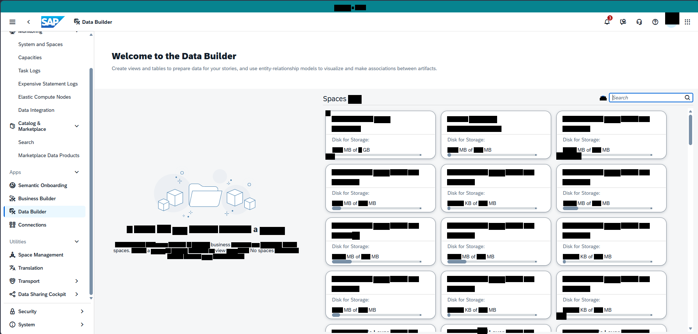

Bildformat: 1911 × 914 Pixel. Die folgenden Positionen beziehen sich auf dieses vollständige Bild.

## 1. Gesamtaufbau und sichtbarer Zustand

### Gesamtansicht

Der Hauptbereich beginnt mit „Welcome to the Data Builder“. Darunter steht ein kurzer Text zu Views, Tabellen und Entity-Relationship-Modellen. Anschließend folgt eine Übersicht von Space-Karten.

### Navigation und Kopfbereich

Links steht die globale Navigation. Unter der Begrüßung befindet sich die Überschrift „Spaces“. Ein Suchfeld liegt oberhalb der Karten im rechten Teil des Hauptbereichs.

### Karten und räumliche Anordnung

Die Karten sind in mehreren Reihen und Spalten angeordnet. Jede Karte enthält einen oberen Titelbereich und darunter Speicherinformationen mit „Disk for Storage“. Einheiten wie MB und GB bleiben sichtbar. Die Karten sind durch helle Rahmen, abgerundete Ecken und regelmäßige Abstände voneinander getrennt.

### Sichtbarer Zustand

Der Screenshot zeigt noch keine geöffnete Tabelle, View oder Modellierungsfläche. Die Auswahlübersicht füllt fast den gesamten Hauptbereich. Weitere Karten sind am unteren Rand nur teilweise sichtbar. Ein Dialog oder ein seitliches Detailfenster ist nicht eingeblendet.

## 2. Räumliche Beschreibung von oben nach unten

### Kopfbereich

**Ungefähre Bildregion:** x 16–97 %, y 10–25 %

Welcome to the Data Builder steht links oben im Hauptbereich. Der Beschreibungssatz liegt darunter. Spaces und das Suchfeld bilden die Zeile direkt oberhalb der Karten.

### Auswahlkarten

**Ungefähre Bildregion:** x 16–97 %, y 26–100 %

Drei Spalten mit wiederkehrenden Karten. Jede Karte zeigt einen oberen Titelbereich, kleine grafische Elemente und darunter Disk for Storage. Die unteren Reihen reichen über den sichtbaren Bildausschnitt hinaus.

## 3. Positionsverzeichnis der lesbaren Beschriftungen

Sortierung nach Bildhöhe, innerhalb derselben Höhe von links nach rechts. Angegeben sind Textbegrenzungen; Abstände und Bedienelementflächen können darüber hinausreichen.

<table>
<colgroup>
<col style="width: 33%" />
<col style="width: 30%" />
<col style="width: 35%" />
</colgroup>
<thead>
<tr class="header">
<th>Sichtbarer Text</th>
<th>Textposition in Pixeln</th>
<th>Relative Lage im Bild</th>
</tr>
</thead>
<tbody>
<tr class="odd">
<td>Data Builder</td>
<td>x 226–307 
y 55–65</td>
<td>oben, links 
x 11.8–16.1 % 
y 6.0–7.1 %</td>
</tr>
<tr class="even">
<td>System and Spaces</td>
<td>x 51–171 
y 116–129</td>
<td>oben, links 
x 2.7–8.9 % 
y 12.7–14.1 %</td>
</tr>
<tr class="odd">
<td>Welcome to the Data Builder</td>
<td>x 306–647 
y 143–162</td>
<td>oben, links 
x 16.0–33.9 % 
y 15.6–17.7 %</td>
</tr>
<tr class="even">
<td>Capacities</td>
<td>x 50–114 
y 152–165</td>
<td>oben, links 
x 2.6–6.0 % 
y 16.6–18.1 %</td>
</tr>
<tr class="odd">
<td>views</td>
<td>x 351–385 
y 182–192</td>
<td>oben, links 
x 18.4–20.1 % 
y 20.0–21.0 %</td>
</tr>
<tr class="even">
<td>tables</td>
<td>x 416–453 
y 182–192</td>
<td>oben, links 
x 21.8–23.7 % 
y 19.9–21.0 %</td>
</tr>
<tr class="odd">
<td>Task Logs</td>
<td>x 50–110 
y 188–201</td>
<td>oben, links 
x 2.6–5.8 % 
y 20.6–22.0 %</td>
</tr>
<tr class="even">
<td>Expensive Statement Logs</td>
<td>x 51–213 
y 224–237</td>
<td>oben, links 
x 2.7–11.1 % 
y 24.5–25.9 %</td>
</tr>
<tr class="odd">
<td>Elastic Compute Nodes</td>
<td>x 51–194 
y 260–273</td>
<td>oben, links 
x 2.7–10.2 % 
y 28.4–29.9 %</td>
</tr>
<tr class="even">
<td>Spaces</td>
<td>x 885–948 
y 263–281</td>
<td>oben, mittig 
x 46.3–49.6 % 
y 28.8–30.7 %</td>
</tr>
<tr class="odd">
<td>search</td>
<td>x 1677–1719 
y 259–275</td>
<td>oben, rechts 
x 87.8–90.0 % 
y 28.3–30.1 %</td>
</tr>
<tr class="even">
<td>Data Integration</td>
<td>x 51–148 
y 296–309</td>
<td>auf mittlerer Höhe, links 
x 2.7–7.7 % 
y 32.4–33.8 %</td>
</tr>
<tr class="odd">
<td>Disk for Storage:</td>
<td>x 910–1010 
y 377–390</td>
<td>auf mittlerer Höhe, mittig 
x 47.6–52.9 % 
y 41.2–42.7 %</td>
</tr>
<tr class="even">
<td>Disk for Storage:</td>
<td>x 1226–1326 
y 377–390</td>
<td>auf mittlerer Höhe, mittig 
x 64.2–69.4 % 
y 41.2–42.7 %</td>
</tr>
<tr class="odd">
<td>Disk for Storage:</td>
<td>x 1542–1642 
y 377–390</td>
<td>auf mittlerer Höhe, rechts 
x 80.7–85.9 % 
y 41.2–42.7 %</td>
</tr>
<tr class="even">
<td>Search</td>
<td>x 51–92 
y 384–394</td>
<td>auf mittlerer Höhe, links 
x 2.7–4.8 % 
y 42.0–43.1 %</td>
</tr>
<tr class="odd">
<td>of</td>
<td>x 966–982 
y 398–420</td>
<td>auf mittlerer Höhe, mittig 
x 50.5–51.4 % 
y 43.5–46.0 %</td>
</tr>
<tr class="even">
<td>of</td>
<td>x 1280–1294 
y 405–415</td>
<td>auf mittlerer Höhe, rechts 
x 67.0–67.7 % 
y 44.3–45.4 %</td>
</tr>
<tr class="odd">
<td>of</td>
<td>x 1606–1618 
y 405–415</td>
<td>auf mittlerer Höhe, rechts 
x 84.0–84.7 % 
y 44.3–45.4 %</td>
</tr>
<tr class="even">
<td>MB</td>
<td>x 1650–1669 
y 405–415</td>
<td>auf mittlerer Höhe, rechts 
x 86.3–87.3 % 
y 44.3–45.4 %</td>
</tr>
<tr class="odd">
<td>Apps</td>
<td>x 26–57 
y 466–479</td>
<td>auf mittlerer Höhe, links 
x 1.4–3.0 % 
y 51.0–52.4 %</td>
</tr>
<tr class="even">
<td>Semantic Onboarding</td>
<td>x 50–184 
y 502–515</td>
<td>auf mittlerer Höhe, links 
x 2.6–9.6 % 
y 54.9–56.3 %</td>
</tr>
<tr class="odd">
<td>Disk for Storage:</td>
<td>x 910–1010 
y 523–536</td>
<td>auf mittlerer Höhe, mittig 
x 47.6–52.9 % 
y 57.2–58.6 %</td>
</tr>
<tr class="even">
<td>Disk for Storage:</td>
<td>x 1226–1326 
y 523–536</td>
<td>auf mittlerer Höhe, mittig 
x 64.2–69.4 % 
y 57.2–58.6 %</td>
</tr>
<tr class="odd">
<td>Disk for Storage:</td>
<td>x 1542–1642 
y 523–536</td>
<td>auf mittlerer Höhe, rechts 
x 80.7–85.9 % 
y 57.2–58.6 %</td>
</tr>
<tr class="even">
<td>Business Builder</td>
<td>x 51–153 
y 538–548</td>
<td>auf mittlerer Höhe, links 
x 2.7–8.0 % 
y 58.9–60.0 %</td>
</tr>
<tr class="odd">
<td>of</td>
<td>x 966–978 
y 551–561</td>
<td>auf mittlerer Höhe, mittig 
x 50.5–51.2 % 
y 60.3–61.4 %</td>
</tr>
<tr class="even">
<td>of</td>
<td>x 1295–1306 
y 551–561</td>
<td>auf mittlerer Höhe, rechts 
x 67.8–68.3 % 
y 60.3–61.4 %</td>
</tr>
<tr class="odd">
<td>of</td>
<td>x 1606–1618 
y 551–561</td>
<td>auf mittlerer Höhe, rechts 
x 84.0–84.7 % 
y 60.3–61.4 %</td>
</tr>
<tr class="even">
<td>Data Builder</td>
<td>x 51–127 
y 574–584</td>
<td>auf mittlerer Höhe, links 
x 2.7–6.6 % 
y 62.8–63.9 %</td>
</tr>
<tr class="odd">
<td>Connections</td>
<td>x 50–126 
y 610–620</td>
<td>unten, links 
x 2.6–6.6 % 
y 66.7–67.8 %</td>
</tr>
<tr class="even">
<td>Utilities</td>
<td>x 27–71 
y 656–666</td>
<td>unten, links 
x 1.4–3.7 % 
y 71.8–72.9 %</td>
</tr>
<tr class="odd">
<td>Disk for Storage:</td>
<td>x 910–1010 
y 669–682</td>
<td>unten, mittig 
x 47.6–52.9 % 
y 73.2–74.6 %</td>
</tr>
<tr class="even">
<td>Disk for Storage:</td>
<td>x 1226–1326 
y 669–682</td>
<td>unten, mittig 
x 64.2–69.4 % 
y 73.2–74.6 %</td>
</tr>
<tr class="odd">
<td>Disk for Storage:</td>
<td>x 1542–1642 
y 669–682</td>
<td>unten, rechts 
x 80.7–85.9 % 
y 73.2–74.6 %</td>
</tr>
<tr class="even">
<td>spaces.</td>
<td>x 311–356 
y 683–693</td>
<td>unten, links 
x 16.3–18.6 % 
y 74.7–75.8 %</td>
</tr>
<tr class="odd">
<td>spaces</td>
<td>x 707–749 
y 683–693</td>
<td>unten, mittig 
x 37.0–39.2 % 
y 74.7–75.8 %</td>
</tr>
<tr class="even">
<td>Space Management</td>
<td>x 50–173 
y 692–705</td>
<td>unten, links 
x 2.6–9.1 % 
y 75.7–77.1 %</td>
</tr>
<tr class="odd">
<td>of</td>
<td>x 974–986 
y 697–707</td>
<td>unten, mittig 
x 51.0–51.6 % 
y 76.3–77.4 %</td>
</tr>
<tr class="even">
<td>of</td>
<td>x 1290–1302 
y 697–707</td>
<td>unten, rechts 
x 67.5–68.1 % 
y 76.3–77.4 %</td>
</tr>
<tr class="odd">
<td>of</td>
<td>x 1611–1622 
y 697–707</td>
<td>unten, rechts 
x 84.3–84.9 % 
y 76.3–77.4 %</td>
</tr>
<tr class="even">
<td>Translation</td>
<td>x 50–117 
y 728–738</td>
<td>unten, links 
x 2.6–6.1 % 
y 79.6–80.7 %</td>
</tr>
<tr class="odd">
<td>Transport</td>
<td>x 50–108 
y 764–777</td>
<td>unten, links 
x 2.6–5.7 % 
y 83.6–85.0 %</td>
</tr>
<tr class="even">
<td>Data Sharing Cockpit</td>
<td>x 51–180 
y 800–813</td>
<td>unten, links 
x 2.7–9.4 % 
y 87.5–88.9 %</td>
</tr>
<tr class="odd">
<td>Disk for Storage:</td>
<td>x 910–1010 
y 815–828</td>
<td>unten, mittig 
x 47.6–52.9 % 
y 89.2–90.6 %</td>
</tr>
<tr class="even">
<td>Disk for Storage:</td>
<td>x 1226–1326 
y 815–828</td>
<td>unten, mittig 
x 64.2–69.4 % 
y 89.2–90.6 %</td>
</tr>
<tr class="odd">
<td>Disk for Storage:</td>
<td>x 1542–1642 
y 815–828</td>
<td>unten, rechts 
x 80.7–85.9 % 
y 89.2–90.6 %</td>
</tr>
<tr class="even">
<td>of</td>
<td>x 964–978 
y 843–853</td>
<td>unten, mittig 
x 50.4–51.2 % 
y 92.2–93.3 %</td>
</tr>
<tr class="odd">
<td>of</td>
<td>x 1295–1306 
y 843–853</td>
<td>unten, rechts 
x 67.8–68.3 % 
y 92.2–93.3 %</td>
</tr>
<tr class="even">
<td>of</td>
<td>x 1611–1623 
y 843–853</td>
<td>unten, rechts 
x 84.3–84.9 % 
y 92.2–93.3 %</td>
</tr>
<tr class="odd">
<td>MB</td>
<td>x 1658–1674 
y 843–853</td>
<td>unten, rechts 
x 86.7–87.6 % 
y 92.2–93.3 %</td>
</tr>
<tr class="even">
<td>Security</td>
<td>x 50–100 
y 847–860</td>
<td>unten, links 
x 2.6–5.2 % 
y 92.7–94.1 %</td>
</tr>
<tr class="odd">
<td>System</td>
<td>x 50–95 
y 883–896</td>
<td>unten, links 
x 2.6–5.0 % 
y 96.6–98.0 %</td>
</tr>
</tbody>
</table>

## 4. Abgrenzung

Die Beschreibung benennt nur den sichtbaren Zustand dieses Screenshots. Aus Symbolen ohne lesbare Beschriftung wird keine konkrete Funktion abgeleitet. Inhalte hinter schwarzen Balken und nicht sichtbare Bereiche außerhalb des Bildrandes bleiben unbeschrieben.

# Bild 10: Semantic Onboarding: Systeme und Inhalte

Bildformat: 1911 × 906 Pixel. Die folgenden Positionen beziehen sich auf dieses vollständige Bild.

## 1. Gesamtaufbau und sichtbarer Zustand

### Gesamtansicht

Die Seite „Semantic Onboarding“ zeigt zwei große Inhaltsgruppen untereinander. Links befindet sich die globale Navigation. Im Kopfbereich steht eine große Überschrift mit einem erklärenden Satz.

### Oberer Abschnitt

Die erste Gruppe heißt „SAP Systems“. Darin sind mehrere Systemkacheln horizontal nebeneinander angeordnet: SAP S/4HANA Cloud, SAP S/4HANA On Premise, SAP BW/4HANA, SAP BW Bridge und SAP HANA. Jede Kachel besitzt einen Namen und ein grafisches Symbol. Unter den Kacheln stehen Angaben wie Connections; bei SAP BW Bridge ist „Not Enabled“ sichtbar. Rechts oben in diesem Abschnitt befindet sich „Open Import Logs“.

### Unterer Abschnitt

Die zweite Gruppe trägt die Überschrift „Content Network“. Hier stehen die Bereiche Samples, Business Content und 3rd Party Business Content nebeneinander. Unter jedem Titel befindet sich ein kurzer Beschreibungstext. Die Bereiche sind mit eigenen Symbolen versehen.

### Darstellung

Die Systemgruppe und die Inhaltsgruppe sind durch deutliche vertikale Abstände getrennt. Links neben den Gruppenüberschriften stehen kleine Aufklappsymbole. Die Oberfläche zeigt eine Übersicht, ohne dass eine Systemkachel geöffnet oder ein Importdialog eingeblendet ist.

## 2. Räumliche Beschreibung von oben nach unten

### Seitentitel

**Ungefähre Bildregion:** x 41–70 %, y 13–18 %

Semantic Onboarding steht groß im oberen Hauptbereich, mit einem Symbol links daneben. Der erklärende Satz ist darunter horizontal angeordnet.

### SAP-Systeme

**Ungefähre Bildregion:** x 16–98 %, y 30–53 %

SAP Systems steht links über einer Reihe aus fünf Systembereichen. Von links nach rechts: SAP S/4HANA Cloud, SAP S/4HANA On Premise, SAP BW/4HANA, SAP BW Bridge und SAP HANA. Jeder Bereich hat einen Titel oben, ein grafisches Symbol darunter und eine Zusatzzeile im unteren Teil. Open Import Logs liegt rechts auf Höhe der Gruppenüberschrift.

### Content Network

**Ungefähre Bildregion:** x 16–98 %, y 60–81 %

Die zweite Gruppenüberschrift steht links. Darunter folgen drei Bereiche: Samples links, Business Content mittig und 3rd Party Business Content rechts. Zu jedem Bereich gehört ein Symbol und ein kurzer Absatz unterhalb des Titels.

## 3. Positionsverzeichnis der lesbaren Beschriftungen

Sortierung nach Bildhöhe, innerhalb derselben Höhe von links nach rechts. Angegeben sind Textbegrenzungen; Abstände und Bedienelementflächen können darüber hinausreichen.

<table>
<colgroup>
<col style="width: 33%" />
<col style="width: 30%" />
<col style="width: 35%" />
</colgroup>
<thead>
<tr class="header">
<th>Sichtbarer Text</th>
<th>Textposition in Pixeln</th>
<th>Relative Lage im Bild</th>
</tr>
</thead>
<tbody>
<tr class="odd">
<td>Semantic Onboarding</td>
<td>x 219–363 
y 42–58</td>
<td>oben, links 
x 11.5–19.0 % 
y 4.6–6.4 %</td>
</tr>
<tr class="even">
<td>System and Spaces</td>
<td>x 44–166 
y 106–119</td>
<td>oben, links 
x 2.3–8.7 % 
y 11.7–13.1 %</td>
</tr>
<tr class="odd">
<td>Semantic Onboarding</td>
<td>x 860–1350 
y 124–170</td>
<td>oben, mittig 
x 45.0–70.7 % 
y 13.7–18.8 %</td>
</tr>
<tr class="even">
<td>Capacities</td>
<td>x 44–108 
y 142–155</td>
<td>oben, links 
x 2.3–5.7 % 
y 15.7–17.1 %</td>
</tr>
<tr class="odd">
<td>Task Logs</td>
<td>x 44–104 
y 178–191</td>
<td>oben, links 
x 2.3–5.5 % 
y 19.6–21.1 %</td>
</tr>
<tr class="even">
<td>from</td>
<td>x 858–892 
y 206–217</td>
<td>oben, mittig 
x 44.9–46.7 % 
y 22.7–24.0 %</td>
</tr>
<tr class="odd">
<td>SAP systems,</td>
<td>x 899–999 
y 206–220</td>
<td>oben, mittig 
x 47.0–52.3 % 
y 22.7–24.3 %</td>
</tr>
<tr class="even">
<td>Content Network,</td>
<td>x 1070–1200 
y 206–220</td>
<td>oben, mittig 
x 56.0–62.8 % 
y 22.7–24.3 %</td>
</tr>
<tr class="odd">
<td>other data</td>
<td>x 1490–1566 
y 206–217</td>
<td>oben, rechts 
x 78.0–81.9 % 
y 22.7–24.0 %</td>
</tr>
<tr class="even">
<td>Expensive Statement Logs</td>
<td>x 45–207 
y 214–227</td>
<td>oben, links 
x 2.4–10.8 % 
y 23.6–25.1 %</td>
</tr>
<tr class="odd">
<td>Elastic Compute Nodes</td>
<td>x 45–188 
y 250–263</td>
<td>oben, links 
x 2.4–9.8 % 
y 27.6–29.0 %</td>
</tr>
<tr class="even">
<td>SAP Systems</td>
<td>x 368–455 
y 279–292</td>
<td>oben, links 
x 19.3–23.8 % 
y 30.8–32.2 %</td>
</tr>
<tr class="odd">
<td>Open Import Logs</td>
<td>x 1734–1844 
y 279–292</td>
<td>oben, rechts 
x 90.7–96.5 % 
y 30.8–32.2 %</td>
</tr>
<tr class="even">
<td>Data Integration</td>
<td>x 45–142 
y 286–299</td>
<td>oben, links 
x 2.4–7.5 % 
y 31.6–33.0 %</td>
</tr>
<tr class="odd">
<td>SAP S/4HANA Cloud</td>
<td>x 394–528 
y 339–349</td>
<td>auf mittlerer Höhe, links 
x 20.6–27.6 % 
y 37.4–38.5 %</td>
</tr>
<tr class="even">
<td>SAP BW Bridge</td>
<td>x 1258–1358 
y 339–352</td>
<td>auf mittlerer Höhe, rechts 
x 65.8–71.1 % 
y 37.4–38.9 %</td>
</tr>
<tr class="odd">
<td>SAP HANA</td>
<td>x 1546–1616 
y 339–349</td>
<td>auf mittlerer Höhe, rechts 
x 80.9–84.6 % 
y 37.4–38.5 %</td>
</tr>
<tr class="even">
<td>Search</td>
<td>x 44–86 
y 374–384</td>
<td>auf mittlerer Höhe, links 
x 2.3–4.5 % 
y 41.3–42.4 %</td>
</tr>
<tr class="odd">
<td>Apps</td>
<td>x 20–51 
y 456–469</td>
<td>auf mittlerer Höhe, links 
x 1.0–2.7 % 
y 50.3–51.8 %</td>
</tr>
<tr class="even">
<td>Connections</td>
<td>x 394–470 
y 457–467</td>
<td>auf mittlerer Höhe, links 
x 20.6–24.6 % 
y 50.4–51.5 %</td>
</tr>
<tr class="odd">
<td>Connections</td>
<td>x 682–758 
y 457–467</td>
<td>auf mittlerer Höhe, mittig 
x 35.7–39.6 % 
y 50.4–51.5 %</td>
</tr>
<tr class="even">
<td>Connections</td>
<td>x 970–1046 
y 457–467</td>
<td>auf mittlerer Höhe, mittig 
x 50.7–54.7 % 
y 50.4–51.5 %</td>
</tr>
<tr class="odd">
<td>Not Enabled</td>
<td>x 1258–1333 
y 457–467</td>
<td>auf mittlerer Höhe, rechts 
x 65.8–69.8 % 
y 50.4–51.5 %</td>
</tr>
<tr class="even">
<td>Connections</td>
<td>x 1546–1622 
y 457–467</td>
<td>auf mittlerer Höhe, rechts 
x 80.9–84.9 % 
y 50.4–51.5 %</td>
</tr>
<tr class="odd">
<td>Business Builder</td>
<td>x 44–147 
y 528–538</td>
<td>auf mittlerer Höhe, links 
x 2.3–7.7 % 
y 58.3–59.4 %</td>
</tr>
<tr class="even">
<td>Content Network</td>
<td>x 368–480 
y 548–558</td>
<td>auf mittlerer Höhe, links 
x 19.3–25.1 % 
y 60.5–61.6 %</td>
</tr>
<tr class="odd">
<td>Data Builder</td>
<td>x 44–121 
y 564–574</td>
<td>auf mittlerer Höhe, links 
x 2.3–6.3 % 
y 62.3–63.4 %</td>
</tr>
<tr class="even">
<td>Connections</td>
<td>x 44–120 
y 600–610</td>
<td>auf mittlerer Höhe, links 
x 2.3–6.3 % 
y 66.2–67.3 %</td>
</tr>
<tr class="odd">
<td>Samples</td>
<td>x 538–593 
y 608–621</td>
<td>unten, links 
x 28.1–31.0 % 
y 67.1–68.5 %</td>
</tr>
<tr class="even">
<td>Business Content</td>
<td>x 922–1037 
y 608–618</td>
<td>unten, mittig 
x 48.2–54.3 % 
y 67.1–68.2 %</td>
</tr>
<tr class="odd">
<td>3rd Party Business Content</td>
<td>x 1305–1485 
y 608–621</td>
<td>unten, rechts 
x 68.3–77.7 % 
y 67.1–68.5 %</td>
</tr>
<tr class="even">
<td>Utilities</td>
<td>x 21–65 
y 646–656</td>
<td>unten, links 
x 1.1–3.4 % 
y 71.3–72.4 %</td>
</tr>
<tr class="odd">
<td>Space Management</td>
<td>x 44–167 
y 682–695</td>
<td>unten, links 
x 2.3–8.7 % 
y 75.3–76.7 %</td>
</tr>
<tr class="even">
<td>from</td>
<td>x 609–637 
y 699–709</td>
<td>unten, links 
x 31.9–33.3 % 
y 77.2–78.3 %</td>
</tr>
<tr class="odd">
<td>of</td>
<td>x 716–728 
y 699–709</td>
<td>unten, mittig 
x 37.5–38.1 % 
y 77.2–78.3 %</td>
</tr>
<tr class="even">
<td>of</td>
<td>x 1087–1099 
y 699–709</td>
<td>unten, mittig 
x 56.9–57.5 % 
y 77.2–78.3 %</td>
</tr>
<tr class="odd">
<td>Business content.</td>
<td>x 1104–1211 
y 699–709</td>
<td>unten, mittig 
x 57.8–63.4 % 
y 77.2–78.3 %</td>
</tr>
<tr class="even">
<td>of</td>
<td>x 1604–1616 
y 699–709</td>
<td>unten, rechts 
x 83.9–84.6 % 
y 77.2–78.3 %</td>
</tr>
<tr class="odd">
<td>Translation</td>
<td>x 44–111 
y 718–728</td>
<td>unten, links 
x 2.3–5.8 % 
y 79.2–80.4 %</td>
</tr>
<tr class="even">
<td>Transport</td>
<td>x 44–102 
y 754–767</td>
<td>unten, links 
x 2.3–5.3 % 
y 83.2–84.7 %</td>
</tr>
<tr class="odd">
<td>Data Sharing Cockpit</td>
<td>x 44–174 
y 790–803</td>
<td>unten, links 
x 2.3–9.1 % 
y 87.2–88.6 %</td>
</tr>
<tr class="even">
<td>Security</td>
<td>x 44–94 
y 837–850</td>
<td>unten, links 
x 2.3–4.9 % 
y 92.4–93.8 %</td>
</tr>
<tr class="odd">
<td>System</td>
<td>x 44–89 
y 873–886</td>
<td>unten, links 
x 2.3–4.7 % 
y 96.4–97.8 %</td>
</tr>
</tbody>
</table>

## 4. Abgrenzung

Die Beschreibung benennt nur den sichtbaren Zustand dieses Screenshots. Aus Symbolen ohne lesbare Beschriftung wird keine konkrete Funktion abgeleitet. Inhalte hinter schwarzen Balken und nicht sichtbare Bereiche außerhalb des Bildrandes bleiben unbeschrieben.

# Bild 11: Space Management: Karten mit technischen Angaben

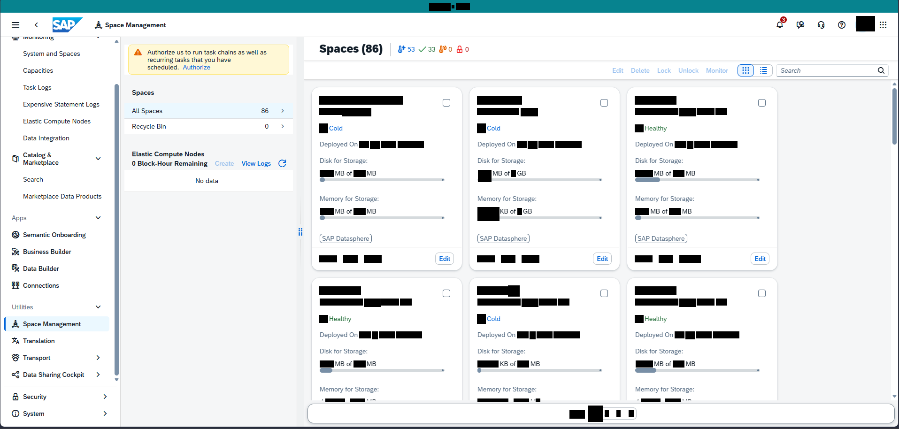

Bildformat: 1915 × 914 Pixel. Die folgenden Positionen beziehen sich auf dieses vollständige Bild.

## 1. Gesamtaufbau und sichtbarer Zustand

### Gesamtansicht

Die Seite zeigt eine Space-Verwaltungsübersicht. Neben der globalen Navigation links steht eine zusätzliche schmale Seitenleiste. Rechts davon befindet sich ein mehrspaltiges Kartenraster.

### Zusätzliche Seitenleiste

Im oberen Teil der inneren Seitenleiste steht ein Hinweis mit der Schaltfläche „Authorize“. Darunter folgen „Spaces“, „All Spaces“ und „Recycle Bin“. Weiter unten befindet sich ein Bereich „Elastic Compute Nodes“ mit „View Logs“ und einem leeren Datenzustand.

### Karten im Hauptbereich

Die Karten enthalten Statusangaben wie Cold oder Healthy. Weitere sichtbare Beschriftungen sind Deployed On, Disk for Storage und Memory for Storage. Die Speicherzeilen zeigen Einheiten wie MB, KB und GB. Im unteren Bereich der Karten befinden sich kleine Symbole und die Aktion „Edit“.

### Suche und Layout

Oberhalb des Rasters ist rechts ein Suchfeld sichtbar. Die Karten sind größer und informationsreicher als die einfachen Auswahlkarten in anderen Screenshots. Sie stehen in mehreren Spalten; weitere Karten folgen unterhalb des sichtbaren Ausschnitts. Ein Bearbeitungsdialog ist nicht geöffnet.

## 2. Räumliche Beschreibung von oben nach unten

### Innere Seitenleiste

**Ungefähre Bildregion:** x 14–33 %, y 10–100 %

Ein mehrzeiliger Hinweis mit Authorize liegt oben. Darunter folgen Spaces, All Spaces und Recycle Bin. Elastic Compute Nodes befindet sich weiter unten; View Logs steht rechts im zugehörigen Abschnitt.

### Kartenbereich

**Ungefähre Bildregion:** x 35–98 %, y 10–100 %

Spaces steht links über dem Raster, die Suche rechts. Drei größere Karten stehen nebeneinander. Innerhalb jeder Karte folgen Titelbereich, Status, Deployed On, Disk for Storage, Memory for Storage und eine untere Symbolzeile. Edit liegt unten rechts in jeder Karte. Eine weitere Kartenreihe beginnt darunter.

## 3. Positionsverzeichnis der lesbaren Beschriftungen

Sortierung nach Bildhöhe, innerhalb derselben Höhe von links nach rechts. Angegeben sind Textbegrenzungen; Abstände und Bedienelementflächen können darüber hinausreichen.

<table>
<colgroup>
<col style="width: 33%" />
<col style="width: 30%" />
<col style="width: 35%" />
</colgroup>
<thead>
<tr class="header">
<th>Sichtbarer Text</th>
<th>Textposition in Pixeln</th>
<th>Relative Lage im Bild</th>
</tr>
</thead>
<tbody>
<tr class="odd">
<td>Space Management</td>
<td>x 224–354 
y 43–83</td>
<td>oben, links 
x 11.7–18.5 % 
y 4.7–9.1 %</td>
</tr>
<tr class="even">
<td>Spaces</td>
<td>x 681–764 
y 95–117</td>
<td>oben, mittig 
x 35.6–39.9 % 
y 10.4–12.8 %</td>
</tr>
<tr class="odd">
<td>System and Spaces</td>
<td>x 50–170 
y 109–122</td>
<td>oben, links 
x 2.6–8.9 % 
y 11.9–13.3 %</td>
</tr>
<tr class="even">
<td>Authorize</td>
<td>x 314–372 
y 106–116</td>
<td>oben, links 
x 16.4–19.4 % 
y 11.6–12.7 %</td>
</tr>
<tr class="odd">
<td>run</td>
<td>x 411–430 
y 109–116</td>
<td>oben, links 
x 21.5–22.5 % 
y 11.9–12.7 %</td>
</tr>
<tr class="even">
<td>task chains</td>
<td>x 434–503 
y 106–116</td>
<td>oben, links 
x 22.7–26.3 % 
y 11.6–12.7 %</td>
</tr>
<tr class="odd">
<td>tasks</td>
<td>x 372–404 
y 122–132</td>
<td>oben, links 
x 19.4–21.1 % 
y 13.3–14.4 %</td>
</tr>
<tr class="even">
<td>Capacities</td>
<td>x 49–113 
y 145–158</td>
<td>oben, links 
x 2.6–5.9 % 
y 15.9–17.3 %</td>
</tr>
<tr class="odd">
<td>Authorize</td>
<td>x 390–448 
y 138–148</td>
<td>oben, links 
x 20.4–23.4 % 
y 15.1–16.2 %</td>
</tr>
<tr class="even">
<td>Search</td>
<td>x 1664–1705 
y 145–155</td>
<td>oben, rechts 
x 86.9–89.0 % 
y 15.9–17.0 %</td>
</tr>
<tr class="odd">
<td>Task Logs</td>
<td>x 49–110 
y 181–194</td>
<td>oben, links 
x 2.6–5.7 % 
y 19.8–21.2 %</td>
</tr>
<tr class="even">
<td>Spaces</td>
<td>x 282–328 
y 192–205</td>
<td>oben, links 
x 14.7–17.1 % 
y 21.0–22.4 %</td>
</tr>
<tr class="odd">
<td>Expensive Statement Logs</td>
<td>x 50–212 
y 217–230</td>
<td>oben, links 
x 2.6–11.1 % 
y 23.7–25.2 %</td>
</tr>
<tr class="even">
<td>All Spaces</td>
<td>x 281–346 
y 231–244</td>
<td>oben, links 
x 14.7–18.1 % 
y 25.3–26.7 %</td>
</tr>
<tr class="odd">
<td>Elastic Compute Nodes</td>
<td>x 50–193 
y 253–266</td>
<td>oben, links 
x 2.6–10.1 % 
y 27.7–29.1 %</td>
</tr>
<tr class="even">
<td>Recycle Bin</td>
<td>x 282–353 
y 264–277</td>
<td>oben, links 
x 14.7–18.4 % 
y 28.9–30.3 %</td>
</tr>
<tr class="odd">
<td>Data Integration</td>
<td>x 50–148 
y 289–302</td>
<td>oben, links 
x 2.6–7.7 % 
y 31.6–33.0 %</td>
</tr>
<tr class="even">
<td>Deployed On</td>
<td>x 682–761 
y 302–315</td>
<td>auf mittlerer Höhe, mittig 
x 35.6–39.7 % 
y 33.0–34.5 %</td>
</tr>
<tr class="odd">
<td>Deployed On</td>
<td>x 1018–1097 
y 302–315</td>
<td>auf mittlerer Höhe, mittig 
x 53.2–57.3 % 
y 33.0–34.5 %</td>
</tr>
<tr class="even">
<td>Deployed On</td>
<td>x 1354–1433 
y 302–315</td>
<td>auf mittlerer Höhe, rechts 
x 70.7–74.8 % 
y 33.0–34.5 %</td>
</tr>
<tr class="odd">
<td>Elastic Compute Nodes</td>
<td>x 282–435 
y 323–336</td>
<td>auf mittlerer Höhe, links 
x 14.7–22.7 % 
y 35.3–36.8 %</td>
</tr>
<tr class="even">
<td>Disk for Storage:</td>
<td>x 682–782 
y 337–350</td>
<td>auf mittlerer Höhe, mittig 
x 35.6–40.8 % 
y 36.9–38.3 %</td>
</tr>
<tr class="odd">
<td>Disk for Storage:</td>
<td>x 1018–1118 
y 337–350</td>
<td>auf mittlerer Höhe, mittig 
x 53.2–58.4 % 
y 36.9–38.3 %</td>
</tr>
<tr class="even">
<td>Disk for Storage:</td>
<td>x 1354–1454 
y 337–350</td>
<td>auf mittlerer Höhe, rechts 
x 70.7–75.9 % 
y 36.9–38.3 %</td>
</tr>
<tr class="odd">
<td>View Logs</td>
<td>x 515–577 
y 343–356</td>
<td>auf mittlerer Höhe, links 
x 26.9–30.1 % 
y 37.5–38.9 %</td>
</tr>
<tr class="even">
<td>of</td>
<td>x 738–750 
y 364–374</td>
<td>auf mittlerer Höhe, mittig 
x 38.6–39.2 % 
y 39.8–40.9 %</td>
</tr>
<tr class="odd">
<td>of</td>
<td>x 1074–1086 
y 364–374</td>
<td>auf mittlerer Höhe, mittig 
x 56.1–56.7 % 
y 39.8–40.9 %</td>
</tr>
<tr class="even">
<td>of</td>
<td>x 1418–1430 
y 364–374</td>
<td>auf mittlerer Höhe, rechts 
x 74.0–74.6 % 
y 39.8–40.9 %</td>
</tr>
<tr class="odd">
<td>Search</td>
<td>x 50–92 
y 377–387</td>
<td>auf mittlerer Höhe, links 
x 2.6–4.8 % 
y 41.2–42.3 %</td>
</tr>
<tr class="even">
<td>No data</td>
<td>x 417–464 
y 380–390</td>
<td>auf mittlerer Höhe, links 
x 21.8–24.3 % 
y 41.6–42.7 %</td>
</tr>
<tr class="odd">
<td>Memory for Storage:</td>
<td>x 682–806 
y 418–431</td>
<td>auf mittlerer Höhe, mittig 
x 35.6–42.1 % 
y 45.7–47.2 %</td>
</tr>
<tr class="even">
<td>Memory for Storage:</td>
<td>x 1018–1142 
y 418–431</td>
<td>auf mittlerer Höhe, mittig 
x 53.2–59.6 % 
y 45.7–47.2 %</td>
</tr>
<tr class="odd">
<td>Memory for Storage:</td>
<td>x 1354–1478 
y 418–431</td>
<td>auf mittlerer Höhe, rechts 
x 70.7–77.2 % 
y 45.7–47.2 %</td>
</tr>
<tr class="even">
<td>of</td>
<td>x 738–750 
y 445–455</td>
<td>auf mittlerer Höhe, mittig 
x 38.6–39.2 % 
y 48.7–49.8 %</td>
</tr>
<tr class="odd">
<td>of</td>
<td>x 1087–1098 
y 445–455</td>
<td>auf mittlerer Höhe, mittig 
x 56.8–57.4 % 
y 48.7–49.8 %</td>
</tr>
<tr class="even">
<td>of</td>
<td>x 1410–1422 
y 445–455</td>
<td>auf mittlerer Höhe, rechts 
x 73.7–74.3 % 
y 48.7–49.8 %</td>
</tr>
<tr class="odd">
<td>Apps</td>
<td>x 25–56 
y 459–472</td>
<td>auf mittlerer Höhe, links 
x 1.3–2.9 % 
y 50.2–51.6 %</td>
</tr>
<tr class="even">
<td>Semantic Onboarding</td>
<td>x 50–183 
y 495–508</td>
<td>auf mittlerer Höhe, links 
x 2.6–9.6 % 
y 54.2–55.6 %</td>
</tr>
<tr class="odd">
<td>Business Builder</td>
<td>x 50–152 
y 531–541</td>
<td>auf mittlerer Höhe, links 
x 2.6–7.9 % 
y 58.1–59.2 %</td>
</tr>
<tr class="even">
<td>Edit</td>
<td>x 936–959 
y 546–556</td>
<td>auf mittlerer Höhe, mittig 
x 48.9–50.1 % 
y 59.7–60.8 %</td>
</tr>
<tr class="odd">
<td>Edit</td>
<td>x 1272–1295 
y 546–556</td>
<td>auf mittlerer Höhe, rechts 
x 66.4–67.6 % 
y 59.7–60.8 %</td>
</tr>
<tr class="even">
<td>Edit</td>
<td>x 1608–1631 
y 546–556</td>
<td>auf mittlerer Höhe, rechts 
x 84.0–85.2 % 
y 59.7–60.8 %</td>
</tr>
<tr class="odd">
<td>Data Builder</td>
<td>x 50–126 
y 567–577</td>
<td>auf mittlerer Höhe, links 
x 2.6–6.6 % 
y 62.0–63.1 %</td>
</tr>
<tr class="even">
<td>Connections</td>
<td>x 49–126 
y 603–613</td>
<td>auf mittlerer Höhe, links 
x 2.6–6.6 % 
y 66.0–67.1 %</td>
</tr>
<tr class="odd">
<td>Utilities</td>
<td>x 26–70 
y 649–659</td>
<td>unten, links 
x 1.4–3.7 % 
y 71.0–72.1 %</td>
</tr>
<tr class="even">
<td>Space Management</td>
<td>x 50–172 
y 685–698</td>
<td>unten, links 
x 2.6–9.0 % 
y 74.9–76.4 %</td>
</tr>
<tr class="odd">
<td>Deployed On</td>
<td>x 682–761 
y 708–721</td>
<td>unten, mittig 
x 35.6–39.7 % 
y 77.5–78.9 %</td>
</tr>
<tr class="even">
<td>Deployed On</td>
<td>x 1018–1097 
y 708–721</td>
<td>unten, mittig 
x 53.2–57.3 % 
y 77.5–78.9 %</td>
</tr>
<tr class="odd">
<td>Deployed On</td>
<td>x 1354–1433 
y 708–721</td>
<td>unten, rechts 
x 70.7–74.8 % 
y 77.5–78.9 %</td>
</tr>
<tr class="even">
<td>Translation</td>
<td>x 49–116 
y 721–731</td>
<td>unten, links 
x 2.6–6.1 % 
y 78.9–80.0 %</td>
</tr>
<tr class="odd">
<td>Disk for Storage:</td>
<td>x 682–782 
y 743–756</td>
<td>unten, mittig 
x 35.6–40.8 % 
y 81.3–82.7 %</td>
</tr>
<tr class="even">
<td>Disk for Storage:</td>
<td>x 1018–1118 
y 743–756</td>
<td>unten, mittig 
x 53.2–58.4 % 
y 81.3–82.7 %</td>
</tr>
<tr class="odd">
<td>Disk for Storage:</td>
<td>x 1354–1454 
y 743–756</td>
<td>unten, rechts 
x 70.7–75.9 % 
y 81.3–82.7 %</td>
</tr>
<tr class="even">
<td>Transport</td>
<td>x 49–107 
y 757–770</td>
<td>unten, links 
x 2.6–5.6 % 
y 82.8–84.2 %</td>
</tr>
<tr class="odd">
<td>of</td>
<td>x 1086–1098 
y 760–796</td>
<td>unten, mittig 
x 56.7–57.3 % 
y 83.2–87.0 %</td>
</tr>
<tr class="even">
<td>of</td>
<td>x 738–750 
y 770–780</td>
<td>unten, mittig 
x 38.6–39.2 % 
y 84.2–85.3 %</td>
</tr>
<tr class="odd">
<td>of</td>
<td>x 1418–1430 
y 770–780</td>
<td>unten, rechts 
x 74.0–74.6 % 
y 84.2–85.3 %</td>
</tr>
<tr class="even">
<td>Data Sharing Cockpit</td>
<td>x 50–179 
y 793–806</td>
<td>unten, links 
x 2.6–9.3 % 
y 86.8–88.2 %</td>
</tr>
<tr class="odd">
<td>Memory for Storage:</td>
<td>x 682–806 
y 824–837</td>
<td>unten, mittig 
x 35.6–42.1 % 
y 90.2–91.6 %</td>
</tr>
<tr class="even">
<td>Memory for Storage:</td>
<td>x 1018–1142 
y 824–837</td>
<td>unten, mittig 
x 53.2–59.6 % 
y 90.2–91.6 %</td>
</tr>
<tr class="odd">
<td>Memory for Storage:</td>
<td>x 1354–1478 
y 824–837</td>
<td>unten, rechts 
x 70.7–77.2 % 
y 90.2–91.6 %</td>
</tr>
<tr class="even">
<td>Security</td>
<td>x 50–99 
y 840–853</td>
<td>unten, links 
x 2.6–5.2 % 
y 91.9–93.3 %</td>
</tr>
<tr class="odd">
<td>System</td>
<td>x 50–94 
y 876–889</td>
<td>unten, links 
x 2.6–4.9 % 
y 95.8–97.3 %</td>
</tr>
</tbody>
</table>

## 4. Abgrenzung

Die Beschreibung benennt nur den sichtbaren Zustand dieses Screenshots. Aus Symbolen ohne lesbare Beschriftung wird keine konkrete Funktion abgeleitet. Inhalte hinter schwarzen Balken und nicht sichtbare Bereiche außerhalb des Bildrandes bleiben unbeschrieben.

# Bild 12: Connections: keine Space-Auswahl

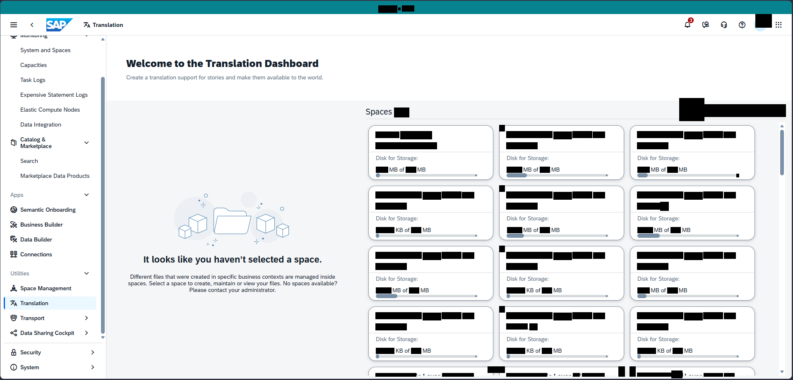

> **Hinweis (09.10.2026):** Der Screenshot zeigt in der Shellbar „Translation“ und den Titel „Welcome to the Translation Dashboard“, also die
> App *Translation*, nicht *Connections*. Aufbau (Seitentyp A) gilt trotzdem; der Leerzustandstext „It looks like you haven't selected a space.“
> stammt aus Translation. Ein echter Connections-Screenshot fehlt noch.

Bildformat: 1916 × 919 Pixel. Die folgenden Positionen beziehen sich auf dieses vollständige Bild.

## 1. Gesamtaufbau und sichtbarer Zustand

### Gesamtansicht

Der Screenshot zeigt eine zweigeteilte Connections-Ansicht. Links neben dem Hauptinhalt steht die globale Navigation. Der mittlere Bereich enthält einen Hinweis, während rechts eine Space-Auswahl als Kartenraster angezeigt wird.

### Mittlerer Hinweisbereich

In der Mitte befindet sich eine größere Illustration. Darunter steht der Hinweis, dass noch kein Space ausgewählt wurde. Ein weiterer Absatz erklärt, dass Dateien in Spaces organisiert sind und ein Space ausgewählt werden soll. Zusätzlich ist ein Hinweis auf den Administrator sichtbar.

### Rechter Bereich

Rechts stehen mehrere Karten in Reihen und Spalten. Jede Karte besitzt einen oberen Bezeichnungsbereich und darunter „Disk for Storage“. Einheiten wie MB und KB sind sichtbar. Die Karten setzen sich bis zum unteren Bildrand fort.

### Bedienelemente und Zustand

Oberhalb der Karten steht ein Suchfeld. Der Hinweisbereich bleibt frei von einer Verbindungsliste oder Verbindungseigenschaften. Der Screenshot zeigt somit den sichtbaren Zustand vor der Auswahl einer Karte; ein Verbindungsdialog ist nicht geöffnet.

## 2. Räumliche Beschreibung von oben nach unten

### Leerzustand links im Hauptbereich

**Ungefähre Bildregion:** x 16–44 %, y 26–77 %

Eine große Illustration steht oberhalb des Hinweises, dass noch kein Space ausgewählt wurde. Der Hinweistext ist unter der Illustration zentriert. Darunter folgen ein Erklärungstext und ein Administratorhinweis.

### Karten rechts

**Ungefähre Bildregion:** x 47–98 %, y 10–100 %

Das Suchfeld liegt oben rechts. Unterhalb stehen drei schmalere Karten pro Reihe. Disk for Storage steht innerhalb jeder Karte unter dem Titelbereich. Die Reihen setzen sich nach unten fort.

## 3. Positionsverzeichnis der lesbaren Beschriftungen

Sortierung nach Bildhöhe, innerhalb derselben Höhe von links nach rechts. Angegeben sind Textbegrenzungen; Abstände und Bedienelementflächen können darüber hinausreichen.

<table>
<colgroup>
<col style="width: 33%" />
<col style="width: 30%" />
<col style="width: 35%" />
</colgroup>
<thead>
<tr class="header">
<th>Sichtbarer Text</th>
<th>Textposition in Pixeln</th>
<th>Relative Lage im Bild</th>
</tr>
</thead>
<tbody>
<tr class="odd">
<td>Translation</td>
<td>x 224–297 
y 55–65</td>
<td>oben, links 
x 11.7–15.5 % 
y 6.0–7.1 %</td>
</tr>
<tr class="even">
<td>System and Spaces</td>
<td>x 50–170 
y 116–129</td>
<td>oben, links 
x 2.6–8.9 % 
y 12.6–14.0 %</td>
</tr>
<tr class="odd">
<td>Translation</td>
<td>x 497–632 
y 143–162</td>
<td>oben, links 
x 25.9–33.0 % 
y 15.6–17.6 %</td>
</tr>
<tr class="even">
<td>Capacities</td>
<td>x 49–113 
y 152–165</td>
<td>oben, links 
x 2.6–5.9 % 
y 16.5–18.0 %</td>
</tr>
<tr class="odd">
<td>translation</td>
<td>x 362–425 
y 182–192</td>
<td>oben, links 
x 18.9–22.2 % 
y 19.8–20.9 %</td>
</tr>
<tr class="even">
<td>Task Logs</td>
<td>x 49–109 
y 188–201</td>
<td>oben, links 
x 2.6–5.7 % 
y 20.5–21.9 %</td>
</tr>
<tr class="odd">
<td>Expensive Statement Logs</td>
<td>x 50–212 
y 224–237</td>
<td>oben, links 
x 2.6–11.1 % 
y 24.4–25.8 %</td>
</tr>
<tr class="even">
<td>Elastic Compute Nodes</td>
<td>x 50–193 
y 260–273</td>
<td>oben, links 
x 2.6–10.1 % 
y 28.3–29.7 %</td>
</tr>
<tr class="odd">
<td>Spaces</td>
<td>x 884–947 
y 263–281</td>
<td>oben, mittig 
x 46.1–49.4 % 
y 28.6–30.6 %</td>
</tr>
<tr class="even">
<td>Data Integration</td>
<td>x 50–147 
y 296–309</td>
<td>oben, links 
x 2.6–7.7 % 
y 32.2–33.6 %</td>
</tr>
<tr class="odd">
<td>Disk for Storage:</td>
<td>x 909–1009 
y 377–390</td>
<td>auf mittlerer Höhe, mittig 
x 47.4–52.7 % 
y 41.0–42.4 %</td>
</tr>
<tr class="even">
<td>Disk for Storage:</td>
<td>x 1225–1325 
y 377–390</td>
<td>auf mittlerer Höhe, mittig 
x 63.9–69.2 % 
y 41.0–42.4 %</td>
</tr>
<tr class="odd">
<td>Disk for Storage:</td>
<td>x 1541–1641 
y 377–390</td>
<td>auf mittlerer Höhe, rechts 
x 80.4–85.6 % 
y 41.0–42.4 %</td>
</tr>
<tr class="even">
<td>Search</td>
<td>x 50–91 
y 384–394</td>
<td>auf mittlerer Höhe, links 
x 2.6–4.7 % 
y 41.8–42.9 %</td>
</tr>
<tr class="odd">
<td>of</td>
<td>x 965–977 
y 405–415</td>
<td>auf mittlerer Höhe, mittig 
x 50.4–51.0 % 
y 44.1–45.2 %</td>
</tr>
<tr class="even">
<td>of</td>
<td>x 1289–1301 
y 405–415</td>
<td>auf mittlerer Höhe, rechts 
x 67.3–67.9 % 
y 44.1–45.2 %</td>
</tr>
<tr class="odd">
<td>of</td>
<td>x 1597–1609 
y 405–415</td>
<td>auf mittlerer Höhe, rechts 
x 83.4–84.0 % 
y 44.1–45.2 %</td>
</tr>
<tr class="even">
<td>Apps</td>
<td>x 25–56 
y 466–479</td>
<td>auf mittlerer Höhe, links 
x 1.3–2.9 % 
y 50.7–52.1 %</td>
</tr>
<tr class="odd">
<td>Semantic Onboarding</td>
<td>x 50–183 
y 502–515</td>
<td>auf mittlerer Höhe, links 
x 2.6–9.6 % 
y 54.6–56.0 %</td>
</tr>
<tr class="even">
<td>Disk for Storage:</td>
<td>x 909–1009 
y 523–536</td>
<td>auf mittlerer Höhe, mittig 
x 47.4–52.7 % 
y 56.9–58.3 %</td>
</tr>
<tr class="odd">
<td>Disk for Storage:</td>
<td>x 1225–1325 
y 523–536</td>
<td>auf mittlerer Höhe, mittig 
x 63.9–69.2 % 
y 56.9–58.3 %</td>
</tr>
<tr class="even">
<td>Disk for Storage:</td>
<td>x 1541–1641 
y 523–536</td>
<td>auf mittlerer Höhe, rechts 
x 80.4–85.6 % 
y 56.9–58.3 %</td>
</tr>
<tr class="odd">
<td>Business Builder</td>
<td>x 50–152 
y 538–548</td>
<td>auf mittlerer Höhe, links 
x 2.6–7.9 % 
y 58.5–59.6 %</td>
</tr>
<tr class="even">
<td>of</td>
<td>x 978–989 
y 551–561</td>
<td>auf mittlerer Höhe, mittig 
x 51.0–51.6 % 
y 60.0–61.0 %</td>
</tr>
<tr class="odd">
<td>of</td>
<td>x 1289–1301 
y 551–561</td>
<td>auf mittlerer Höhe, rechts 
x 67.3–67.9 % 
y 60.0–61.0 %</td>
</tr>
<tr class="even">
<td>of</td>
<td>x 1605–1617 
y 551–561</td>
<td>auf mittlerer Höhe, rechts 
x 83.8–84.4 % 
y 60.0–61.0 %</td>
</tr>
<tr class="odd">
<td>Data Builder</td>
<td>x 50–126 
y 574–584</td>
<td>auf mittlerer Höhe, links 
x 2.6–6.6 % 
y 62.5–63.5 %</td>
</tr>
<tr class="even">
<td>Connections</td>
<td>x 49–126 
y 610–620</td>
<td>auf mittlerer Höhe, links 
x 2.6–6.6 % 
y 66.4–67.5 %</td>
</tr>
<tr class="odd">
<td>space.</td>
<td>x 711–777 
y 623–640</td>
<td>unten, mittig 
x 37.1–40.6 % 
y 67.8–69.6 %</td>
</tr>
<tr class="even">
<td>Utilities</td>
<td>x 26–70 
y 656–666</td>
<td>unten, links 
x 1.4–3.7 % 
y 71.4–72.5 %</td>
</tr>
<tr class="odd">
<td>Disk for Storage:</td>
<td>x 909–1009 
y 669–682</td>
<td>unten, mittig 
x 47.4–52.7 % 
y 72.8–74.2 %</td>
</tr>
<tr class="even">
<td>Disk for Storage:</td>
<td>x 1225–1325 
y 669–682</td>
<td>unten, mittig 
x 63.9–69.2 % 
y 72.8–74.2 %</td>
</tr>
<tr class="odd">
<td>Disk for Storage:</td>
<td>x 1541–1641 
y 669–682</td>
<td>unten, rechts 
x 80.4–85.6 % 
y 72.8–74.2 %</td>
</tr>
<tr class="even">
<td>spaces.</td>
<td>x 310–355 
y 683–693</td>
<td>unten, links 
x 16.2–18.5 % 
y 74.3–75.4 %</td>
</tr>
<tr class="odd">
<td>Select</td>
<td>x 360–398 
y 680–690</td>
<td>unten, links 
x 18.8–20.8 % 
y 74.0–75.1 %</td>
</tr>
<tr class="even">
<td>space</td>
<td>x 414–450 
y 683–693</td>
<td>unten, links 
x 21.6–23.5 % 
y 74.3–75.4 %</td>
</tr>
<tr class="odd">
<td>spaces</td>
<td>x 706–748 
y 683–693</td>
<td>unten, mittig 
x 36.8–39.0 % 
y 74.3–75.4 %</td>
</tr>
<tr class="even">
<td>Space Management</td>
<td>x 50–172 
y 692–705</td>
<td>unten, links 
x 2.6–9.0 % 
y 75.3–76.7 %</td>
</tr>
<tr class="odd">
<td>of</td>
<td>x 973–985 
y 697–707</td>
<td>unten, mittig 
x 50.8–51.4 % 
y 75.8–76.9 %</td>
</tr>
<tr class="even">
<td>of</td>
<td>x 1294–1305 
y 697–707</td>
<td>unten, rechts 
x 67.5–68.1 % 
y 75.8–76.9 %</td>
</tr>
<tr class="odd">
<td>of</td>
<td>x 1597–1609 
y 697–707</td>
<td>unten, rechts 
x 83.4–84.0 % 
y 75.8–76.9 %</td>
</tr>
<tr class="even">
<td>Translation</td>
<td>x 49–116 
y 728–738</td>
<td>unten, links 
x 2.6–6.1 % 
y 79.2–80.3 %</td>
</tr>
<tr class="odd">
<td>Transport</td>
<td>x 49–107 
y 764–777</td>
<td>unten, links 
x 2.6–5.6 % 
y 83.1–84.5 %</td>
</tr>
<tr class="even">
<td>Data Sharing Cockpit</td>
<td>x 50–179 
y 800–813</td>
<td>unten, links 
x 2.6–9.3 % 
y 87.1–88.5 %</td>
</tr>
<tr class="odd">
<td>Disk for Storage:</td>
<td>x 909–1009 
y 815–828</td>
<td>unten, mittig 
x 47.4–52.7 % 
y 88.7–90.1 %</td>
</tr>
<tr class="even">
<td>Disk for Storage:</td>
<td>x 1225–1325 
y 815–828</td>
<td>unten, mittig 
x 63.9–69.2 % 
y 88.7–90.1 %</td>
</tr>
<tr class="odd">
<td>Disk for Storage:</td>
<td>x 1541–1641 
y 815–828</td>
<td>unten, rechts 
x 80.4–85.6 % 
y 88.7–90.1 %</td>
</tr>
<tr class="even">
<td>of</td>
<td>x 978–989 
y 843–853</td>
<td>unten, mittig 
x 51.0–51.6 % 
y 91.7–92.8 %</td>
</tr>
<tr class="odd">
<td>of</td>
<td>x 1294–1305 
y 843–853</td>
<td>unten, rechts 
x 67.5–68.1 % 
y 91.7–92.8 %</td>
</tr>
<tr class="even">
<td>of</td>
<td>x 1610–1621 
y 843–853</td>
<td>unten, rechts 
x 84.0–84.6 % 
y 91.7–92.8 %</td>
</tr>
<tr class="odd">
<td>Security</td>
<td>x 50–99 
y 847–860</td>
<td>unten, links 
x 2.6–5.2 % 
y 92.2–93.6 %</td>
</tr>
<tr class="even">
<td>System</td>
<td>x 50–94 
y 883–896</td>
<td>unten, links 
x 2.6–4.9 % 
y 96.1–97.5 %</td>
</tr>
</tbody>
</table>

## 4. Abgrenzung

Die Beschreibung benennt nur den sichtbaren Zustand dieses Screenshots. Aus Symbolen ohne lesbare Beschriftung wird keine konkrete Funktion abgeleitet. Inhalte hinter schwarzen Balken und nicht sichtbare Bereiche außerhalb des Bildrandes bleiben unbeschrieben.

# Bild 13: Transport: Paketübersicht

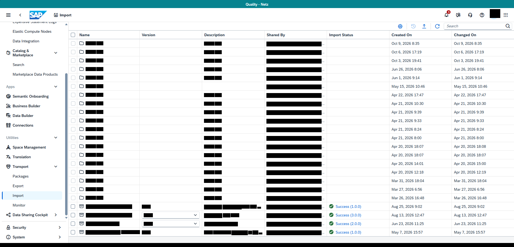

Bildformat: 1910 × 921 Pixel. Die folgenden Positionen beziehen sich auf dieses vollständige Bild.

## 1. Gesamtaufbau und sichtbarer Zustand

### Gesamtansicht

Das Bild zeigt eine Transport- beziehungsweise Paketliste in Tabellenform. Die globale Navigation befindet sich links. Der Hauptbereich besteht aus einer Werkzeugleiste und einer breiten Tabelle.

### Oben

Oberhalb der Tabelle sind eine Suche und mehrere kleine Aktionssymbole sichtbar. Die Tabelle beginnt mit Auswahlkästchen am linken Rand jeder Zeile.

### Tabellenstruktur

Die Überschriften umfassen Name, Version, Description, Shared By, Import Status, Created On und Changed On. Die rechte Hälfte enthält Status- sowie Datums- und Zeitspalten. Die Einträge sind in horizontalen Zeilen angeordnet; Auswahlkästchen ermöglichen die sichtbare Markierung einzelner Zeilen. Die Inhalte der geschwärzten Felder werden nicht ergänzt.

### Visuelle Darstellung

Die Liste füllt nahezu den gesamten Inhaltsbereich. Helle Zeilentrennungen strukturieren die Einträge. Die Spaltenüberschriften stehen oberhalb der Liste, während die Werkzeugleiste darüber angeordnet ist. Es ist kein einzelnes Paket als Detailansicht und kein Importdialog geöffnet.

## 2. Räumliche Beschreibung von oben nach unten

### Werkzeugleiste

**Ungefähre Bildregion:** x 16–98 %, y 9–15 %

Eine Reihe kleiner Aktionssymbole und ein Suchbereich liegen über der Tabelle.

### Paketliste

**Ungefähre Bildregion:** x 16–100 %, y 15–100 %

Die Auswahlkästchen stehen ganz links in der Tabelle. Danach folgen Name, Version, Description und Shared By. Import Status liegt rechts davon. Created On und Changed On bilden die rechten Zeitspalten. Die Datenzeilen liegen dicht untereinander.

## 3. Positionsverzeichnis der lesbaren Beschriftungen

Sortierung nach Bildhöhe, innerhalb derselben Höhe von links nach rechts. Angegeben sind Textbegrenzungen; Abstände und Bedienelementflächen können darüber hinausreichen.

<table>
<colgroup>
<col style="width: 33%" />
<col style="width: 30%" />
<col style="width: 35%" />
</colgroup>
<thead>
<tr class="header">
<th>Sichtbarer Text</th>
<th>Textposition in Pixeln</th>
<th>Relative Lage im Bild</th>
</tr>
</thead>
<tbody>
<tr class="odd">
<td>Import</td>
<td>x 222–265 
y 51–64</td>
<td>oben, links 
x 11.6–13.9 % 
y 5.5–6.9 %</td>
</tr>
<tr class="even">
<td>Search</td>
<td>x 1661–1702 
y 92–102</td>
<td>oben, rechts 
x 87.0–89.1 % 
y 10.0–11.1 %</td>
</tr>
<tr class="odd">
<td>Elastic Compute Nodes</td>
<td>x 48–191 
y 112–125</td>
<td>oben, links 
x 2.5–10.0 % 
y 12.2–13.6 %</td>
</tr>
<tr class="even">
<td>Name</td>
<td>x 296–333 
y 125–135</td>
<td>oben, links 
x 15.5–17.4 % 
y 13.6–14.7 %</td>
</tr>
<tr class="odd">
<td>Version</td>
<td>x 527–576 
y 125–135</td>
<td>oben, links 
x 27.6–30.2 % 
y 13.6–14.7 %</td>
</tr>
<tr class="even">
<td>Description</td>
<td>x 760–834 
y 125–138</td>
<td>oben, mittig 
x 39.8–43.7 % 
y 13.6–15.0 %</td>
</tr>
<tr class="odd">
<td>Shared By</td>
<td>x 992–1059 
y 125–138</td>
<td>oben, mittig 
x 51.9–55.4 % 
y 13.6–15.0 %</td>
</tr>
<tr class="even">
<td>Import Status</td>
<td>x 1224–1312 
y 125–138</td>
<td>oben, mittig 
x 64.1–68.7 % 
y 13.6–15.0 %</td>
</tr>
<tr class="odd">
<td>Created On</td>
<td>x 1456–1530 
y 125–135</td>
<td>oben, rechts 
x 76.2–80.1 % 
y 13.6–14.7 %</td>
</tr>
<tr class="even">
<td>Changed On</td>
<td>x 1688–1769 
y 125–138</td>
<td>oben, rechts 
x 88.4–92.6 % 
y 13.6–15.0 %</td>
</tr>
<tr class="odd">
<td>Data Integration</td>
<td>x 48–145 
y 148–161</td>
<td>oben, links 
x 2.5–7.6 % 
y 16.1–17.5 %</td>
</tr>
<tr class="even">
<td>Search</td>
<td>x 48–89 
y 236–246</td>
<td>oben, links 
x 2.5–4.7 % 
y 25.6–26.7 %</td>
</tr>
<tr class="odd">
<td>Apps</td>
<td>x 24–54 
y 318–330</td>
<td>auf mittlerer Höhe, links 
x 1.2–2.8 % 
y 34.5–35.9 %</td>
</tr>
<tr class="even">
<td>Semantic Onboarding</td>
<td>x 48–181 
y 354–367</td>
<td>auf mittlerer Höhe, links 
x 2.5–9.5 % 
y 38.4–39.8 %</td>
</tr>
<tr class="odd">
<td>Business Builder</td>
<td>x 48–150 
y 390–400</td>
<td>auf mittlerer Höhe, links 
x 2.5–7.9 % 
y 42.3–43.4 %</td>
</tr>
<tr class="even">
<td>Data Builder</td>
<td>x 48–124 
y 426–436</td>
<td>auf mittlerer Höhe, links 
x 2.5–6.5 % 
y 46.3–47.3 %</td>
</tr>
<tr class="odd">
<td>Connections</td>
<td>x 47–124 
y 462–472</td>
<td>auf mittlerer Höhe, links 
x 2.5–6.5 % 
y 50.2–51.2 %</td>
</tr>
<tr class="even">
<td>Utilities</td>
<td>x 24–68 
y 508–518</td>
<td>auf mittlerer Höhe, links 
x 1.3–3.6 % 
y 55.2–56.2 %</td>
</tr>
<tr class="odd">
<td>Space Management</td>
<td>x 48–170 
y 544–557</td>
<td>auf mittlerer Höhe, links 
x 2.5–8.9 % 
y 59.1–60.5 %</td>
</tr>
<tr class="even">
<td>Translation</td>
<td>x 47–114 
y 580–590</td>
<td>auf mittlerer Höhe, links 
x 2.5–6.0 % 
y 63.0–64.1 %</td>
</tr>
<tr class="odd">
<td>Transport</td>
<td>x 47–105 
y 616–629</td>
<td>unten, links 
x 2.5–5.5 % 
y 66.9–68.3 %</td>
</tr>
<tr class="even">
<td>Import</td>
<td>x 48–87 
y 724–737</td>
<td>unten, links 
x 2.5–4.6 % 
y 78.6–80.0 %</td>
</tr>
<tr class="odd">
<td>Success</td>
<td>x 1248–1298 
y 765–775</td>
<td>unten, mittig 
x 65.3–67.9 % 
y 83.1–84.1 %</td>
</tr>
<tr class="even">
<td>Data Sharing Cockpit</td>
<td>x 48–177 
y 796–809</td>
<td>unten, links 
x 2.5–9.3 % 
y 86.4–87.8 %</td>
</tr>
<tr class="odd">
<td>Success</td>
<td>x 1248–1298 
y 797–807</td>
<td>unten, mittig 
x 65.3–67.9 % 
y 86.5–87.6 %</td>
</tr>
<tr class="even">
<td>Success</td>
<td>x 1248–1298 
y 829–839</td>
<td>unten, mittig 
x 65.3–67.9 % 
y 90.0–91.1 %</td>
</tr>
<tr class="odd">
<td>Security</td>
<td>x 48–97 
y 843–856</td>
<td>unten, links 
x 2.5–5.1 % 
y 91.5–92.9 %</td>
</tr>
<tr class="even">
<td>Success</td>
<td>x 1248–1298 
y 861–871</td>
<td>unten, mittig 
x 65.3–67.9 % 
y 93.5–94.6 %</td>
</tr>
<tr class="odd">
<td>System</td>
<td>x 48–92 
y 879–892</td>
<td>unten, links 
x 2.5–4.8 % 
y 95.4–96.9 %</td>
</tr>
</tbody>
</table>

## 4. Abgrenzung

Die Beschreibung benennt nur den sichtbaren Zustand dieses Screenshots. Aus Symbolen ohne lesbare Beschriftung wird keine konkrete Funktion abgeleitet. Inhalte hinter schwarzen Balken und nicht sichtbare Bereiche außerhalb des Bildrandes bleiben unbeschrieben.

# Bild 14: Audit: Protokolltabelle

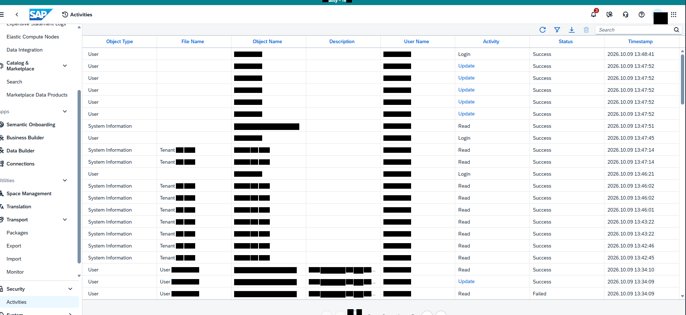

Bildformat: 1884 × 868 Pixel. Die folgenden Positionen beziehen sich auf dieses vollständige Bild.

## 1. Gesamtaufbau und sichtbarer Zustand

### Gesamtansicht

Der Screenshot zeigt eine Audit- beziehungsweise Aktivitätsprotokollansicht. Eine große Tabelle nimmt den mittleren und rechten Bereich ein. Links steht die globale Navigation.

### Tabellenüberschriften

Die sichtbaren Spalten heißen Object Type, File Name, Object Name, Description, User Name, Activity, Status und Timestamp. Die Spalten sind horizontal nebeneinander angeordnet. Der rechte Teil der Tabelle enthält Aktivitäten, Status und Zeitstempel.

### Sichtbare Einträge

In der Spalte Activity stehen unter anderem Login, Update und Read. Die Statusspalte zeigt „Success“. Links in der Tabelle ist mehrfach der Objekttyp „Information“ sichtbar. Die Zeitstempel stehen zeilenweise am rechten Rand. Die geschwärzten Inhalte der übrigen Felder werden nicht beschrieben.

### Anordnung

Viele Protokollzeilen sind gleichzeitig sichtbar. Die gleichmäßige Zeilenhöhe und die Spaltenausrichtung ergeben eine dichte Listenansicht. Der Screenshot zeigt keine geöffnete Protokollmeldung oder ein Detailfenster, sondern die Übersicht der Einträge.

## 2. Räumliche Beschreibung von oben nach unten

### Protokolltabelle

**Ungefähre Bildregion:** x 16–100 %, y 12–100 %

Die Kopfzeile enthält Object Type, File Name, Object Name, Description, User Name, Activity, Status und Timestamp. Activity liegt rechts vom Benutzerfeld. Success steht in der Statusspalte. Die Zeitstempel befinden sich am rechten Rand. Information steht in mehreren Zeilen links in der Tabelle.

## 3. Positionsverzeichnis der lesbaren Beschriftungen

Sortierung nach Bildhöhe, innerhalb derselben Höhe von links nach rechts. Angegeben sind Textbegrenzungen; Abstände und Bedienelementflächen können darüber hinausreichen.

<table>
<colgroup>
<col style="width: 33%" />
<col style="width: 30%" />
<col style="width: 35%" />
</colgroup>
<thead>
<tr class="header">
<th>Sichtbarer Text</th>
<th>Textposition in Pixeln</th>
<th>Relative Lage im Bild</th>
</tr>
</thead>
<tbody>
<tr class="odd">
<td>Search</td>
<td>x 1646–1687 
y 77–87</td>
<td>oben, rechts 
x 87.3–89.5 % 
y 8.9–10.0 %</td>
</tr>
<tr class="even">
<td>Elastic Compute Nodes</td>
<td>x 19–162 
y 96–109</td>
<td>oben, links 
x 1.0–8.6 % 
y 11.1–12.6 %</td>
</tr>
<tr class="odd">
<td>Object Type</td>
<td>x 292–365 
y 109–122</td>
<td>oben, links 
x 15.5–19.4 % 
y 12.6–14.1 %</td>
</tr>
<tr class="even">
<td>File Name</td>
<td>x 500–560 
y 109–119</td>
<td>oben, links 
x 26.5–29.7 % 
y 12.6–13.7 %</td>
</tr>
<tr class="odd">
<td>Object Name</td>
<td>x 695–774 
y 109–122</td>
<td>oben, mittig 
x 36.9–41.1 % 
y 12.6–14.1 %</td>
</tr>
<tr class="even">
<td>Description</td>
<td>x 906–974 
y 109–122</td>
<td>oben, mittig 
x 48.1–51.7 % 
y 12.6–14.1 %</td>
</tr>
<tr class="odd">
<td>User Name</td>
<td>x 1110–1178 
y 109–119</td>
<td>oben, mittig 
x 58.9–62.5 % 
y 12.6–13.7 %</td>
</tr>
<tr class="even">
<td>Activity</td>
<td>x 1327–1371 
y 109–122</td>
<td>oben, rechts 
x 70.4–72.8 % 
y 12.6–14.1 %</td>
</tr>
<tr class="odd">
<td>Status</td>
<td>x 1535–1573 
y 109–119</td>
<td>oben, rechts 
x 81.5–83.5 % 
y 12.6–13.7 %</td>
</tr>
<tr class="even">
<td>Timestamp</td>
<td>x 1725–1792 
y 109–122</td>
<td>oben, rechts 
x 91.6–95.1 % 
y 12.6–14.1 %</td>
</tr>
<tr class="odd">
<td>Data Integration</td>
<td>x 19–116 
y 132–145</td>
<td>oben, links 
x 1.0–6.2 % 
y 15.2–16.7 %</td>
</tr>
<tr class="even">
<td>Login</td>
<td>x 1259–1291 
y 144–157</td>
<td>oben, rechts 
x 66.8–68.5 % 
y 16.6–18.1 %</td>
</tr>
<tr class="odd">
<td>Success</td>
<td>x 1464–1514 
y 144–154</td>
<td>oben, rechts 
x 77.7–80.4 % 
y 16.6–17.7 %</td>
</tr>
<tr class="even">
<td>Update</td>
<td>x 1260–1303 
y 176–189</td>
<td>oben, rechts 
x 66.9–69.2 % 
y 20.3–21.8 %</td>
</tr>
<tr class="odd">
<td>Success</td>
<td>x 1464–1514 
y 177–187</td>
<td>oben, rechts 
x 77.7–80.4 % 
y 20.4–21.5 %</td>
</tr>
<tr class="even">
<td>Update</td>
<td>x 1260–1303 
y 209–222</td>
<td>oben, rechts 
x 66.9–69.2 % 
y 24.1–25.6 %</td>
</tr>
<tr class="odd">
<td>Search</td>
<td>x 19–60 
y 220–230</td>
<td>oben, links 
x 1.0–3.2 % 
y 25.3–26.5 %</td>
</tr>
<tr class="even">
<td>Success</td>
<td>x 1464–1514 
y 210–220</td>
<td>oben, rechts 
x 77.7–80.4 % 
y 24.2–25.3 %</td>
</tr>
<tr class="odd">
<td>Update</td>
<td>x 1260–1303 
y 242–255</td>
<td>oben, rechts 
x 66.9–69.2 % 
y 27.9–29.4 %</td>
</tr>
<tr class="even">
<td>Success</td>
<td>x 1464–1514 
y 243–253</td>
<td>oben, rechts 
x 77.7–80.4 % 
y 28.0–29.1 %</td>
</tr>
<tr class="odd">
<td>Update</td>
<td>x 1260–1303 
y 275–288</td>
<td>oben, rechts 
x 66.9–69.2 % 
y 31.7–33.2 %</td>
</tr>
<tr class="even">
<td>Success</td>
<td>x 1464–1514 
y 276–286</td>
<td>oben, rechts 
x 77.7–80.4 % 
y 31.8–32.9 %</td>
</tr>
<tr class="odd">
<td>Update</td>
<td>x 1260–1303 
y 308–321</td>
<td>auf mittlerer Höhe, rechts 
x 66.9–69.2 % 
y 35.5–37.0 %</td>
</tr>
<tr class="even">
<td>Success</td>
<td>x 1464–1514 
y 309–319</td>
<td>auf mittlerer Höhe, rechts 
x 77.7–80.4 % 
y 35.6–36.8 %</td>
</tr>
<tr class="odd">
<td>Semantic Onboarding</td>
<td>x 18–152 
y 338–351</td>
<td>auf mittlerer Höhe, links 
x 1.0–8.1 % 
y 38.9–40.4 %</td>
</tr>
<tr class="even">
<td>System</td>
<td>x 243–287 
y 342–355</td>
<td>auf mittlerer Höhe, links 
x 12.9–15.2 % 
y 39.4–40.9 %</td>
</tr>
<tr class="odd">
<td>Information</td>
<td>x 292–361 
y 342–352</td>
<td>auf mittlerer Höhe, links 
x 15.5–19.2 % 
y 39.4–40.6 %</td>
</tr>
<tr class="even">
<td>Read</td>
<td>x 1259–1290 
y 342–352</td>
<td>auf mittlerer Höhe, rechts 
x 66.8–68.5 % 
y 39.4–40.6 %</td>
</tr>
<tr class="odd">
<td>Success</td>
<td>x 1464–1514 
y 342–352</td>
<td>auf mittlerer Höhe, rechts 
x 77.7–80.4 % 
y 39.4–40.6 %</td>
</tr>
<tr class="even">
<td>Business Builder</td>
<td>x 19–121 
y 374–384</td>
<td>auf mittlerer Höhe, links 
x 1.0–6.4 % 
y 43.1–44.2 %</td>
</tr>
<tr class="odd">
<td>Login</td>
<td>x 1259–1291 
y 375–388</td>
<td>auf mittlerer Höhe, rechts 
x 66.8–68.5 % 
y 43.2–44.7 %</td>
</tr>
<tr class="even">
<td>Success</td>
<td>x 1464–1514 
y 375–385</td>
<td>auf mittlerer Höhe, rechts 
x 77.7–80.4 % 
y 43.2–44.4 %</td>
</tr>
<tr class="odd">
<td>Data Builder</td>
<td>x 19–95 
y 410–420</td>
<td>auf mittlerer Höhe, links 
x 1.0–5.0 % 
y 47.2–48.4 %</td>
</tr>
<tr class="even">
<td>System</td>
<td>x 243–287 
y 408–421</td>
<td>auf mittlerer Höhe, links 
x 12.9–15.2 % 
y 47.0–48.5 %</td>
</tr>
<tr class="odd">
<td>Information</td>
<td>x 292–361 
y 408–418</td>
<td>auf mittlerer Höhe, links 
x 15.5–19.2 % 
y 47.0–48.2 %</td>
</tr>
<tr class="even">
<td>Read</td>
<td>x 1259–1290 
y 408–418</td>
<td>auf mittlerer Höhe, rechts 
x 66.8–68.5 % 
y 47.0–48.2 %</td>
</tr>
<tr class="odd">
<td>Success</td>
<td>x 1464–1514 
y 408–418</td>
<td>auf mittlerer Höhe, rechts 
x 77.7–80.4 % 
y 47.0–48.2 %</td>
</tr>
<tr class="even">
<td>Connections</td>
<td>x 18–94 
y 446–456</td>
<td>auf mittlerer Höhe, links 
x 1.0–5.0 % 
y 51.4–52.5 %</td>
</tr>
<tr class="odd">
<td>System</td>
<td>x 243–287 
y 441–454</td>
<td>auf mittlerer Höhe, links 
x 12.9–15.2 % 
y 50.8–52.3 %</td>
</tr>
<tr class="even">
<td>Information</td>
<td>x 292–361 
y 441–451</td>
<td>auf mittlerer Höhe, links 
x 15.5–19.2 % 
y 50.8–52.0 %</td>
</tr>
<tr class="odd">
<td>Read</td>
<td>x 1259–1290 
y 441–451</td>
<td>auf mittlerer Höhe, rechts 
x 66.8–68.5 % 
y 50.8–52.0 %</td>
</tr>
<tr class="even">
<td>Success</td>
<td>x 1464–1514 
y 441–451</td>
<td>auf mittlerer Höhe, rechts 
x 77.7–80.4 % 
y 50.8–52.0 %</td>
</tr>
<tr class="odd">
<td>Login</td>
<td>x 1259–1291 
y 474–487</td>
<td>auf mittlerer Höhe, rechts 
x 66.8–68.5 % 
y 54.6–56.1 %</td>
</tr>
<tr class="even">
<td>Success</td>
<td>x 1464–1514 
y 474–484</td>
<td>auf mittlerer Höhe, rechts 
x 77.7–80.4 % 
y 54.6–55.8 %</td>
</tr>
<tr class="odd">
<td>System</td>
<td>x 243–287 
y 507–520</td>
<td>auf mittlerer Höhe, links 
x 12.9–15.2 % 
y 58.4–59.9 %</td>
</tr>
<tr class="even">
<td>Information</td>
<td>x 292–361 
y 507–517</td>
<td>auf mittlerer Höhe, links 
x 15.5–19.2 % 
y 58.4–59.6 %</td>
</tr>
<tr class="odd">
<td>Read</td>
<td>x 1259–1290 
y 507–517</td>
<td>auf mittlerer Höhe, rechts 
x 66.8–68.5 % 
y 58.4–59.6 %</td>
</tr>
<tr class="even">
<td>Success</td>
<td>x 1464–1514 
y 507–517</td>
<td>auf mittlerer Höhe, rechts 
x 77.7–80.4 % 
y 58.4–59.6 %</td>
</tr>
<tr class="odd">
<td>Space Management</td>
<td>x 18–141 
y 528–541</td>
<td>auf mittlerer Höhe, links 
x 1.0–7.5 % 
y 60.8–62.3 %</td>
</tr>
<tr class="even">
<td>System</td>
<td>x 243–287 
y 540–553</td>
<td>auf mittlerer Höhe, links 
x 12.9–15.2 % 
y 62.2–63.7 %</td>
</tr>
<tr class="odd">
<td>Information</td>
<td>x 292–361 
y 540–550</td>
<td>auf mittlerer Höhe, links 
x 15.5–19.2 % 
y 62.2–63.4 %</td>
</tr>
<tr class="even">
<td>Read</td>
<td>x 1259–1290 
y 540–550</td>
<td>auf mittlerer Höhe, rechts 
x 66.8–68.5 % 
y 62.2–63.4 %</td>
</tr>
<tr class="odd">
<td>Success</td>
<td>x 1464–1514 
y 540–550</td>
<td>auf mittlerer Höhe, rechts 
x 77.7–80.4 % 
y 62.2–63.4 %</td>
</tr>
<tr class="even">
<td>Translation</td>
<td>x 18–85 
y 564–574</td>
<td>auf mittlerer Höhe, links 
x 1.0–4.5 % 
y 65.0–66.1 %</td>
</tr>
<tr class="odd">
<td>System</td>
<td>x 243–287 
y 573–586</td>
<td>auf mittlerer Höhe, links 
x 12.9–15.2 % 
y 66.0–67.5 %</td>
</tr>
<tr class="even">
<td>Information</td>
<td>x 292–361 
y 573–583</td>
<td>auf mittlerer Höhe, links 
x 15.5–19.2 % 
y 66.0–67.2 %</td>
</tr>
<tr class="odd">
<td>Read</td>
<td>x 1259–1290 
y 573–583</td>
<td>auf mittlerer Höhe, rechts 
x 66.8–68.5 % 
y 66.0–67.2 %</td>
</tr>
<tr class="even">
<td>Success</td>
<td>x 1464–1514 
y 573–583</td>
<td>auf mittlerer Höhe, rechts 
x 77.7–80.4 % 
y 66.0–67.2 %</td>
</tr>
<tr class="odd">
<td>Transport</td>
<td>x 18–76 
y 600–613</td>
<td>unten, links 
x 1.0–4.0 % 
y 69.1–70.6 %</td>
</tr>
<tr class="even">
<td>System</td>
<td>x 243–287 
y 606–619</td>
<td>unten, links 
x 12.9–15.2 % 
y 69.8–71.3 %</td>
</tr>
<tr class="odd">
<td>Information</td>
<td>x 292–361 
y 606–616</td>
<td>unten, links 
x 15.5–19.2 % 
y 69.8–71.0 %</td>
</tr>
<tr class="even">
<td>Read</td>
<td>x 1259–1290 
y 606–616</td>
<td>unten, rechts 
x 66.8–68.5 % 
y 69.8–71.0 %</td>
</tr>
<tr class="odd">
<td>Success</td>
<td>x 1464–1514 
y 606–616</td>
<td>unten, rechts 
x 77.7–80.4 % 
y 69.8–71.0 %</td>
</tr>
<tr class="even">
<td>System</td>
<td>x 243–287 
y 639–652</td>
<td>unten, links 
x 12.9–15.2 % 
y 73.6–75.1 %</td>
</tr>
<tr class="odd">
<td>Information</td>
<td>x 292–361 
y 639–649</td>
<td>unten, links 
x 15.5–19.2 % 
y 73.6–74.8 %</td>
</tr>
<tr class="even">
<td>Read</td>
<td>x 1259–1290 
y 639–649</td>
<td>unten, rechts 
x 66.8–68.5 % 
y 73.6–74.8 %</td>
</tr>
<tr class="odd">
<td>Success</td>
<td>x 1464–1514 
y 639–649</td>
<td>unten, rechts 
x 77.7–80.4 % 
y 73.6–74.8 %</td>
</tr>
<tr class="even">
<td>System</td>
<td>x 243–287 
y 672–685</td>
<td>unten, links 
x 12.9–15.2 % 
y 77.4–78.9 %</td>
</tr>
<tr class="odd">
<td>Information</td>
<td>x 292–361 
y 672–682</td>
<td>unten, links 
x 15.5–19.2 % 
y 77.4–78.6 %</td>
</tr>
<tr class="even">
<td>Read</td>
<td>x 1259–1290 
y 672–682</td>
<td>unten, rechts 
x 66.8–68.5 % 
y 77.4–78.6 %</td>
</tr>
<tr class="odd">
<td>Success</td>
<td>x 1464–1514 
y 672–682</td>
<td>unten, rechts 
x 77.7–80.4 % 
y 77.4–78.6 %</td>
</tr>
<tr class="even">
<td>Import</td>
<td>x 19–58 
y 708–721</td>
<td>unten, links 
x 1.0–3.1 % 
y 81.6–83.1 %</td>
</tr>
<tr class="odd">
<td>System</td>
<td>x 243–287 
y 705–718</td>
<td>unten, links 
x 12.9–15.2 % 
y 81.2–82.7 %</td>
</tr>
<tr class="even">
<td>Information</td>
<td>x 292–361 
y 705–715</td>
<td>unten, links 
x 15.5–19.2 % 
y 81.2–82.4 %</td>
</tr>
<tr class="odd">
<td>Read</td>
<td>x 1259–1290 
y 705–715</td>
<td>unten, rechts 
x 66.8–68.5 % 
y 81.2–82.4 %</td>
</tr>
<tr class="even">
<td>Success</td>
<td>x 1464–1514 
y 705–715</td>
<td>unten, rechts 
x 77.7–80.4 % 
y 81.2–82.4 %</td>
</tr>
<tr class="odd">
<td>Read</td>
<td>x 1259–1290 
y 738–748</td>
<td>unten, rechts 
x 66.8–68.5 % 
y 85.0–86.2 %</td>
</tr>
<tr class="even">
<td>Success</td>
<td>x 1464–1514 
y 738–748</td>
<td>unten, rechts 
x 77.7–80.4 % 
y 85.0–86.2 %</td>
</tr>
<tr class="odd">
<td>Update</td>
<td>x 1260–1303 
y 770–783</td>
<td>unten, rechts 
x 66.9–69.2 % 
y 88.7–90.2 %</td>
</tr>
<tr class="even">
<td>Success</td>
<td>x 1464–1514 
y 771–781</td>
<td>unten, rechts 
x 77.7–80.4 % 
y 88.8–90.0 %</td>
</tr>
<tr class="odd">
<td>Security</td>
<td>x 18–68 
y 791–804</td>
<td>unten, links 
x 1.0–3.6 % 
y 91.1–92.6 %</td>
</tr>
<tr class="even">
<td>Read</td>
<td>x 1259–1290 
y 804–814</td>
<td>unten, rechts 
x 66.8–68.5 % 
y 92.6–93.8 %</td>
</tr>
<tr class="odd">
<td>Failed</td>
<td>x 1464–1500 
y 804–814</td>
<td>unten, rechts 
x 77.7–79.6 % 
y 92.6–93.8 %</td>
</tr>
</tbody>
</table>

## 4. Abgrenzung

Die Beschreibung benennt nur den sichtbaren Zustand dieses Screenshots. Aus Symbolen ohne lesbare Beschriftung wird keine konkrete Funktion abgeleitet. Inhalte hinter schwarzen Balken und nicht sichtbare Bereiche außerhalb des Bildrandes bleiben unbeschrieben.

# Bild 15: System: On-Premise Agents und Third-Party Drivers

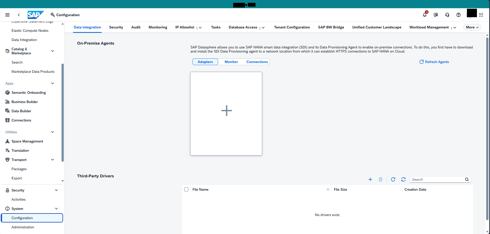

Bildformat: 1912 × 913 Pixel. Die folgenden Positionen beziehen sich auf dieses vollständige Bild.

## 1. Gesamtaufbau und sichtbarer Zustand

### Gesamtansicht

Die Systemseite besitzt eine obere Reihe mit mehreren Registerkarten. Im Hauptbereich steht ein Abschnitt zu On-Premise Agents. Darunter folgt ein Tabellenbereich für Third-Party Drivers.

### Registerkarten oben

Sichtbare Registerkarten sind unter anderem Audit, Tasks, Data Integration, Security, Monitoring, IP Allowlist, Database Access, Tenant Configuration, SAP BW Bridge, Unified Customer Landscape und Workload Management. Einige Register besitzen ein kleines Dropdown-Symbol.

### Oberer Hauptbereich

Der Abschnitt „On-Premise Agents“ enthält einen erklärenden Absatz zu SAP HANA Smart Data Integration und einem Data Provisioning Agent. Darunter stehen die Schaltflächen „Monitor Connections“ und „Refresh Agents“. Der dazwischenliegende Inhaltsbereich ist weitgehend leer.

### Unterer Hauptbereich

„Third-Party Drivers“ besitzt eine eigene Werkzeugleiste mit mehreren Symbolen und einer Suche. Die Tabelle enthält die Spalten File Name, File Size und Creation Date. In der Tabellenfläche steht „No drivers exist.“. Die beiden Abschnitte sind durch einen deutlichen vertikalen Abstand getrennt.

## 2. Räumliche Beschreibung von oben nach unten

### Registerleiste

**Ungefähre Bildregion:** x 16–100 %, y 9–14 %

Die Register sind horizontal angeordnet. Audit und Tasks stehen links, danach folgen die weiteren Systembereiche. Kleine nach unten gerichtete Pfeile erscheinen bei einzelnen Registerbezeichnungen.

### Agentenbereich

**Ungefähre Bildregion:** x 16–97 %, y 14–70 %

On-Premise Agents steht links über dem Abschnitt. Der Erklärungstext beginnt weiter rechts und läuft über mehrere Zeilen. Monitor Connections steht unter dem Text links, Refresh Agents weiter rechts. Der große Bereich darunter bleibt weitgehend leer.

### Treiberbereich

**Ungefähre Bildregion:** x 16–97 %, y 74–100 %

Third-Party Drivers steht links. Rechts darüber beziehungsweise daneben liegen kleine Werkzeugleistensymbole und Search. Die Tabelle enthält File Name links, File Size mittig und Creation Date rechts. No drivers exist. steht im leeren Tabellenkörper.

## 3. Positionsverzeichnis der lesbaren Beschriftungen

Sortierung nach Bildhöhe, innerhalb derselben Höhe von links nach rechts. Angegeben sind Textbegrenzungen; Abstände und Bedienelementflächen können darüber hinausreichen.

<table>
<colgroup>
<col style="width: 33%" />
<col style="width: 30%" />
<col style="width: 35%" />
</colgroup>
<thead>
<tr class="header">
<th>Sichtbarer Text</th>
<th>Textposition in Pixeln</th>
<th>Relative Lage im Bild</th>
</tr>
</thead>
<tbody>
<tr class="odd">
<td>Data Integration</td>
<td>x 289–393 
y 101–114</td>
<td>oben, links 
x 15.1–20.6 % 
y 11.1–12.5 %</td>
</tr>
<tr class="even">
<td>Security</td>
<td>x 426–480 
y 101–114</td>
<td>oben, links 
x 22.3–25.1 % 
y 11.1–12.5 %</td>
</tr>
<tr class="odd">
<td>Audit</td>
<td>x 513–548 
y 101–111</td>
<td>oben, links 
x 26.8–28.7 % 
y 11.1–12.2 %</td>
</tr>
<tr class="even">
<td>Monitoring</td>
<td>x 581–652 
y 101–114</td>
<td>oben, links 
x 30.4–34.1 % 
y 11.1–12.5 %</td>
</tr>
<tr class="odd">
<td>IP Allowlist</td>
<td>x 685–758 
y 101–111</td>
<td>oben, mittig 
x 35.8–39.6 % 
y 11.1–12.2 %</td>
</tr>
<tr class="even">
<td>Tasks</td>
<td>x 824–860 
y 101–111</td>
<td>oben, mittig 
x 43.1–45.0 % 
y 11.1–12.2 %</td>
</tr>
<tr class="odd">
<td>Database Access</td>
<td>x 893–1004 
y 101–111</td>
<td>oben, mittig 
x 46.7–52.5 % 
y 11.1–12.2 %</td>
</tr>
<tr class="even">
<td>Tenant Configuration</td>
<td>x 1070–1209 
y 101–114</td>
<td>oben, mittig 
x 56.0–63.2 % 
y 11.1–12.5 %</td>
</tr>
<tr class="odd">
<td>SAP BW Bridge</td>
<td>x 1242–1342 
y 101–114</td>
<td>oben, rechts 
x 65.0–70.2 % 
y 11.1–12.5 %</td>
</tr>
<tr class="even">
<td>Unified Customer Landscape</td>
<td>x 1376–1566 
y 101–114</td>
<td>oben, rechts 
x 71.9–81.9 % 
y 11.1–12.5 %</td>
</tr>
<tr class="odd">
<td>Workload Management</td>
<td>x 1598–1751 
y 101–114</td>
<td>oben, rechts 
x 83.6–91.6 % 
y 11.1–12.5 %</td>
</tr>
<tr class="even">
<td>More</td>
<td>x 1819–1852 
y 101–111</td>
<td>oben, rechts 
x 95.1–96.9 % 
y 11.1–12.2 %</td>
</tr>
<tr class="odd">
<td>Elastic Compute Nodes</td>
<td>x 46–189 
y 114–127</td>
<td>oben, links 
x 2.4–9.9 % 
y 12.5–13.9 %</td>
</tr>
<tr class="even">
<td>Data Integration</td>
<td>x 46–144 
y 150–163</td>
<td>oben, links 
x 2.4–7.5 % 
y 16.4–17.9 %</td>
</tr>
<tr class="odd">
<td>On-Premise Agents</td>
<td>x 302–446 
y 162–177</td>
<td>oben, links 
x 15.8–23.3 % 
y 17.8–19.4 %</td>
</tr>
<tr class="even">
<td>SAP HANA</td>
<td>x 960–1026 
y 179–189</td>
<td>oben, mittig 
x 50.2–53.7 % 
y 19.6–20.7 %</td>
</tr>
<tr class="odd">
<td>data integration</td>
<td>x 1068–1164 
y 179–192</td>
<td>oben, mittig 
x 55.9–60.9 % 
y 19.6–21.0 %</td>
</tr>
<tr class="even">
<td>connections.</td>
<td>x 1534–1610 
y 179–189</td>
<td>oben, rechts 
x 80.2–84.2 % 
y 19.6–20.7 %</td>
</tr>
<tr class="odd">
<td>from</td>
<td>x 1143–1170 
y 195–205</td>
<td>oben, mittig 
x 59.8–61.2 % 
y 21.4–22.5 %</td>
</tr>
<tr class="even">
<td>connections</td>
<td>x 1358–1431 
y 195–205</td>
<td>oben, rechts 
x 71.0–74.8 % 
y 21.4–22.5 %</td>
</tr>
<tr class="odd">
<td>SAP HANA</td>
<td>x 1452–1518 
y 195–205</td>
<td>oben, rechts 
x 75.9–79.4 % 
y 21.4–22.5 %</td>
</tr>
<tr class="even">
<td>Search</td>
<td>x 46–88 
y 238–248</td>
<td>oben, links 
x 2.4–4.6 % 
y 26.1–27.2 %</td>
</tr>
<tr class="odd">
<td>Connections</td>
<td>x 962–1045 
y 236–246</td>
<td>oben, mittig 
x 50.3–54.7 % 
y 25.8–26.9 %</td>
</tr>
<tr class="even">
<td>Refresh Agents</td>
<td>x 1660–1752 
y 236–249</td>
<td>oben, rechts 
x 86.8–91.6 % 
y 25.8–27.3 %</td>
</tr>
<tr class="odd">
<td>Apps</td>
<td>x 21–52 
y 320–333</td>
<td>auf mittlerer Höhe, links 
x 1.1–2.7 % 
y 35.0–36.5 %</td>
</tr>
<tr class="even">
<td>Semantic Onboarding</td>
<td>x 45–179 
y 356–369</td>
<td>auf mittlerer Höhe, links 
x 2.4–9.4 % 
y 39.0–40.4 %</td>
</tr>
<tr class="odd">
<td>Business Builder</td>
<td>x 46–148 
y 392–402</td>
<td>auf mittlerer Höhe, links 
x 2.4–7.7 % 
y 42.9–44.0 %</td>
</tr>
<tr class="even">
<td>Data Builder</td>
<td>x 46–122 
y 428–438</td>
<td>auf mittlerer Höhe, links 
x 2.4–6.4 % 
y 46.9–48.0 %</td>
</tr>
<tr class="odd">
<td>Connections</td>
<td>x 45–122 
y 464–474</td>
<td>auf mittlerer Höhe, links 
x 2.4–6.4 % 
y 50.8–51.9 %</td>
</tr>
<tr class="even">
<td>Utilities</td>
<td>x 22–66 
y 510–520</td>
<td>auf mittlerer Höhe, links 
x 1.2–3.5 % 
y 55.9–57.0 %</td>
</tr>
<tr class="odd">
<td>Space Management</td>
<td>x 45–168 
y 546–559</td>
<td>auf mittlerer Höhe, links 
x 2.4–8.8 % 
y 59.8–61.2 %</td>
</tr>
<tr class="even">
<td>Translation</td>
<td>x 45–112 
y 582–592</td>
<td>auf mittlerer Höhe, links 
x 2.4–5.9 % 
y 63.7–64.8 %</td>
</tr>
<tr class="odd">
<td>Transport</td>
<td>x 45–103 
y 618–631</td>
<td>unten, links 
x 2.4–5.4 % 
y 67.7–69.1 %</td>
</tr>
<tr class="even">
<td>Third-Party Drivers</td>
<td>x 301–444 
y 680–695</td>
<td>unten, links 
x 15.7–23.2 % 
y 74.5–76.1 %</td>
</tr>
<tr class="odd">
<td>Search</td>
<td>x 1608–1650 
y 695–705</td>
<td>unten, rechts 
x 84.1–86.3 % 
y 76.1–77.2 %</td>
</tr>
<tr class="even">
<td>Security</td>
<td>x 45–95 
y 737–750</td>
<td>unten, links 
x 2.4–5.0 % 
y 80.7–82.1 %</td>
</tr>
<tr class="odd">
<td>File Name</td>
<td>x 752–813 
y 734–744</td>
<td>unten, mittig 
x 39.3–42.5 % 
y 80.4–81.5 %</td>
</tr>
<tr class="even">
<td>File Size</td>
<td>x 1304–1354 
y 734–744</td>
<td>unten, rechts 
x 68.2–70.8 % 
y 80.4–81.5 %</td>
</tr>
<tr class="odd">
<td>Creation Date</td>
<td>x 1578–1663 
y 734–744</td>
<td>unten, rechts 
x 82.6–87.0 % 
y 80.4–81.5 %</td>
</tr>
<tr class="even">
<td>System</td>
<td>x 45–90 
y 809–822</td>
<td>unten, links 
x 2.4–4.7 % 
y 88.6–90.0 %</td>
</tr>
<tr class="odd">
<td>No drivers exist.</td>
<td>x 1230–1327 
y 833–843</td>
<td>unten, mittig 
x 64.3–69.4 % 
y 91.2–92.3 %</td>
</tr>
</tbody>
</table>

## 4. Abgrenzung

Die Beschreibung benennt nur den sichtbaren Zustand dieses Screenshots. Aus Symbolen ohne lesbare Beschriftung wird keine konkrete Funktion abgeleitet. Inhalte hinter schwarzen Balken und nicht sichtbare Bereiche außerhalb des Bildrandes bleiben unbeschrieben.

# Bild 16: Tasks: Importaufgaben

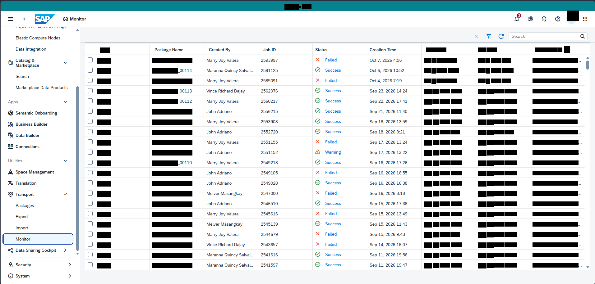

Bildformat: 1914 × 915 Pixel. Die folgenden Positionen beziehen sich auf dieses vollständige Bild.

## 1. Gesamtaufbau und sichtbarer Zustand

### Gesamtansicht

Der Screenshot zeigt eine Aufgabenliste als breite Tabelle. Die globale Navigation bleibt links sichtbar. Oben im Hauptbereich befinden sich kleine Aktionssymbole und eine Suchfunktion.

### Spalten

Die Tabelle enthält Job ID, Status, Creation Time, Start Time, End Time, Type, Package Name, Created By und Correlation ID. Die Zeitspalten stehen nebeneinander im mittleren Bereich. Rechts folgen die Felder für Paket, Ersteller und Korrelationskennung.

### Sichtbare Werte

In der Statusspalte sind sowohl Failed als auch Success sichtbar. In der Spalte Type steht wiederholt „Import“. Die Spalten Creation Time, Start Time und End Time enthalten jeweils Datum und Uhrzeit. Die geschwärzten Identifikatoren und personenbezogenen Felder werden nicht wiedergegeben.

### Darstellung

Die Tabelle zeigt zahlreiche Aufgaben untereinander. Jeder Datensatz bildet eine eigene Zeile. Die Statusangaben stehen links von den Zeitspalten und sind dadurch leicht mit den jeweiligen Zeitangaben zuzuordnen. Ein Aufgaben-Detailfenster oder ein Fehlerdialog ist nicht geöffnet.

## 2. Räumliche Beschreibung von oben nach unten

### Werkzeugleiste

**Ungefähre Bildregion:** x 16–98 %, y 9–13 %

Kleine Symbole stehen links im Kopfbereich, Search weiter rechts.

### Importtabelle

**Ungefähre Bildregion:** x 16–100 %, y 13–100 %

Job ID steht links, Status direkt daneben. Creation Time, Start Time und End Time folgen in drei nebeneinanderliegenden Zeitspalten. Type liegt rechts davon. Package Name, Created By und Correlation ID stehen im rechten Tabellenbereich. Failed und Success erscheinen in der Statusspalte, Import in der Typ-Spalte.

## 3. Positionsverzeichnis der lesbaren Beschriftungen

Sortierung nach Bildhöhe, innerhalb derselben Höhe von links nach rechts. Angegeben sind Textbegrenzungen; Abstände und Bedienelementflächen können darüber hinausreichen.

<table>
<colgroup>
<col style="width: 33%" />
<col style="width: 30%" />
<col style="width: 35%" />
</colgroup>
<thead>
<tr class="header">
<th>Sichtbarer Text</th>
<th>Textposition in Pixeln</th>
<th>Relative Lage im Bild</th>
</tr>
</thead>
<tbody>
<tr class="odd">
<td>Search</td>
<td>x 1648–1689 
y 112–122</td>
<td>oben, rechts 
x 86.1–88.2 % 
y 12.2–13.3 %</td>
</tr>
<tr class="even">
<td>Elastic Compute Nodes</td>
<td>x 51–194 
y 117–130</td>
<td>oben, links 
x 2.7–10.1 % 
y 12.8–14.2 %</td>
</tr>
<tr class="odd">
<td>Data Integration</td>
<td>x 51–148 
y 153–166</td>
<td>oben, links 
x 2.7–7.7 % 
y 16.7–18.1 %</td>
</tr>
<tr class="even">
<td>Package Name</td>
<td>x 498–590 
y 155–168</td>
<td>oben, links 
x 26.0–30.8 % 
y 16.9–18.4 %</td>
</tr>
<tr class="odd">
<td>Created By</td>
<td>x 672–741 
y 155–168</td>
<td>oben, mittig 
x 35.1–38.7 % 
y 16.9–18.4 %</td>
</tr>
<tr class="even">
<td>Job ID</td>
<td>x 847–887 
y 155–165</td>
<td>oben, mittig 
x 44.3–46.3 % 
y 16.9–18.0 %</td>
</tr>
<tr class="odd">
<td>Status</td>
<td>x 1015–1052 
y 155–165</td>
<td>oben, mittig 
x 53.0–55.0 % 
y 16.9–18.0 %</td>
</tr>
<tr class="even">
<td>Creation Time</td>
<td>x 1190–1274 
y 155–165</td>
<td>oben, mittig 
x 62.1–66.6 % 
y 16.9–18.0 %</td>
</tr>
<tr class="odd">
<td>Failed</td>
<td>x 1047–1083 
y 188–198</td>
<td>oben, mittig 
x 54.7–56.6 % 
y 20.5–21.6 %</td>
</tr>
<tr class="even">
<td>Success</td>
<td>x 1047–1096 
y 221–231</td>
<td>oben, mittig 
x 54.7–57.3 % 
y 24.2–25.2 %</td>
</tr>
<tr class="odd">
<td>Search</td>
<td>x 51–92 
y 241–251</td>
<td>oben, links 
x 2.7–4.8 % 
y 26.3–27.4 %</td>
</tr>
<tr class="even">
<td>Failed</td>
<td>x 1047–1083 
y 254–264</td>
<td>oben, mittig 
x 54.7–56.6 % 
y 27.8–28.9 %</td>
</tr>
<tr class="odd">
<td>Success</td>
<td>x 1047–1096 
y 287–297</td>
<td>oben, mittig 
x 54.7–57.3 % 
y 31.4–32.5 %</td>
</tr>
<tr class="even">
<td>Apps</td>
<td>x 26–57 
y 323–336</td>
<td>auf mittlerer Höhe, links 
x 1.4–3.0 % 
y 35.3–36.7 %</td>
</tr>
<tr class="odd">
<td>Success</td>
<td>x 1047–1096 
y 320–330</td>
<td>auf mittlerer Höhe, mittig 
x 54.7–57.3 % 
y 35.0–36.1 %</td>
</tr>
<tr class="even">
<td>Success</td>
<td>x 1047–1096 
y 353–363</td>
<td>auf mittlerer Höhe, mittig 
x 54.7–57.3 % 
y 38.6–39.7 %</td>
</tr>
<tr class="odd">
<td>Semantic Onboarding</td>
<td>x 50–184 
y 359–372</td>
<td>auf mittlerer Höhe, links 
x 2.6–9.6 % 
y 39.2–40.7 %</td>
</tr>
<tr class="even">
<td>Success</td>
<td>x 1047–1096 
y 386–396</td>
<td>auf mittlerer Höhe, mittig 
x 54.7–57.3 % 
y 42.2–43.3 %</td>
</tr>
<tr class="odd">
<td>Business Builder</td>
<td>x 51–153 
y 395–405</td>
<td>auf mittlerer Höhe, links 
x 2.7–8.0 % 
y 43.2–44.3 %</td>
</tr>
<tr class="even">
<td>Success</td>
<td>x 1047–1096 
y 419–429</td>
<td>auf mittlerer Höhe, mittig 
x 54.7–57.3 % 
y 45.8–46.9 %</td>
</tr>
<tr class="odd">
<td>Data Builder</td>
<td>x 51–127 
y 431–441</td>
<td>auf mittlerer Höhe, links 
x 2.7–6.6 % 
y 47.1–48.2 %</td>
</tr>
<tr class="even">
<td>Failed</td>
<td>x 1047–1083 
y 452–462</td>
<td>auf mittlerer Höhe, mittig 
x 54.7–56.6 % 
y 49.4–50.5 %</td>
</tr>
<tr class="odd">
<td>Connections</td>
<td>x 50–126 
y 467–477</td>
<td>auf mittlerer Höhe, links 
x 2.6–6.6 % 
y 51.0–52.1 %</td>
</tr>
<tr class="even">
<td>Utilities</td>
<td>x 27–71 
y 513–523</td>
<td>auf mittlerer Höhe, links 
x 1.4–3.7 % 
y 56.1–57.2 %</td>
</tr>
<tr class="odd">
<td>Success</td>
<td>x 1047–1096 
y 518–528</td>
<td>auf mittlerer Höhe, mittig 
x 54.7–57.3 % 
y 56.6–57.7 %</td>
</tr>
<tr class="even">
<td>Space Management</td>
<td>x 50–173 
y 549–562</td>
<td>auf mittlerer Höhe, links 
x 2.6–9.0 % 
y 60.0–61.4 %</td>
</tr>
<tr class="odd">
<td>Failed</td>
<td>x 1047–1083 
y 551–561</td>
<td>auf mittlerer Höhe, mittig 
x 54.7–56.6 % 
y 60.2–61.3 %</td>
</tr>
<tr class="even">
<td>Translation</td>
<td>x 50–117 
y 585–595</td>
<td>auf mittlerer Höhe, links 
x 2.6–6.1 % 
y 63.9–65.0 %</td>
</tr>
<tr class="odd">
<td>Success</td>
<td>x 1047–1096 
y 584–594</td>
<td>auf mittlerer Höhe, mittig 
x 54.7–57.3 % 
y 63.8–64.9 %</td>
</tr>
<tr class="even">
<td>Failed</td>
<td>x 1047–1083 
y 617–627</td>
<td>unten, mittig 
x 54.7–56.6 % 
y 67.4–68.5 %</td>
</tr>
<tr class="odd">
<td>Transport</td>
<td>x 50–108 
y 621–634</td>
<td>unten, links 
x 2.6–5.6 % 
y 67.9–69.3 %</td>
</tr>
<tr class="even">
<td>Success</td>
<td>x 1047–1096 
y 650–660</td>
<td>unten, mittig 
x 54.7–57.3 % 
y 71.0–72.1 %</td>
</tr>
<tr class="odd">
<td>Failed</td>
<td>x 1047–1083 
y 683–693</td>
<td>unten, mittig 
x 54.7–56.6 % 
y 74.6–75.7 %</td>
</tr>
<tr class="even">
<td>Success</td>
<td>x 1047–1096 
y 716–726</td>
<td>unten, mittig 
x 54.7–57.3 % 
y 78.3–79.3 %</td>
</tr>
<tr class="odd">
<td>Import</td>
<td>x 51–90 
y 729–742</td>
<td>unten, links 
x 2.7–4.7 % 
y 79.7–81.1 %</td>
</tr>
<tr class="even">
<td>Failed</td>
<td>x 1047–1083 
y 749–759</td>
<td>unten, mittig 
x 54.7–56.6 % 
y 81.9–83.0 %</td>
</tr>
<tr class="odd">
<td>Failed</td>
<td>x 1047–1083 
y 782–792</td>
<td>unten, mittig 
x 54.7–56.6 % 
y 85.5–86.6 %</td>
</tr>
<tr class="even">
<td>Data Sharing Cockpit</td>
<td>x 51–180 
y 801–814</td>
<td>unten, links 
x 2.7–9.4 % 
y 87.5–89.0 %</td>
</tr>
<tr class="odd">
<td>Success</td>
<td>x 1047–1096 
y 815–825</td>
<td>unten, mittig 
x 54.7–57.3 % 
y 89.1–90.2 %</td>
</tr>
<tr class="even">
<td>Security</td>
<td>x 50–100 
y 848–861</td>
<td>unten, links 
x 2.6–5.2 % 
y 92.7–94.1 %</td>
</tr>
<tr class="odd">
<td>Success</td>
<td>x 1047–1096 
y 848–858</td>
<td>unten, mittig 
x 54.7–57.3 % 
y 92.7–93.8 %</td>
</tr>
<tr class="even">
<td>System</td>
<td>x 50–95 
y 884–897</td>
<td>unten, links 
x 2.6–5.0 % 
y 96.6–98.0 %</td>
</tr>
</tbody>
</table>

## 4. Abgrenzung

Die Beschreibung benennt nur den sichtbaren Zustand dieses Screenshots. Aus Symbolen ohne lesbare Beschriftung wird keine konkrete Funktion abgeleitet. Inhalte hinter schwarzen Balken und nicht sichtbare Bereiche außerhalb des Bildrandes bleiben unbeschrieben.

# Bild 17: Data Builder: Objektliste und Erstellungsaktionen

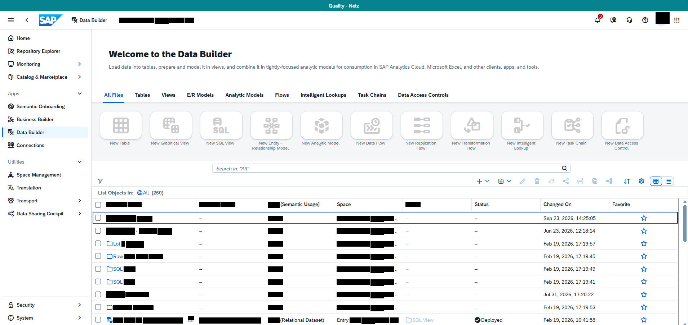

Bildformat: 1909 × 904 Pixel. Die folgenden Positionen beziehen sich auf dieses vollständige Bild.

## 1. Gesamtaufbau und sichtbarer Zustand

### Gesamtansicht

Das Bild zeigt eine Data-Builder-Übersicht mit einem Begrüßungsbereich oben, einer Reihe von Objektkategorien und Erstellungsaktionen in der Mitte sowie einer Tabelle unten.

### Kopfbereich und Kategorien

Oben steht „Welcome to the Data Builder“ mit einem kurzen erklärenden Absatz. Darunter sind die Kategorien All Files, Tables, Views, E/R Models, Flows, Task Chains, Data Access Controls, Analytic Models und Intelligent Lookups horizontal angeordnet.

### Erstellungsaktionen

Unter den Kategorien stehen große Symbolaktionen mit Beschriftungen: New Table, New Graphical View, New SQL View, New Entity-Relationship Model, New Analytic Model, New Data Flow, New Replication Flow, New Transformation Flow, New Intelligent Lookup, New Task Chain und New Data Access Control. Die Aktionen sind in einer durchgehenden Reihe angeordnet.

### Unterer Bereich

Unterhalb einer Such- und Werkzeugleiste folgt die Objektliste. Sichtbar sind Spalten für Type beziehungsweise Semantic Usage, Space, Folder, Status, Changed On und Favorite. Mehrere Zeilen sind als Folder gekennzeichnet; eine weitere Zeile zeigt einen View-Eintrag mit Relational Dataset und Deployed. Ein Menü ist in diesem Bild nicht aufgeklappt.

## 2. Räumliche Beschreibung von oben nach unten

### Begrüßung und Kategorien

**Ungefähre Bildregion:** x 16–98 %, y 11–31 %

Welcome to the Data Builder steht links oben. Der erklärende Absatz liegt darunter. Die Kategorien bilden eine durchgehende horizontale Reihe unterhalb des Textes.

### Erstellungsaktionen

**Ungefähre Bildregion:** x 16–98 %, y 34–44 %

Große Symbole stehen jeweils oberhalb ihrer Beschriftungen. Die Aktionen laufen von New Table links bis New Data Access Control rechts. Längere Beschriftungen sind über mehrere Zeilen verteilt.

### Werkzeugleiste und Objekttabelle

**Ungefähre Bildregion:** x 16–100 %, y 47–100 %

Die Suche und kleinen Aktionssymbole liegen über List Objects In und der Tabellenkopfzeile. Die Tabelle zeigt Ordnerzeilen sowie unten einen View-Eintrag. Status und Änderungszeit liegen rechts, Favorite am äußersten rechten Rand.

## 3. Positionsverzeichnis der lesbaren Beschriftungen

Sortierung nach Bildhöhe, innerhalb derselben Höhe von links nach rechts. Angegeben sind Textbegrenzungen; Abstände und Bedienelementflächen können darüber hinausreichen.

<table>
<colgroup>
<col style="width: 33%" />
<col style="width: 30%" />
<col style="width: 35%" />
</colgroup>
<thead>
<tr class="header">
<th>Sichtbarer Text</th>
<th>Textposition in Pixeln</th>
<th>Relative Lage im Bild</th>
</tr>
</thead>
<tbody>
<tr class="odd">
<td>Data Builder</td>
<td>x 222–297 
y 51–61</td>
<td>oben, links 
x 11.6–15.6 % 
y 5.6–6.7 %</td>
</tr>
<tr class="even">
<td>Home</td>
<td>x 46–83 
y 101–111</td>
<td>oben, links 
x 2.4–4.3 % 
y 11.2–12.3 %</td>
</tr>
<tr class="odd">
<td>Repository Explorer</td>
<td>x 46–168 
y 137–150</td>
<td>oben, links 
x 2.4–8.8 % 
y 15.2–16.6 %</td>
</tr>
<tr class="even">
<td>Welcome to the Data Builder</td>
<td>x 302–643 
y 140–159</td>
<td>oben, links 
x 15.8–33.7 % 
y 15.5–17.6 %</td>
</tr>
<tr class="odd">
<td>Monitoring</td>
<td>x 46–112 
y 173–186</td>
<td>oben, links 
x 2.4–5.9 % 
y 19.1–20.6 %</td>
</tr>
<tr class="even">
<td>tables,</td>
<td>x 394–435 
y 181–192</td>
<td>oben, links 
x 20.7–22.8 % 
y 20.0–21.3 %</td>
</tr>
<tr class="odd">
<td>views,</td>
<td>x 587–624 
y 182–192</td>
<td>oben, links 
x 30.7–32.7 % 
y 20.1–21.3 %</td>
</tr>
<tr class="even">
<td>analytic models</td>
<td>x 834–929 
y 181–194</td>
<td>oben, mittig 
x 43.7–48.7 % 
y 20.0–21.5 %</td>
</tr>
<tr class="odd">
<td>apps,</td>
<td>x 1398–1430 
y 184–194</td>
<td>oben, rechts 
x 73.2–74.9 % 
y 20.4–21.5 %</td>
</tr>
<tr class="even">
<td>Catalog &amp; Marketplace</td>
<td>x 46–187 
y 209–222</td>
<td>oben, links 
x 2.4–9.8 % 
y 23.1–24.6 %</td>
</tr>
<tr class="odd">
<td>Apps</td>
<td>x 22–53 
y 255–268</td>
<td>oben, links 
x 1.2–2.8 % 
y 28.2–29.6 %</td>
</tr>
<tr class="even">
<td>All Files</td>
<td>x 290–342 
y 259–269</td>
<td>oben, links 
x 15.2–17.9 % 
y 28.7–29.8 %</td>
</tr>
<tr class="odd">
<td>Tables</td>
<td>x 374–416 
y 259–269</td>
<td>oben, links 
x 19.6–21.8 % 
y 28.7–29.8 %</td>
</tr>
<tr class="even">
<td>Views</td>
<td>x 448–486 
y 259–269</td>
<td>oben, links 
x 23.5–25.5 % 
y 28.7–29.8 %</td>
</tr>
<tr class="odd">
<td>E/R Models</td>
<td>x 520–593 
y 259–269</td>
<td>oben, links 
x 27.2–31.1 % 
y 28.7–29.8 %</td>
</tr>
<tr class="even">
<td>Analytic Models</td>
<td>x 626–731 
y 259–272</td>
<td>oben, mittig 
x 32.8–38.3 % 
y 28.7–30.1 %</td>
</tr>
<tr class="odd">
<td>Flows</td>
<td>x 764–802 
y 259–269</td>
<td>oben, mittig 
x 40.0–42.0 % 
y 28.7–29.8 %</td>
</tr>
<tr class="even">
<td>Intelligent Lookups</td>
<td>x 834–960 
y 259–272</td>
<td>oben, mittig 
x 43.7–50.3 % 
y 28.7–30.1 %</td>
</tr>
<tr class="odd">
<td>Task Chains</td>
<td>x 993–1072 
y 259–269</td>
<td>oben, mittig 
x 52.0–56.2 % 
y 28.7–29.8 %</td>
</tr>
<tr class="even">
<td>Data Access Controls</td>
<td>x 1105–1244 
y 259–269</td>
<td>oben, mittig 
x 57.9–65.2 % 
y 28.7–29.8 %</td>
</tr>
<tr class="odd">
<td>Semantic Onboarding</td>
<td>x 46–180 
y 291–304</td>
<td>oben, links 
x 2.4–9.4 % 
y 32.2–33.6 %</td>
</tr>
<tr class="even">
<td>Business Builder</td>
<td>x 46–149 
y 327–337</td>
<td>auf mittlerer Höhe, links 
x 2.4–7.8 % 
y 36.2–37.3 %</td>
</tr>
<tr class="odd">
<td>Data Builder</td>
<td>x 46–123 
y 363–373</td>
<td>auf mittlerer Höhe, links 
x 2.4–6.4 % 
y 40.2–41.3 %</td>
</tr>
<tr class="even">
<td>Connections</td>
<td>x 46–122 
y 399–409</td>
<td>auf mittlerer Höhe, links 
x 2.4–6.4 % 
y 44.1–45.2 %</td>
</tr>
<tr class="odd">
<td>New Table</td>
<td>x 306–360 
y 394–402</td>
<td>auf mittlerer Höhe, links 
x 16.0–18.9 % 
y 43.6–44.5 %</td>
</tr>
<tr class="even">
<td>New Graphical View</td>
<td>x 420–525 
y 394–405</td>
<td>auf mittlerer Höhe, links 
x 22.0–27.5 % 
y 43.6–44.8 %</td>
</tr>
<tr class="odd">
<td>New SQL View</td>
<td>x 573–650 
y 394–402</td>
<td>auf mittlerer Höhe, links 
x 30.0–34.0 % 
y 43.6–44.5 %</td>
</tr>
<tr class="even">
<td>New Entity</td>
<td>x 719–775 
y 394–405</td>
<td>auf mittlerer Höhe, mittig 
x 37.7–40.6 % 
y 43.6–44.8 %</td>
</tr>
<tr class="odd">
<td>New Analytic Model</td>
<td>x 838–942 
y 394–405</td>
<td>auf mittlerer Höhe, mittig 
x 43.9–49.3 % 
y 43.6–44.8 %</td>
</tr>
<tr class="even">
<td>New Data Flow</td>
<td>x 989–1068 
y 394–402</td>
<td>auf mittlerer Höhe, mittig 
x 51.8–56.0 % 
y 43.6–44.5 %</td>
</tr>
<tr class="odd">
<td>New Replication</td>
<td>x 1126–1210 
y 394–405</td>
<td>auf mittlerer Höhe, mittig 
x 59.0–63.4 % 
y 43.6–44.8 %</td>
</tr>
<tr class="even">
<td>New Transformation</td>
<td>x 1255–1359 
y 394–402</td>
<td>auf mittlerer Höhe, rechts 
x 65.7–71.2 % 
y 43.6–44.5 %</td>
</tr>
<tr class="odd">
<td>New Intelligent</td>
<td>x 1407–1486 
y 394–405</td>
<td>auf mittlerer Höhe, rechts 
x 73.7–77.8 % 
y 43.6–44.8 %</td>
</tr>
<tr class="even">
<td>New Task Chain</td>
<td>x 1544–1627 
y 394–402</td>
<td>auf mittlerer Höhe, rechts 
x 80.9–85.2 % 
y 43.6–44.5 %</td>
</tr>
<tr class="odd">
<td>New Data Access</td>
<td>x 1680–1770 
y 394–402</td>
<td>auf mittlerer Höhe, rechts 
x 88.0–92.7 % 
y 43.6–44.5 %</td>
</tr>
<tr class="even">
<td>Relationship Model</td>
<td>x 700–801 
y 408–419</td>
<td>auf mittlerer Höhe, mittig 
x 36.7–42.0 % 
y 45.1–46.3 %</td>
</tr>
<tr class="odd">
<td>Utilities</td>
<td>x 23–67 
y 445–455</td>
<td>auf mittlerer Höhe, links 
x 1.2–3.5 % 
y 49.2–50.3 %</td>
</tr>
<tr class="even">
<td>Search in:</td>
<td>x 600–661 
y 464–474</td>
<td>auf mittlerer Höhe, mittig 
x 31.5–34.6 % 
y 51.3–52.4 %</td>
</tr>
<tr class="odd">
<td>"All"</td>
<td>x 666–691 
y 464–474</td>
<td>auf mittlerer Höhe, mittig 
x 34.9–36.2 % 
y 51.3–52.4 %</td>
</tr>
<tr class="even">
<td>Space Management</td>
<td>x 46–169 
y 481–494</td>
<td>auf mittlerer Höhe, links 
x 2.4–8.9 % 
y 53.2–54.6 %</td>
</tr>
<tr class="odd">
<td>Translation</td>
<td>x 46–113 
y 517–527</td>
<td>auf mittlerer Höhe, links 
x 2.4–5.9 % 
y 57.2–58.3 %</td>
</tr>
<tr class="even">
<td>List Objects In:</td>
<td>x 273–370 
y 531–544</td>
<td>auf mittlerer Höhe, links 
x 14.3–19.4 % 
y 58.7–60.2 %</td>
</tr>
<tr class="odd">
<td>Transport</td>
<td>x 46–104 
y 553–566</td>
<td>auf mittlerer Höhe, links 
x 2.4–5.4 % 
y 61.2–62.6 %</td>
</tr>
<tr class="even">
<td>(Semantic Usage)</td>
<td>x 781–886 
y 559–581</td>
<td>auf mittlerer Höhe, mittig 
x 40.9–46.4 % 
y 61.8–64.3 %</td>
</tr>
<tr class="odd">
<td>Space</td>
<td>x 936–973 
y 563–576</td>
<td>auf mittlerer Höhe, mittig 
x 49.0–51.0 % 
y 62.3–63.7 %</td>
</tr>
<tr class="even">
<td>Status</td>
<td>x 1318–1356 
y 563–573</td>
<td>auf mittlerer Höhe, rechts 
x 69.0–71.0 % 
y 62.3–63.4 %</td>
</tr>
<tr class="odd">
<td>Changed On</td>
<td>x 1508–1586 
y 563–576</td>
<td>auf mittlerer Höhe, rechts 
x 79.0–83.1 % 
y 62.3–63.7 %</td>
</tr>
<tr class="even">
<td>Favorite</td>
<td>x 1700–1748 
y 563–573</td>
<td>auf mittlerer Höhe, rechts 
x 89.0–91.6 % 
y 62.3–63.4 %</td>
</tr>
<tr class="odd">
<td>Data Sharing Cockpit</td>
<td>x 46–176 
y 589–602</td>
<td>auf mittlerer Höhe, links 
x 2.4–9.2 % 
y 65.2–66.6 %</td>
</tr>
<tr class="even">
<td>Security</td>
<td>x 46–96 
y 843–856</td>
<td>unten, links 
x 2.4–5.0 % 
y 93.3–94.7 %</td>
</tr>
<tr class="odd">
<td>System</td>
<td>x 46–91 
y 879–892</td>
<td>unten, links 
x 2.4–4.8 % 
y 97.2–98.7 %</td>
</tr>
<tr class="even">
<td>Deployed</td>
<td>x 1336–1394 
y 885–898</td>
<td>unten, rechts 
x 70.0–73.0 % 
y 97.9–99.3 %</td>
</tr>
</tbody>
</table>

## 4. Abgrenzung

Die Beschreibung benennt nur den sichtbaren Zustand dieses Screenshots. Aus Symbolen ohne lesbare Beschriftung wird keine konkrete Funktion abgeleitet. Inhalte hinter schwarzen Balken und nicht sichtbare Bereiche außerhalb des Bildrandes bleiben unbeschrieben.

# Bild 18: Data Builder: geöffnetes Erstellungsmenü

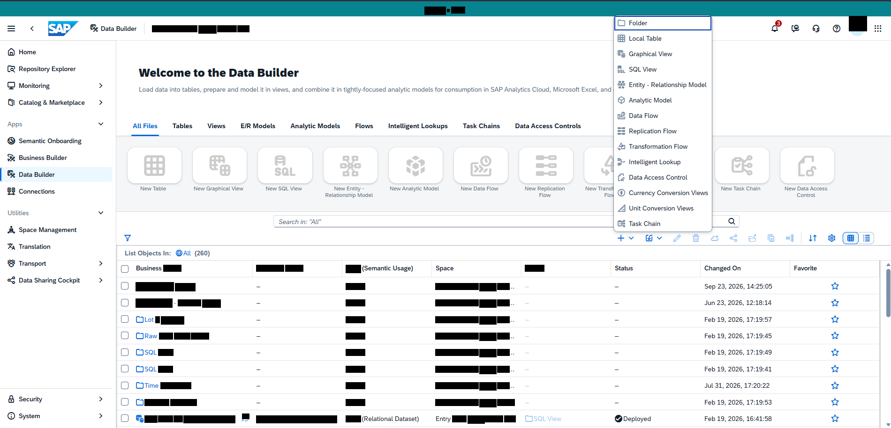

Bildformat: 1900 × 915 Pixel. Die folgenden Positionen beziehen sich auf dieses vollständige Bild.

## 1. Gesamtaufbau und sichtbarer Zustand

### Gesamtansicht

Die Grundansicht entspricht einer Data-Builder-Objektübersicht. Zusätzlich ist im oberen rechten Teil des Hauptbereichs ein vertikales Dropdown-Menü geöffnet. Dieses liegt über den darunterliegenden Erstellungsaktionen.

### Menü rechts oben

Das Menü enthält Einträge mit kleinen Symbolen. Sichtbar sind Graphical View, SQL View, Entity-Relationship Model, Analytic Model, Data Flow, Replication Flow, Transformation Flow, Intelligent Lookup, Data Access Control, Currency Conversion Views, Unit Conversion Views und Task Chain. Die Einträge stehen einzeln untereinander.

### Hintergrund

Hinter dem Menü sind die Begrüßungsüberschrift, die Kategorien All Files, Tables, Views, E/R Models, Flows, Task Chains, Data Access Controls, Analytic Models und Intelligent Lookups sowie die Reihe der Erstellungsaktionen sichtbar. Das Menü verdeckt einen Teil dieser Reihe, ohne die gesamte Seite zu überlagern.

### Unterer Bereich

Die Objektliste bleibt im unteren Teil des Screenshots sichtbar. Sie enthält mehrere Ordnerzeilen, Datumsangaben und einen bereitgestellten View-Eintrag. Die globale Navigation steht links. Ein modaler Dialog ist nicht geöffnet; nur das Dropdown-Menü liegt über dem Seiteninhalt.

## 2. Räumliche Beschreibung von oben nach unten

### Hintergrund

**Ungefähre Bildregion:** x 16–98 %, y 11–100 %

Die Begrüßung, Kategorien, Erstellungsaktionen und Objekttabelle bleiben sichtbar. Der rechte Teil der oberen Inhaltsfläche wird durch das geöffnete Menü überlagert.

### Geöffnetes Erstellungsmenü

**Ungefähre Bildregion:** x 79–97 %, y 10–49 %

Das schmale weiße Menü liegt oben rechts. Kleine Symbole stehen links vor den Einträgen. Die Einträge sind von oben nach unten gestapelt: Graphical View, SQL View, Entity-Relationship Model, Analytic Model, Data Flow, Replication Flow, Transformation Flow, Intelligent Lookup, Data Access Control, Currency Conversion Views, Unit Conversion Views und Task Chain. Der letzte Eintrag liegt knapp oberhalb der Tabellenwerkzeugleiste.

## 3. Positionsverzeichnis der lesbaren Beschriftungen

Sortierung nach Bildhöhe, innerhalb derselben Höhe von links nach rechts. Angegeben sind Textbegrenzungen; Abstände und Bedienelementflächen können darüber hinausreichen.

<table>
<colgroup>
<col style="width: 33%" />
<col style="width: 30%" />
<col style="width: 35%" />
</colgroup>
<thead>
<tr class="header">
<th>Sichtbarer Text</th>
<th>Textposition in Pixeln</th>
<th>Relative Lage im Bild</th>
</tr>
</thead>
<tbody>
<tr class="odd">
<td>Data Builder</td>
<td>x 216–291 
y 56–66</td>
<td>oben, links 
x 11.3–15.3 % 
y 6.1–7.2 %</td>
</tr>
<tr class="even">
<td>Local Table</td>
<td>x 1342–1410 
y 77–87</td>
<td>oben, rechts 
x 70.6–74.2 % 
y 8.4–9.5 %</td>
</tr>
<tr class="odd">
<td>Home</td>
<td>x 40–77 
y 106–116</td>
<td>oben, links 
x 2.1–4.1 % 
y 11.6–12.7 %</td>
</tr>
<tr class="even">
<td>Graphical View</td>
<td>x 1341–1433 
y 110–123</td>
<td>oben, rechts 
x 70.6–75.4 % 
y 12.0–13.4 %</td>
</tr>
<tr class="odd">
<td>Repository Explorer</td>
<td>x 40–162 
y 142–155</td>
<td>oben, links 
x 2.1–8.5 % 
y 15.5–16.9 %</td>
</tr>
<tr class="even">
<td>Welcome to the Data Builder</td>
<td>x 296–637 
y 145–164</td>
<td>oben, links 
x 15.6–33.5 % 
y 15.8–17.9 %</td>
</tr>
<tr class="odd">
<td>SQL View</td>
<td>x 1342–1400 
y 143–154</td>
<td>oben, rechts 
x 70.6–73.7 % 
y 15.6–16.8 %</td>
</tr>
<tr class="even">
<td>Monitoring</td>
<td>x 40–106 
y 178–191</td>
<td>oben, links 
x 2.1–5.6 % 
y 19.5–20.9 %</td>
</tr>
<tr class="odd">
<td>Entity</td>
<td>x 1342–1376 
y 176–189</td>
<td>oben, rechts 
x 70.6–72.4 % 
y 19.2–20.7 %</td>
</tr>
<tr class="even">
<td>Relationship Model</td>
<td>x 1389–1506 
y 176–189</td>
<td>oben, rechts 
x 73.1–79.3 % 
y 19.2–20.7 %</td>
</tr>
<tr class="odd">
<td>tables,</td>
<td>x 388–429 
y 186–198</td>
<td>oben, links 
x 20.4–22.6 % 
y 20.3–21.6 %</td>
</tr>
<tr class="even">
<td>views,</td>
<td>x 581–618 
y 186–198</td>
<td>oben, links 
x 30.6–32.5 % 
y 20.4–21.6 %</td>
</tr>
<tr class="odd">
<td>analytic models</td>
<td>x 828–923 
y 186–199</td>
<td>oben, mittig 
x 43.6–48.6 % 
y 20.3–21.7 %</td>
</tr>
<tr class="even">
<td>Analytic Model</td>
<td>x 1341–1432 
y 209–222</td>
<td>oben, rechts 
x 70.6–75.4 % 
y 22.8–24.3 %</td>
</tr>
<tr class="odd">
<td>Catalog &amp; Marketplace</td>
<td>x 40–181 
y 214–227</td>
<td>oben, links 
x 2.1–9.5 % 
y 23.4–24.8 %</td>
</tr>
<tr class="even">
<td>Data Flow</td>
<td>x 1342–1403 
y 242–252</td>
<td>oben, rechts 
x 70.6–73.8 % 
y 26.4–27.5 %</td>
</tr>
<tr class="odd">
<td>Apps</td>
<td>x 16–47 
y 260–273</td>
<td>oben, links 
x 0.8–2.5 % 
y 28.4–29.8 %</td>
</tr>
<tr class="even">
<td>All Files</td>
<td>x 284–336 
y 264–274</td>
<td>oben, links 
x 14.9–17.7 % 
y 28.9–29.9 %</td>
</tr>
<tr class="odd">
<td>Tables</td>
<td>x 368–410 
y 264–274</td>
<td>oben, links 
x 19.4–21.6 % 
y 28.9–29.9 %</td>
</tr>
<tr class="even">
<td>Views</td>
<td>x 442–480 
y 264–274</td>
<td>oben, links 
x 23.3–25.3 % 
y 28.9–29.9 %</td>
</tr>
<tr class="odd">
<td>E/R Models</td>
<td>x 514–587 
y 264–274</td>
<td>oben, links 
x 27.0–30.9 % 
y 28.9–29.9 %</td>
</tr>
<tr class="even">
<td>Analytic Models</td>
<td>x 620–725 
y 264–277</td>
<td>oben, mittig 
x 32.6–38.2 % 
y 28.9–30.3 %</td>
</tr>
<tr class="odd">
<td>Flows</td>
<td>x 758–796 
y 264–274</td>
<td>oben, mittig 
x 39.9–41.9 % 
y 28.9–29.9 %</td>
</tr>
<tr class="even">
<td>Intelligent Lookups</td>
<td>x 828–954 
y 264–277</td>
<td>oben, mittig 
x 43.6–50.2 % 
y 28.9–30.3 %</td>
</tr>
<tr class="odd">
<td>Task Chains</td>
<td>x 987–1066 
y 264–274</td>
<td>oben, mittig 
x 51.9–56.1 % 
y 28.9–29.9 %</td>
</tr>
<tr class="even">
<td>Data Access Controls</td>
<td>x 1099–1238 
y 264–274</td>
<td>oben, mittig 
x 57.8–65.2 % 
y 28.9–29.9 %</td>
</tr>
<tr class="odd">
<td>Replication Flow</td>
<td>x 1342–1443 
y 275–288</td>
<td>oben, rechts 
x 70.6–75.9 % 
y 30.1–31.5 %</td>
</tr>
<tr class="even">
<td>Semantic Onboarding</td>
<td>x 40–174 
y 296–309</td>
<td>auf mittlerer Höhe, links 
x 2.1–9.2 % 
y 32.3–33.8 %</td>
</tr>
<tr class="odd">
<td>Transformation Flow</td>
<td>x 1341–1466 
y 308–318</td>
<td>auf mittlerer Höhe, rechts 
x 70.6–77.2 % 
y 33.7–34.8 %</td>
</tr>
<tr class="even">
<td>Business Builder</td>
<td>x 40–143 
y 332–342</td>
<td>auf mittlerer Höhe, links 
x 2.1–7.5 % 
y 36.3–37.4 %</td>
</tr>
<tr class="odd">
<td>Intelligent Lookup</td>
<td>x 1342–1451 
y 341–354</td>
<td>auf mittlerer Höhe, rechts 
x 70.6–76.4 % 
y 37.3–38.7 %</td>
</tr>
<tr class="even">
<td>Data Builder</td>
<td>x 40–117 
y 368–378</td>
<td>auf mittlerer Höhe, links 
x 2.1–6.2 % 
y 40.2–41.3 %</td>
</tr>
<tr class="odd">
<td>Data Access Control</td>
<td>x 1342–1466 
y 374–384</td>
<td>auf mittlerer Höhe, rechts 
x 70.6–77.1 % 
y 40.9–42.0 %</td>
</tr>
<tr class="even">
<td>New Table</td>
<td>x 300–354 
y 399–407</td>
<td>auf mittlerer Höhe, links 
x 15.8–18.6 % 
y 43.6–44.5 %</td>
</tr>
<tr class="odd">
<td>New Graphical View</td>
<td>x 414–519 
y 399–410</td>
<td>auf mittlerer Höhe, links 
x 21.8–27.3 % 
y 43.6–44.8 %</td>
</tr>
<tr class="even">
<td>New SQL View</td>
<td>x 567–644 
y 399–408</td>
<td>auf mittlerer Höhe, links 
x 29.8–33.9 % 
y 43.6–44.5 %</td>
</tr>
<tr class="odd">
<td>New Entity</td>
<td>x 713–769 
y 399–410</td>
<td>auf mittlerer Höhe, mittig 
x 37.5–40.5 % 
y 43.6–44.8 %</td>
</tr>
<tr class="even">
<td>New Analytic Model</td>
<td>x 832–936 
y 399–410</td>
<td>auf mittlerer Höhe, mittig 
x 43.8–49.3 % 
y 43.6–44.8 %</td>
</tr>
<tr class="odd">
<td>New Data Flow</td>
<td>x 983–1062 
y 399–407</td>
<td>auf mittlerer Höhe, mittig 
x 51.7–55.9 % 
y 43.6–44.5 %</td>
</tr>
<tr class="even">
<td>New Replication</td>
<td>x 1120–1204 
y 399–410</td>
<td>auf mittlerer Höhe, mittig 
x 58.9–63.4 % 
y 43.6–44.8 %</td>
</tr>
<tr class="odd">
<td>New Task Chain</td>
<td>x 1538–1621 
y 399–407</td>
<td>auf mittlerer Höhe, rechts 
x 80.9–85.3 % 
y 43.6–44.5 %</td>
</tr>
<tr class="even">
<td>New Data Access</td>
<td>x 1674–1764 
y 399–407</td>
<td>auf mittlerer Höhe, rechts 
x 88.1–92.8 % 
y 43.6–44.5 %</td>
</tr>
<tr class="odd">
<td>Connections</td>
<td>x 40–116 
y 404–414</td>
<td>auf mittlerer Höhe, links 
x 2.1–6.1 % 
y 44.2–45.2 %</td>
</tr>
<tr class="even">
<td>Relationship Model</td>
<td>x 694–795 
y 413–424</td>
<td>auf mittlerer Höhe, mittig 
x 36.5–41.8 % 
y 45.1–46.3 %</td>
</tr>
<tr class="odd">
<td>Currency Conversion Views</td>
<td>x 1341–1510 
y 407–420</td>
<td>auf mittlerer Höhe, rechts 
x 70.6–79.5 % 
y 44.5–45.9 %</td>
</tr>
<tr class="even">
<td>Unit Conversion Views</td>
<td>x 1342–1479 
y 440–450</td>
<td>auf mittlerer Höhe, rechts 
x 70.6–77.8 % 
y 48.1–49.2 %</td>
</tr>
<tr class="odd">
<td>Utilities</td>
<td>x 17–61 
y 450–460</td>
<td>auf mittlerer Höhe, links 
x 0.9–3.2 % 
y 49.2–50.3 %</td>
</tr>
<tr class="even">
<td>Search in:</td>
<td>x 594–655 
y 469–479</td>
<td>auf mittlerer Höhe, links 
x 31.3–34.5 % 
y 51.3–52.3 %</td>
</tr>
<tr class="odd">
<td>"All"</td>
<td>x 660–685 
y 469–479</td>
<td>auf mittlerer Höhe, mittig 
x 34.8–36.1 % 
y 51.3–52.3 %</td>
</tr>
<tr class="even">
<td>Task Chain</td>
<td>x 1341–1408 
y 473–483</td>
<td>auf mittlerer Höhe, rechts 
x 70.6–74.1 % 
y 51.7–52.8 %</td>
</tr>
<tr class="odd">
<td>Space Management</td>
<td>x 40–163 
y 486–499</td>
<td>auf mittlerer Höhe, links 
x 2.1–8.6 % 
y 53.1–54.5 %</td>
</tr>
<tr class="even">
<td>Translation</td>
<td>x 40–107 
y 522–532</td>
<td>auf mittlerer Höhe, links 
x 2.1–5.6 % 
y 57.0–58.1 %</td>
</tr>
<tr class="odd">
<td>List Objects In:</td>
<td>x 267–364 
y 536–549</td>
<td>auf mittlerer Höhe, links 
x 14.1–19.1 % 
y 58.6–60.0 %</td>
</tr>
<tr class="even">
<td>Transport</td>
<td>x 40–98 
y 558–571</td>
<td>auf mittlerer Höhe, links 
x 2.1–5.2 % 
y 61.0–62.4 %</td>
</tr>
<tr class="odd">
<td>(Semantic Usage)</td>
<td>x 775–880 
y 564–586</td>
<td>auf mittlerer Höhe, mittig 
x 40.8–46.3 % 
y 61.6–64.0 %</td>
</tr>
<tr class="even">
<td>Space</td>
<td>x 930–967 
y 568–581</td>
<td>auf mittlerer Höhe, mittig 
x 48.9–50.9 % 
y 62.1–63.5 %</td>
</tr>
<tr class="odd">
<td>Status</td>
<td>x 1312–1350 
y 568–578</td>
<td>auf mittlerer Höhe, rechts 
x 69.0–71.0 % 
y 62.1–63.2 %</td>
</tr>
<tr class="even">
<td>Changed On</td>
<td>x 1502–1580 
y 568–581</td>
<td>auf mittlerer Höhe, rechts 
x 79.1–83.1 % 
y 62.1–63.5 %</td>
</tr>
<tr class="odd">
<td>Favorite</td>
<td>x 1694–1742 
y 568–578</td>
<td>auf mittlerer Höhe, rechts 
x 89.1–91.7 % 
y 62.1–63.2 %</td>
</tr>
<tr class="even">
<td>Data Sharing Cockpit</td>
<td>x 40–170 
y 594–607</td>
<td>auf mittlerer Höhe, links 
x 2.1–8.9 % 
y 64.9–66.3 %</td>
</tr>
<tr class="odd">
<td>Security</td>
<td>x 40–90 
y 848–861</td>
<td>unten, links 
x 2.1–4.7 % 
y 92.7–94.1 %</td>
</tr>
<tr class="even">
<td>System</td>
<td>x 40–85 
y 884–897</td>
<td>unten, links 
x 2.1–4.5 % 
y 96.6–98.0 %</td>
</tr>
<tr class="odd">
<td>Deployed</td>
<td>x 1330–1388 
y 890–903</td>
<td>unten, rechts 
x 70.0–73.1 % 
y 97.3–98.7 %</td>
</tr>
</tbody>
</table>

## 4. Abgrenzung

Die Beschreibung benennt nur den sichtbaren Zustand dieses Screenshots. Aus Symbolen ohne lesbare Beschriftung wird keine konkrete Funktion abgeleitet. Inhalte hinter schwarzen Balken und nicht sichtbare Bereiche außerhalb des Bildrandes bleiben unbeschrieben.

# Bild 19: Data Builder: geöffnetes Importmenü

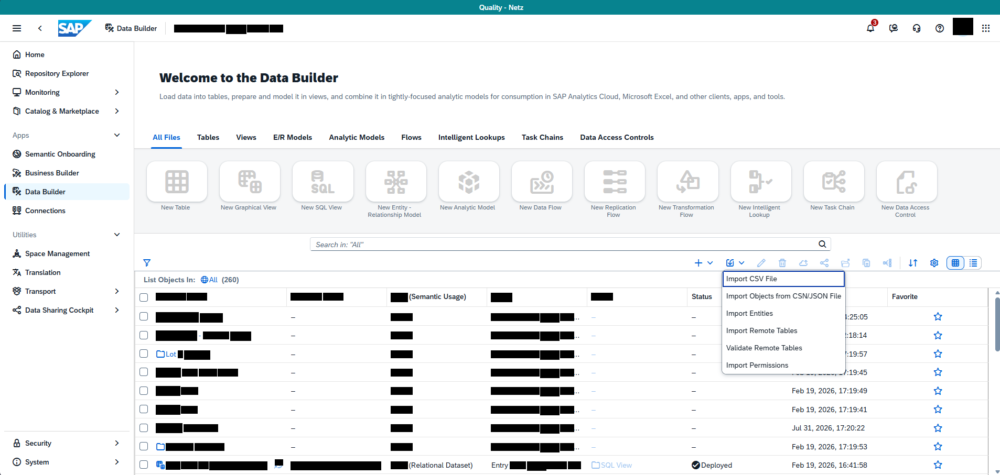

Bildformat: 1907 × 907 Pixel. Die folgenden Positionen beziehen sich auf dieses vollständige Bild.

## 1. Gesamtaufbau und sichtbarer Zustand

### Gesamtansicht

Der Screenshot zeigt die Data-Builder-Übersicht mit Begrüßung, Objektkategorien, Erstellungsaktionen und Objektliste. Rechts oberhalb beziehungsweise über der Tabelle ist ein Importmenü geöffnet.

### Importmenü

Das vertikale Menü enthält die sichtbaren Einträge Import Objects from CSN/JSON File, Import Entities, Import Remote Tables, Validate Remote Tables und Import Permissions. Jeder Eintrag steht in einer eigenen Zeile. Das Menü liegt rechts im Hauptbereich und verdeckt einen Teil der Tabelle.

### Oberer Hintergrund

Im oberen Bereich bleiben die Begrüßungsüberschrift und die horizontale Kategorienreihe sichtbar. Darunter stehen die großen Aktionen für neue Tabellen, Views, Modelle und Flows. Zwischen diesen Aktionen und der Tabelle befindet sich die Such- und Werkzeugleiste.

### Tabelle und Navigation

Die Objektliste im unteren Bereich zeigt Ordnerzeilen und einen View-Eintrag mit Bereitstellungsstatus. Rechts stehen Datum und Uhrzeit in einer eigenen Spalte. Die globale Navigation bleibt am linken Rand sichtbar. Es ist noch kein Datei-Auswahldialog oder Importformular eingeblendet.

## 2. Räumliche Beschreibung von oben nach unten

### Hintergrund

**Ungefähre Bildregion:** x 16–98 %, y 11–100 %

Die Kategorien und großen Erstellungsaktionen bleiben vollständig beziehungsweise überwiegend sichtbar. Die Objektliste beginnt darunter.

### Geöffnetes Importmenü

**Ungefähre Bildregion:** x 79–97 %, y 59–78 %

Das Menü liegt rechts über dem oberen Teil der Objektliste. Von oben nach unten stehen Import Objects from CSN/JSON File, Import Entities, Import Remote Tables, Validate Remote Tables und Import Permissions. Die Zeilen sind gleichmäßig voneinander getrennt; der erste Eintrag ist länger als die folgenden.

## 3. Positionsverzeichnis der lesbaren Beschriftungen

Sortierung nach Bildhöhe, innerhalb derselben Höhe von links nach rechts. Angegeben sind Textbegrenzungen; Abstände und Bedienelementflächen können darüber hinausreichen.

<table>
<colgroup>
<col style="width: 33%" />
<col style="width: 30%" />
<col style="width: 35%" />
</colgroup>
<thead>
<tr class="header">
<th>Sichtbarer Text</th>
<th>Textposition in Pixeln</th>
<th>Relative Lage im Bild</th>
</tr>
</thead>
<tbody>
<tr class="odd">
<td>Data Builder</td>
<td>x 224–299 
y 49–59</td>
<td>oben, links 
x 11.7–15.7 % 
y 5.4–6.5 %</td>
</tr>
<tr class="even">
<td>Home</td>
<td>x 48–85 
y 99–109</td>
<td>oben, links 
x 2.5–4.5 % 
y 10.9–12.0 %</td>
</tr>
<tr class="odd">
<td>Repository Explorer</td>
<td>x 48–170 
y 135–148</td>
<td>oben, links 
x 2.5–8.9 % 
y 14.9–16.3 %</td>
</tr>
<tr class="even">
<td>Welcome to the Data Builder</td>
<td>x 304–645 
y 138–157</td>
<td>oben, links 
x 15.9–33.8 % 
y 15.2–17.3 %</td>
</tr>
<tr class="odd">
<td>Monitoring</td>
<td>x 48–114 
y 171–184</td>
<td>oben, links 
x 2.5–6.0 % 
y 18.9–20.3 %</td>
</tr>
<tr class="even">
<td>tables,</td>
<td>x 396–437 
y 179–190</td>
<td>oben, links 
x 20.8–22.9 % 
y 19.7–21.0 %</td>
</tr>
<tr class="odd">
<td>views,</td>
<td>x 589–626 
y 180–190</td>
<td>oben, links 
x 30.9–32.8 % 
y 19.8–21.0 %</td>
</tr>
<tr class="even">
<td>analytic models</td>
<td>x 836–931 
y 179–192</td>
<td>oben, mittig 
x 43.8–48.8 % 
y 19.7–21.2 %</td>
</tr>
<tr class="odd">
<td>apps,</td>
<td>x 1400–1432 
y 182–192</td>
<td>oben, rechts 
x 73.4–75.1 % 
y 20.1–21.2 %</td>
</tr>
<tr class="even">
<td>Catalog &amp; Marketplace</td>
<td>x 48–189 
y 207–220</td>
<td>oben, links 
x 2.5–9.9 % 
y 22.8–24.3 %</td>
</tr>
<tr class="odd">
<td>Apps</td>
<td>x 24–55 
y 253–266</td>
<td>oben, links 
x 1.3–2.9 % 
y 27.9–29.3 %</td>
</tr>
<tr class="even">
<td>All Files</td>
<td>x 292–344 
y 257–267</td>
<td>oben, links 
x 15.3–18.0 % 
y 28.3–29.4 %</td>
</tr>
<tr class="odd">
<td>Tables</td>
<td>x 376–418 
y 257–267</td>
<td>oben, links 
x 19.7–21.9 % 
y 28.3–29.4 %</td>
</tr>
<tr class="even">
<td>Views</td>
<td>x 450–488 
y 257–267</td>
<td>oben, links 
x 23.6–25.6 % 
y 28.3–29.4 %</td>
</tr>
<tr class="odd">
<td>E/R Models</td>
<td>x 522–595 
y 257–267</td>
<td>oben, links 
x 27.3–31.2 % 
y 28.3–29.4 %</td>
</tr>
<tr class="even">
<td>Analytic Models</td>
<td>x 628–733 
y 257–270</td>
<td>oben, mittig 
x 32.9–38.4 % 
y 28.3–29.8 %</td>
</tr>
<tr class="odd">
<td>Flows</td>
<td>x 766–804 
y 257–267</td>
<td>oben, mittig 
x 40.2–42.1 % 
y 28.3–29.4 %</td>
</tr>
<tr class="even">
<td>Intelligent Lookups</td>
<td>x 836–962 
y 257–270</td>
<td>oben, mittig 
x 43.9–50.5 % 
y 28.3–29.8 %</td>
</tr>
<tr class="odd">
<td>Task Chains</td>
<td>x 995–1074 
y 257–267</td>
<td>oben, mittig 
x 52.2–56.3 % 
y 28.3–29.4 %</td>
</tr>
<tr class="even">
<td>Data Access Controls</td>
<td>x 1107–1246 
y 257–267</td>
<td>oben, mittig 
x 58.0–65.4 % 
y 28.3–29.4 %</td>
</tr>
<tr class="odd">
<td>Semantic Onboarding</td>
<td>x 48–182 
y 289–302</td>
<td>oben, links 
x 2.5–9.5 % 
y 31.9–33.3 %</td>
</tr>
<tr class="even">
<td>Business Builder</td>
<td>x 48–151 
y 325–335</td>
<td>auf mittlerer Höhe, links 
x 2.5–7.9 % 
y 35.8–36.9 %</td>
</tr>
<tr class="odd">
<td>Data Builder</td>
<td>x 48–125 
y 361–371</td>
<td>auf mittlerer Höhe, links 
x 2.5–6.6 % 
y 39.8–40.9 %</td>
</tr>
<tr class="even">
<td>Connections</td>
<td>x 48–124 
y 397–407</td>
<td>auf mittlerer Höhe, links 
x 2.5–6.5 % 
y 43.8–44.9 %</td>
</tr>
<tr class="odd">
<td>New Table</td>
<td>x 308–362 
y 392–400</td>
<td>auf mittlerer Höhe, links 
x 16.2–19.0 % 
y 43.2–44.1 %</td>
</tr>
<tr class="even">
<td>New Graphical View</td>
<td>x 422–527 
y 392–403</td>
<td>auf mittlerer Höhe, links 
x 22.1–27.6 % 
y 43.2–44.4 %</td>
</tr>
<tr class="odd">
<td>New SQL View</td>
<td>x 575–652 
y 392–400</td>
<td>auf mittlerer Höhe, links 
x 30.2–34.2 % 
y 43.2–44.2 %</td>
</tr>
<tr class="even">
<td>New Entity</td>
<td>x 721–777 
y 392–403</td>
<td>auf mittlerer Höhe, mittig 
x 37.8–40.7 % 
y 43.2–44.4 %</td>
</tr>
<tr class="odd">
<td>New Analytic Model</td>
<td>x 840–944 
y 392–403</td>
<td>auf mittlerer Höhe, mittig 
x 44.0–49.5 % 
y 43.2–44.4 %</td>
</tr>
<tr class="even">
<td>New Data Flow</td>
<td>x 991–1070 
y 392–400</td>
<td>auf mittlerer Höhe, mittig 
x 52.0–56.1 % 
y 43.2–44.1 %</td>
</tr>
<tr class="odd">
<td>New Replication</td>
<td>x 1128–1212 
y 392–403</td>
<td>auf mittlerer Höhe, mittig 
x 59.1–63.6 % 
y 43.2–44.4 %</td>
</tr>
<tr class="even">
<td>New Transformation</td>
<td>x 1257–1361 
y 392–400</td>
<td>auf mittlerer Höhe, rechts 
x 65.9–71.4 % 
y 43.2–44.1 %</td>
</tr>
<tr class="odd">
<td>New Intelligent</td>
<td>x 1409–1488 
y 392–403</td>
<td>auf mittlerer Höhe, rechts 
x 73.9–78.0 % 
y 43.2–44.4 %</td>
</tr>
<tr class="even">
<td>New Task Chain</td>
<td>x 1546–1629 
y 392–400</td>
<td>auf mittlerer Höhe, rechts 
x 81.1–85.4 % 
y 43.2–44.1 %</td>
</tr>
<tr class="odd">
<td>New Data Access</td>
<td>x 1682–1772 
y 392–400</td>
<td>auf mittlerer Höhe, rechts 
x 88.2–92.9 % 
y 43.2–44.1 %</td>
</tr>
<tr class="even">
<td>Relationship Model</td>
<td>x 702–803 
y 406–417</td>
<td>auf mittlerer Höhe, mittig 
x 36.8–42.1 % 
y 44.8–46.0 %</td>
</tr>
<tr class="odd">
<td>Utilities</td>
<td>x 25–69 
y 443–453</td>
<td>auf mittlerer Höhe, links 
x 1.3–3.6 % 
y 48.8–49.9 %</td>
</tr>
<tr class="even">
<td>Search in:</td>
<td>x 603–663 
y 462–472</td>
<td>auf mittlerer Höhe, mittig 
x 31.6–34.8 % 
y 50.9–52.0 %</td>
</tr>
<tr class="odd">
<td>"All"</td>
<td>x 668–693 
y 462–472</td>
<td>auf mittlerer Höhe, mittig 
x 35.1–36.3 % 
y 50.9–52.0 %</td>
</tr>
<tr class="even">
<td>Space Management</td>
<td>x 48–171 
y 479–492</td>
<td>auf mittlerer Höhe, links 
x 2.5–9.0 % 
y 52.8–54.2 %</td>
</tr>
<tr class="odd">
<td>Translation</td>
<td>x 48–115 
y 515–525</td>
<td>auf mittlerer Höhe, links 
x 2.5–6.0 % 
y 56.8–57.9 %</td>
</tr>
<tr class="even">
<td>List Objects In:</td>
<td>x 275–372 
y 529–542</td>
<td>auf mittlerer Höhe, links 
x 14.4–19.5 % 
y 58.3–59.8 %</td>
</tr>
<tr class="odd">
<td>Transport</td>
<td>x 48–106 
y 551–564</td>
<td>auf mittlerer Höhe, links 
x 2.5–5.6 % 
y 60.7–62.2 %</td>
</tr>
<tr class="even">
<td>(Semantic Usage)</td>
<td>x 783–888 
y 557–579</td>
<td>auf mittlerer Höhe, mittig 
x 41.1–46.6 % 
y 61.4–63.8 %</td>
</tr>
<tr class="odd">
<td>Status</td>
<td>x 1320–1358 
y 561–571</td>
<td>auf mittlerer Höhe, rechts 
x 69.2–71.2 % 
y 61.9–63.0 %</td>
</tr>
<tr class="even">
<td>Import Objects from CSN/JSON File</td>
<td>x 1386–1604 
y 560–573</td>
<td>auf mittlerer Höhe, rechts 
x 72.7–84.1 % 
y 61.7–63.2 %</td>
</tr>
<tr class="odd">
<td>Favorite</td>
<td>x 1702–1750 
y 561–571</td>
<td>auf mittlerer Höhe, rechts 
x 89.2–91.8 % 
y 61.9–63.0 %</td>
</tr>
<tr class="even">
<td>Data Sharing Cockpit</td>
<td>x 48–178 
y 587–600</td>
<td>auf mittlerer Höhe, links 
x 2.5–9.3 % 
y 64.7–66.2 %</td>
</tr>
<tr class="odd">
<td>Import Entities</td>
<td>x 1386–1474 
y 593–606</td>
<td>auf mittlerer Höhe, rechts 
x 72.7–77.3 % 
y 65.4–66.8 %</td>
</tr>
<tr class="even">
<td>Import Remote Tables</td>
<td>x 1386–1520 
y 626–639</td>
<td>unten, rechts 
x 72.7–79.7 % 
y 69.0–70.5 %</td>
</tr>
<tr class="odd">
<td>Validate Remote Tables</td>
<td>x 1385–1530 
y 659–669</td>
<td>unten, rechts 
x 72.6–80.2 % 
y 72.7–73.8 %</td>
</tr>
<tr class="even">
<td>Import Permissions</td>
<td>x 1386–1503 
y 692–705</td>
<td>unten, rechts 
x 72.7–78.8 % 
y 76.3–77.7 %</td>
</tr>
<tr class="odd">
<td>Security</td>
<td>x 48–98 
y 841–854</td>
<td>unten, links 
x 2.5–5.1 % 
y 92.7–94.2 %</td>
</tr>
<tr class="even">
<td>System</td>
<td>x 48–93 
y 877–890</td>
<td>unten, links 
x 2.5–4.9 % 
y 96.7–98.1 %</td>
</tr>
<tr class="odd">
<td>Deployed</td>
<td>x 1338–1396 
y 883–896</td>
<td>unten, rechts 
x 70.2–73.2 % 
y 97.4–98.8 %</td>
</tr>
</tbody>
</table>

## 4. Abgrenzung

Die Beschreibung benennt nur den sichtbaren Zustand dieses Screenshots. Aus Symbolen ohne lesbare Beschriftung wird keine konkrete Funktion abgeleitet. Inhalte hinter schwarzen Balken und nicht sichtbare Bereiche außerhalb des Bildrandes bleiben unbeschrieben.

# Bild 20: Settings: Benutzerkonto und Darstellungsoptionen

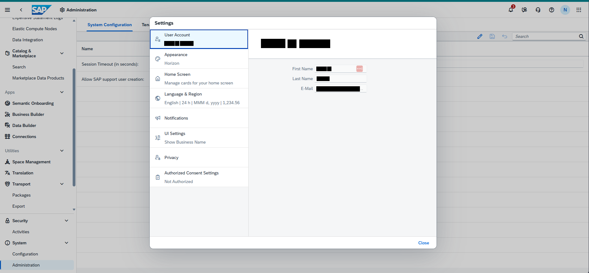

Bildformat: 1905 × 886 Pixel. Die folgenden Positionen beziehen sich auf dieses vollständige Bild.

## 1. Gesamtaufbau und sichtbarer Zustand

### Gesamtansicht

Ein großes Einstellungsfenster steht zentral im Screenshot. Es ist in eine linke Navigationsspalte und einen rechten Inhaltsbereich gegliedert. Oben links im Fenster steht „Settings“.

### Linke Spalte

Die Navigation enthält User Account, Appearance, Home Screen, Language & Region, Notifications, UI Settings und Privacy. Unter Appearance ist „Horizon“ sichtbar. Unter Home Screen steht ein kurzer Hinweis zu den Karten der Startseite. Language & Region zeigt eine kompakte Zusammenfassung von Sprache sowie Zeit-, Datums- und Zahlenformat. Unter UI Settings steht „Show Business Name“. Im Privacy-Bereich sind Consent Settings und „Not Authorized“ sichtbar.

### Rechter Bereich

Der Inhaltsbereich zeigt die Kontoseite. Oben befindet sich ein größerer Bereich für die Kontobezeichnung. Darunter stehen die Feldbeschriftungen First Name, Last Name und E-Mail. Die zugehörigen personenbezogenen Inhalte werden nicht beschrieben. Der übrige rechte Bereich ist überwiegend leer.

### Bedienelemente

Unten rechts befindet sich die Schaltfläche „Close“. Die linke Spalte besitzt klar getrennte Einträge, während die Kontofelder rechts untereinander angeordnet sind. Der Screenshot zeigt keine zusätzliche Unterdialogbox.

## 2. Räumliche Beschreibung von oben nach unten

### Einstellungsfenster

**Ungefähre Bildregion:** x 26–73 %, y 7–92 %

Ein rechteckiges weißes Fenster steht mittig. Settings liegt oben links innerhalb des Fensters. Eine vertikale Trennung gliedert die linke Auswahlspalte und den rechten Kontobereich.

### Linke Auswahlspalte

**Ungefähre Bildregion:** x 26–43 %, y 11–68 %

User Account steht oben. Darunter folgen Appearance mit Horizon, Home Screen mit einer erklärenden Zusatzzeile, Language & Region mit einer Format-Zusammenfassung, Notifications, UI Settings mit Show Business Name und Privacy mit Consent Settings beziehungsweise Not Authorized. Symbole stehen links vor den Haupteinträgen.

### Rechter Kontobereich

**Ungefähre Bildregion:** x 44–72 %, y 13–36 %

Oben liegt der Bereich für die Kontobezeichnung. First Name, Last Name und E-Mail stehen darunter in drei horizontalen Feldzeilen. Die Beschriftungen liegen links von den zugehörigen Wertpositionen.

### Unterer Fensterrand

**Ungefähre Bildregion:** x 26–73 %, y 86–92 %

Close steht ganz unten rechts. Zwischen den Kontofeldern und dem unteren Rand bleibt eine große freie Fläche.

## 3. Positionsverzeichnis der lesbaren Beschriftungen

Sortierung nach Bildhöhe, innerhalb derselben Höhe von links nach rechts. Angegeben sind Textbegrenzungen; Abstände und Bedienelementflächen können darüber hinausreichen.

<table>
<colgroup>
<col style="width: 33%" />
<col style="width: 30%" />
<col style="width: 35%" />
</colgroup>
<thead>
<tr class="header">
<th>Sichtbarer Text</th>
<th>Textposition in Pixeln</th>
<th>Relative Lage im Bild</th>
</tr>
</thead>
<tbody>
<tr class="odd">
<td>System</td>
<td>x 284–331 
y 75–88</td>
<td>oben, links 
x 14.9–17.4 % 
y 8.5–9.9 %</td>
</tr>
<tr class="even">
<td>Settings</td>
<td>x 501–560 
y 69–83</td>
<td>oben, links 
x 26.3–29.4 % 
y 7.8–9.4 %</td>
</tr>
<tr class="odd">
<td>Elastic Compute Nodes</td>
<td>x 42–184 
y 88–101</td>
<td>oben, links 
x 2.2–9.7 % 
y 9.9–11.4 %</td>
</tr>
<tr class="even">
<td>User Account</td>
<td>x 534–614 
y 108–118</td>
<td>oben, links 
x 28.0–32.2 % 
y 12.2–13.3 %</td>
</tr>
<tr class="odd">
<td>Search</td>
<td>x 1668–1710 
y 113–123</td>
<td>oben, rechts 
x 87.6–89.7 % 
y 12.8–13.9 %</td>
</tr>
<tr class="even">
<td>Data Integration</td>
<td>x 42–138 
y 124–137</td>
<td>oben, links 
x 2.2–7.3 % 
y 14.0–15.5 %</td>
</tr>
<tr class="odd">
<td>Name</td>
<td>x 265–300 
y 153–163</td>
<td>oben, links 
x 13.9–15.8 % 
y 17.3–18.4 %</td>
</tr>
<tr class="even">
<td>Appearance</td>
<td>x 533–606 
y 172–185</td>
<td>oben, links 
x 28.0–31.8 % 
y 19.4–20.9 %</td>
</tr>
<tr class="odd">
<td>Horizon</td>
<td>x 534–579 
y 200–210</td>
<td>oben, links 
x 28.0–30.4 % 
y 22.6–23.7 %</td>
</tr>
<tr class="even">
<td>Search</td>
<td>x 41–82 
y 212–222</td>
<td>oben, links 
x 2.2–4.3 % 
y 23.9–25.1 %</td>
</tr>
<tr class="odd">
<td>First Name</td>
<td>x 947–1012 
y 218–228</td>
<td>oben, mittig 
x 49.7–53.1 % 
y 24.6–25.7 %</td>
</tr>
<tr class="even">
<td>Home Screen</td>
<td>x 534–615 
y 236–246</td>
<td>oben, links 
x 28.0–32.3 % 
y 26.6–27.8 %</td>
</tr>
<tr class="odd">
<td>Last Name</td>
<td>x 948–1012 
y 250–260</td>
<td>oben, mittig 
x 49.8–53.1 % 
y 28.2–29.3 %</td>
</tr>
<tr class="even">
<td>home screen</td>
<td>x 676–753 
y 264–274</td>
<td>oben, mittig 
x 35.5–39.5 % 
y 29.9–30.9 %</td>
</tr>
<tr class="odd">
<td>Apps</td>
<td>x 17–47 
y 294–307</td>
<td>auf mittlerer Höhe, links 
x 0.9–2.5 % 
y 33.2–34.7 %</td>
</tr>
<tr class="even">
<td>Language &amp; Region</td>
<td>x 534–652 
y 300–313</td>
<td>auf mittlerer Höhe, links 
x 28.0–34.2 % 
y 33.9–35.3 %</td>
</tr>
<tr class="odd">
<td>Semantic Onboarding</td>
<td>x 41–174 
y 330–343</td>
<td>auf mittlerer Höhe, links 
x 2.2–9.1 % 
y 37.2–38.7 %</td>
</tr>
<tr class="even">
<td>Business Builder</td>
<td>x 41–143 
y 366–376</td>
<td>auf mittlerer Höhe, links 
x 2.2–7.5 % 
y 41.3–42.4 %</td>
</tr>
<tr class="odd">
<td>Notifications</td>
<td>x 534–608 
y 378–388</td>
<td>auf mittlerer Höhe, links 
x 28.0–31.9 % 
y 42.7–43.8 %</td>
</tr>
<tr class="even">
<td>Data Builder</td>
<td>x 41–117 
y 402–412</td>
<td>auf mittlerer Höhe, links 
x 2.2–6.1 % 
y 45.4–46.5 %</td>
</tr>
<tr class="odd">
<td>Connections</td>
<td>x 41–117 
y 438–448</td>
<td>auf mittlerer Höhe, links 
x 2.2–6.1 % 
y 49.4–50.6 %</td>
</tr>
<tr class="even">
<td>Settings</td>
<td>x 551–599 
y 428–441</td>
<td>auf mittlerer Höhe, links 
x 28.9–31.4 % 
y 48.3–49.8 %</td>
</tr>
<tr class="odd">
<td>Show Business Name</td>
<td>x 534–665 
y 456–466</td>
<td>auf mittlerer Höhe, links 
x 28.0–34.9 % 
y 51.5–52.6 %</td>
</tr>
<tr class="even">
<td>Utilities</td>
<td>x 18–61 
y 484–494</td>
<td>auf mittlerer Höhe, links 
x 0.9–3.2 % 
y 54.6–55.8 %</td>
</tr>
<tr class="odd">
<td>Privacy</td>
<td>x 534–577 
y 506–519</td>
<td>auf mittlerer Höhe, links 
x 28.0–30.3 % 
y 57.1–58.6 %</td>
</tr>
<tr class="even">
<td>Space Management</td>
<td>x 41–164 
y 520–533</td>
<td>auf mittlerer Höhe, links 
x 2.2–8.6 % 
y 58.7–60.2 %</td>
</tr>
<tr class="odd">
<td>Translation</td>
<td>x 40–107 
y 556–566</td>
<td>auf mittlerer Höhe, links 
x 2.1–5.6 % 
y 62.8–63.9 %</td>
</tr>
<tr class="even">
<td>Consent Settings</td>
<td>x 604–707 
y 556–569</td>
<td>auf mittlerer Höhe, mittig 
x 31.7–37.1 % 
y 62.8–64.2 %</td>
</tr>
<tr class="odd">
<td>Transport</td>
<td>x 40–98 
y 592–605</td>
<td>unten, links 
x 2.1–5.2 % 
y 66.8–68.3 %</td>
</tr>
<tr class="even">
<td>Not Authorized</td>
<td>x 534–623 
y 584–594</td>
<td>auf mittlerer Höhe, links 
x 28.0–32.7 % 
y 65.9–67.0 %</td>
</tr>
<tr class="odd">
<td>Security</td>
<td>x 41–90 
y 711–724</td>
<td>unten, links 
x 2.2–4.7 % 
y 80.2–81.7 %</td>
</tr>
<tr class="even">
<td>System</td>
<td>x 41–85 
y 783–796</td>
<td>unten, links 
x 2.2–4.5 % 
y 88.4–89.8 %</td>
</tr>
<tr class="odd">
<td>Close</td>
<td>x 1354–1388 
y 783–793</td>
<td>unten, rechts 
x 71.0–72.8 % 
y 88.4–89.5 %</td>
</tr>
</tbody>
</table>

## 4. Abgrenzung

Die Beschreibung benennt nur den sichtbaren Zustand dieses Screenshots. Aus Symbolen ohne lesbare Beschriftung wird keine konkrete Funktion abgeleitet. Inhalte hinter schwarzen Balken und nicht sichtbare Bereiche außerhalb des Bildrandes bleiben unbeschrieben.

# Bild 21: Data Builder: SQL-View-Editor und Eigenschaften

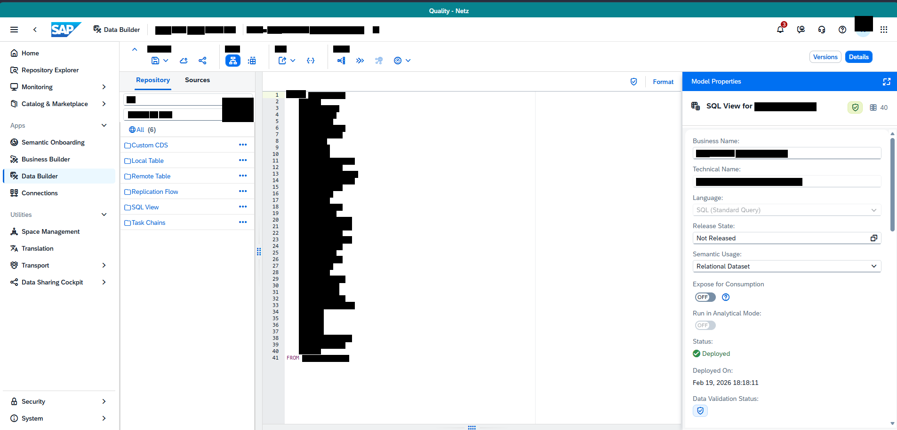

Bildformat: 1906 × 916 Pixel. Die folgenden Positionen beziehen sich auf dieses vollständige Bild.

## 1. Gesamtaufbau und sichtbarer Zustand

### Gesamtansicht

Die Ansicht ist in drei Arbeitsbereiche gegliedert: links ein Repository- beziehungsweise Quellenbereich, in der Mitte ein SQL-Editor und rechts ein Eigenschaftenpanel. Die globale Navigation bleibt am äußersten linken Rand sichtbar.

### Linker Arbeitsbereich

Oben stehen die Register Repository und Sources. Darunter ist eine Objektliste mit Kategorien wie Custom CDS, Local Table, Remote Table, Replication Flow, SQL View und Task Chains sichtbar. Kleine Symbole kennzeichnen die Kategorien. Die Einträge stehen vertikal untereinander.

### Mittlerer Editor

Der Editor zeigt eine SQL-Ansicht mit Zeilennummern am linken Rand. Die sichtbare Struktur besteht aus vielen kurzen Zeilen. Oben befindet sich „Format“. Die konkreten Feld- und Objektbezeichnungen im Code werden nicht beschrieben. Oberhalb des Editors liegt eine Werkzeugleiste mit mehreren Symbolen sowie Versions- und Detailoptionen.

### Rechtes Eigenschaftenpanel

Das Panel heißt „Model Properties“. Sichtbare Feldüberschriften sind Business Name, Technical Name, Language, Release State und Semantic Usage. Weitere Optionen heißen Expose for Consumption und Run in Analytical Mode. Sichtbar sind „Not Released“, „Relational Dataset“ und der Status „Deployed“. Darunter stehen Deployed On und Data Validation Status. Die Eigenschaften sind als vertikale Formularliste angeordnet.

## 2. Räumliche Beschreibung von oben nach unten

### Quellenbereich

**Ungefähre Bildregion:** x 13–28 %, y 15–100 %

Repository und Sources stehen oben als Register. Darunter liegen Kategorien mit kleinen Symbolen links. Custom CDS, Local Table, Remote Table, Replication Flow, SQL View und Task Chains folgen vertikal.

### SQL-Arbeitsfläche

**Ungefähre Bildregion:** x 29–75 %, y 16–100 %

Die Zeilennummern stehen am linken Rand des Editors. Die Codezeilen beginnen rechts daneben. Format liegt oben über dem Editor. Die Werkzeugleiste oberhalb enthält kleine Symbole sowie Versions und Details. Die eigentliche Codebedeutung wird nicht aus den verdeckten Stellen abgeleitet.

### Eigenschaftenpanel

**Ungefähre Bildregion:** x 76–100 %, y 15–100 %

Model Properties steht oben. Darunter folgen Business Name, Technical Name, Language, Release State, Semantic Usage, Expose for Consumption, Run in Analytical Mode, Status, Deployed On und Data Validation Status. Beschriftungen und Werte sind vertikal gestapelt. Die beiden Optionen zur Bereitstellung beziehungsweise zum analytischen Modus enthalten Schalter.

## 3. Positionsverzeichnis der lesbaren Beschriftungen

Sortierung nach Bildhöhe, innerhalb derselben Höhe von links nach rechts. Angegeben sind Textbegrenzungen; Abstände und Bedienelementflächen können darüber hinausreichen.

<table>
<colgroup>
<col style="width: 33%" />
<col style="width: 30%" />
<col style="width: 35%" />
</colgroup>
<thead>
<tr class="header">
<th>Sichtbarer Text</th>
<th>Textposition in Pixeln</th>
<th>Relative Lage im Bild</th>
</tr>
</thead>
<tbody>
<tr class="odd">
<td>Data Builder</td>
<td>x 222–297 
y 58–68</td>
<td>oben, links 
x 11.6–15.6 % 
y 6.3–7.4 %</td>
</tr>
<tr class="even">
<td>Home</td>
<td>x 46–82 
y 108–118</td>
<td>oben, links 
x 2.4–4.3 % 
y 11.8–12.9 %</td>
</tr>
<tr class="odd">
<td>Details</td>
<td>x 1806–1844 
y 106–136</td>
<td>oben, rechts 
x 94.8–96.7 % 
y 11.6–14.8 %</td>
</tr>
<tr class="even">
<td>of</td>
<td>x 717–733 
y 121–137</td>
<td>oben, mittig 
x 37.6–38.5 % 
y 13.2–15.0 %</td>
</tr>
<tr class="odd">
<td>Versions</td>
<td>x 1728–1780 
y 114–132</td>
<td>oben, rechts 
x 90.7–93.4 % 
y 12.4–14.4 %</td>
</tr>
<tr class="even">
<td>Repository Explorer</td>
<td>x 46–168 
y 144–157</td>
<td>oben, links 
x 2.4–8.8 % 
y 15.7–17.1 %</td>
</tr>
<tr class="odd">
<td>Repository</td>
<td>x 290–361 
y 165–178</td>
<td>oben, links 
x 15.2–18.9 % 
y 18.0–19.4 %</td>
</tr>
<tr class="even">
<td>Sources</td>
<td>x 394–446 
y 165–175</td>
<td>oben, links 
x 20.6–23.4 % 
y 18.0–19.1 %</td>
</tr>
<tr class="odd">
<td>Format</td>
<td>x 1388–1431 
y 169–179</td>
<td>oben, rechts 
x 72.8–75.1 % 
y 18.4–19.5 %</td>
</tr>
<tr class="even">
<td>Model Properties</td>
<td>x 1470–1574 
y 168–181</td>
<td>oben, rechts 
x 77.2–82.6 % 
y 18.3–19.8 %</td>
</tr>
<tr class="odd">
<td>Monitoring</td>
<td>x 46–112 
y 180–193</td>
<td>oben, links 
x 2.4–5.9 % 
y 19.7–21.1 %</td>
</tr>
<tr class="even">
<td>Catalog &amp; Marketplace</td>
<td>x 46–186 
y 216–229</td>
<td>oben, links 
x 2.4–9.8 % 
y 23.6–25.0 %</td>
</tr>
<tr class="odd">
<td>Apps</td>
<td>x 22–53 
y 262–275</td>
<td>oben, links 
x 1.2–2.8 % 
y 28.6–30.0 %</td>
</tr>
<tr class="even">
<td>Semantic Onboarding</td>
<td>x 46–180 
y 298–311</td>
<td>auf mittlerer Höhe, links 
x 2.4–9.4 % 
y 32.5–34.0 %</td>
</tr>
<tr class="odd">
<td>Custom CDS</td>
<td>x 264–356 
y 304–316</td>
<td>auf mittlerer Höhe, links 
x 13.9–18.7 % 
y 33.2–34.5 %</td>
</tr>
<tr class="even">
<td>Business Name:</td>
<td>x 1473–1570 
y 295–305</td>
<td>oben, rechts 
x 77.3–82.4 % 
y 32.2–33.3 %</td>
</tr>
<tr class="odd">
<td>Business Builder</td>
<td>x 46–149 
y 334–344</td>
<td>auf mittlerer Höhe, links 
x 2.4–7.8 % 
y 36.5–37.6 %</td>
</tr>
<tr class="even">
<td>Local Table</td>
<td>x 264–348 
y 337–349</td>
<td>auf mittlerer Höhe, links 
x 13.9–18.3 % 
y 36.8–38.1 %</td>
</tr>
<tr class="odd">
<td>Technical Name:</td>
<td>x 1472–1573 
y 355–365</td>
<td>auf mittlerer Höhe, rechts 
x 77.3–82.5 % 
y 38.8–39.8 %</td>
</tr>
<tr class="even">
<td>Data Builder</td>
<td>x 46–123 
y 370–380</td>
<td>auf mittlerer Höhe, links 
x 2.4–6.5 % 
y 40.4–41.5 %</td>
</tr>
<tr class="odd">
<td>Connections</td>
<td>x 46–122 
y 406–416</td>
<td>auf mittlerer Höhe, links 
x 2.4–6.4 % 
y 44.3–45.4 %</td>
</tr>
<tr class="even">
<td>Language:</td>
<td>x 1473–1535 
y 416–429</td>
<td>auf mittlerer Höhe, rechts 
x 77.3–80.5 % 
y 45.4–46.8 %</td>
</tr>
<tr class="odd">
<td>Utilities</td>
<td>x 23–67 
y 452–462</td>
<td>auf mittlerer Höhe, links 
x 1.2–3.5 % 
y 49.3–50.4 %</td>
</tr>
<tr class="even">
<td>Release State:</td>
<td>x 1473–1560 
y 476–486</td>
<td>auf mittlerer Höhe, rechts 
x 77.3–81.8 % 
y 52.0–53.1 %</td>
</tr>
<tr class="odd">
<td>Space Management</td>
<td>x 46–169 
y 488–501</td>
<td>auf mittlerer Höhe, links 
x 2.4–8.9 % 
y 53.3–54.7 %</td>
</tr>
<tr class="even">
<td>Not Released</td>
<td>x 1481–1563 
y 502–512</td>
<td>auf mittlerer Höhe, rechts 
x 77.7–82.0 % 
y 54.8–55.9 %</td>
</tr>
<tr class="odd">
<td>Translation</td>
<td>x 46–113 
y 524–534</td>
<td>auf mittlerer Höhe, links 
x 2.4–5.9 % 
y 57.2–58.3 %</td>
</tr>
<tr class="even">
<td>Semantic Usage:</td>
<td>x 1473–1575 
y 536–549</td>
<td>auf mittlerer Höhe, rechts 
x 77.3–82.6 % 
y 58.5–59.9 %</td>
</tr>
<tr class="odd">
<td>Transport</td>
<td>x 46–104 
y 560–573</td>
<td>auf mittlerer Höhe, links 
x 2.4–5.5 % 
y 61.1–62.6 %</td>
</tr>
<tr class="even">
<td>Relational Dataset</td>
<td>x 1481–1593 
y 562–572</td>
<td>auf mittlerer Höhe, rechts 
x 77.7–83.6 % 
y 61.4–62.4 %</td>
</tr>
<tr class="odd">
<td>Data Sharing Cockpit</td>
<td>x 46–176 
y 596–609</td>
<td>auf mittlerer Höhe, links 
x 2.4–9.2 % 
y 65.1–66.5 %</td>
</tr>
<tr class="even">
<td>Expose for Consumption</td>
<td>x 1473–1623 
y 600–613</td>
<td>auf mittlerer Höhe, rechts 
x 77.3–85.2 % 
y 65.5–66.9 %</td>
</tr>
<tr class="odd">
<td>Run in Analytical Mode:</td>
<td>x 1473–1617 
y 662–675</td>
<td>unten, rechts 
x 77.3–84.8 % 
y 72.3–73.7 %</td>
</tr>
<tr class="even">
<td>Status:</td>
<td>x 1473–1514 
y 722–732</td>
<td>unten, rechts 
x 77.3–79.4 % 
y 78.8–79.9 %</td>
</tr>
<tr class="odd">
<td>Deployed</td>
<td>x 1493–1551 
y 748–761</td>
<td>unten, rechts 
x 78.3–81.4 % 
y 81.7–83.1 %</td>
</tr>
<tr class="even">
<td>Deployed On:</td>
<td>x 1473–1556 
y 784–797</td>
<td>unten, rechts 
x 77.3–81.6 % 
y 85.6–87.0 %</td>
</tr>
<tr class="odd">
<td>Status:</td>
<td>x 1570–1611 
y 844–854</td>
<td>unten, rechts 
x 82.4–84.5 % 
y 92.1–93.2 %</td>
</tr>
<tr class="even">
<td>Security</td>
<td>x 46–96 
y 850–863</td>
<td>unten, links 
x 2.4–5.0 % 
y 92.8–94.2 %</td>
</tr>
<tr class="odd">
<td>System</td>
<td>x 46–91 
y 886–899</td>
<td>unten, links 
x 2.4–4.8 % 
y 96.7–98.1 %</td>
</tr>
</tbody>
</table>

## 4. Abgrenzung

Die Beschreibung benennt nur den sichtbaren Zustand dieses Screenshots. Aus Symbolen ohne lesbare Beschriftung wird keine konkrete Funktion abgeleitet. Inhalte hinter schwarzen Balken und nicht sichtbare Bereiche außerhalb des Bildrandes bleiben unbeschrieben.
